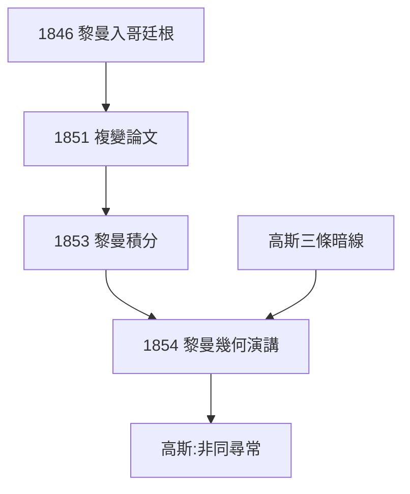

# 5.1 黎曼的出現

## 1846：羞怯的青年

1846 年，20 歲的伯恩哈德·黎曼（Bernhard Riemann）入哥廷根大學，名義上讀神學（父親是牧師），實則旁聽高斯的課。高斯注意到這個沉默寡言的學生——作業本上的解法總有出人意料的轉折。

## 1851–54：三連擊

- 1851 年博士論文：複變函數的幾何理論（黎曼映照定理）；
- 1853 年就職論文：傅立葉級數與黎曼積分；
- 1854 年就職演講：《論作為幾何基礎的假設》——黎曼幾何誕生。

高斯聽完 1854 年演講，回來後對韋伯說：「這個年輕人非同尋常。」——生性吝於誇人的高斯，這句話的分量相當於加冕。

## 師徒暗線

高斯沒有正式指導黎曼（他幾乎不指導任何學生），但三條暗線清晰可見：

1. 非歐幾何的私下構想（3.3）→ 黎曼演講的哲學底氣；
2. 曲面論的高維暗示（4.1）→ 黎曼流形的直接起點；
3. 地磁與物理直覺（4.2）→ 黎曼「幾何即物理」的信念。

**因果**：高斯一生不收徒，卻把最重要的衣缽傳給了一個「沒正式拜師」的學生。1854 年的演講既是黎曼的高峰，也是高斯學術生命的延續——詳見《黎曼傳》第 3 章。
