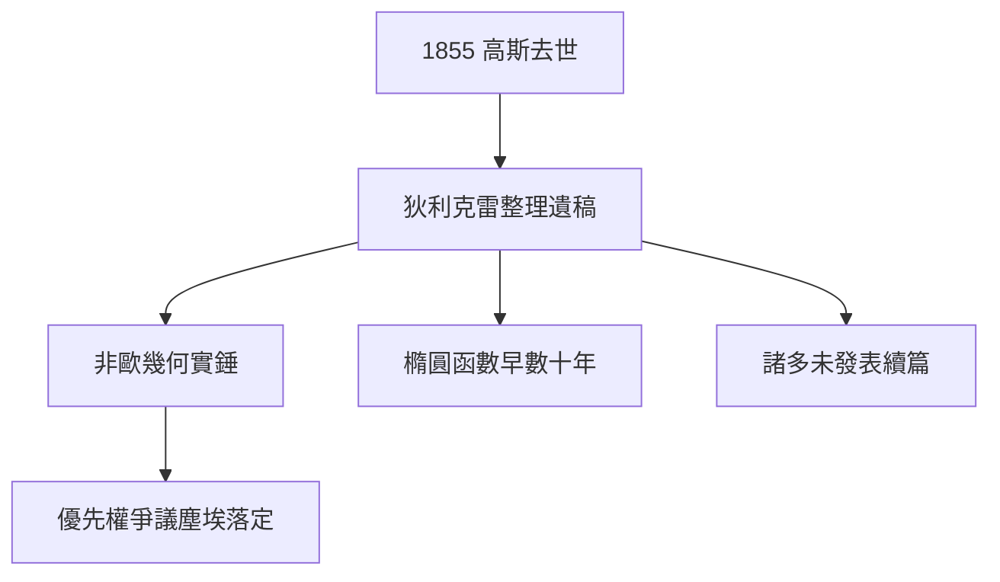

# 5.2 遺稿中的非歐幾何

## 1855：巨星隕落

1855 年 2 月 23 日，高斯在哥廷根去世，享年 77 歲。漢諾威國王下令鑄造紀念章，銘文是他選定的格言：「**數學是科學的皇后，數論是數學的皇后**。」

## 遺稿的爆炸

狄利克雷受託整理遺稿，發現了驚人的庫存：

- 非歐幾何的完整構想（證實 3.3 的書信所言非虛）；
- 橢圓函數雙週期性的發現（比阿貝爾、雅可比早數十年）；
- 最小平方法的完整理論、曲面論的未發表續篇……

學界震動之餘也惋惜：如果他生前發表一半，19 世紀數學史將重寫。

## 為什麼總是不發表

- 座右銘 *Pauca sed matura*：不成熟不發表；
- 對「波奧提亞人」的蔑視：不屑與平庸爭辯；
- 晚年行政與觀測佔據時間。

狄利克雷的評價最公允：「高斯像一隻驕傲的孔雀，展開尾巴時只給自己看。」

**因果**：遺稿證明了他的「先知」之名，也暴露了「不發表」的代價。諷刺的是，正是這種遺憾，襯托出黎曼 1854 年演講的勇氣——學生替老師說出了老師不敢說的話。
