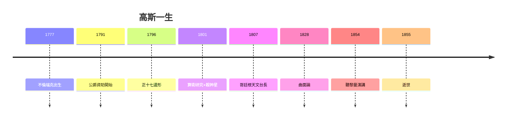

# 5.3 數學王子的不朽遺產

## 「數學王子」的稱號

「Princeps mathematicorum」（數學王子）是漢諾威國王鑄在紀念章上的稱號，實至名歸。拉普拉斯曾說：「世界上只有兩個偉大的數學家——我和高斯。」（高斯聽說後一笑置之。）

## 遺產清單

| 領域 | 高斯的奠基 | 後世開花 |
|---|---|---|
| 數論 | 《算術研究》 | 類域論、朗蘭茲綱領 |
| 微分幾何 | 曲面論、絕妙定理 | 黎曼幾何、廣義相對論 |
| 統計學 | 最小平方法、正態分布 | 現代數理統計 |
| 大地測量 | 三角測量、日光反射儀 | 現代測繪 |
| 電磁學 | 地磁、電報、單位制 | 麥克斯韋、電信時代 |
| 非歐幾何 | 私下構想 | 羅巴切夫斯基、宇宙學 |

## 最後的話

高斯的墓碑按他遺願沒有刻正十七邊形（石匠說太難刻，改刻了一顆十七角星——連墓碑都在講「理論與實踐的差距」）。但哥廷根的傳統記住了他：此後一個半世紀，哥廷根是世界數學的中心——狄利克雷、黎曼、克萊因、希爾伯特，一脈相承。

**因果閉環**：從母親堅持上學（1.1）到公爵資助（1.2），從正十七邊形（2.1）到黎曼演講（5.1）——高斯的一生，是「贊助＋天賦＋嚴謹」的三重奏。而他最大的遺產不是任何定理，是哥廷根這個地方：此後百年，世界數學的首都。
