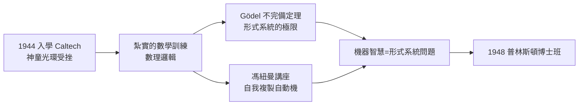

# 1.2 Caltech 數學歲月（1944–1948）

1944 年，十七歲的麥卡錫進入加州理工學院（Caltech）。這裡是美國最精英的數學與物理搖籃——馮紐曼式的「快速計算」文化、Gödel 式的邏輯震撼，都會在這幾年間陸續抵達這個年輕人。但麥卡錫在 Caltech 的故事，起點卻是一場考試失利。

## 天才營裡的普通人

- 入學前，麥卡錫在自我介紹表格上寫著自己 IQ 極高、自學完微積分，儼然神童；
- 第一次考試他就被同學打回原形：周圍全是各地選拔出的尖子，他的「自學知識」存在大量漏洞；
- 他後來幽默地回憶：入學時他公開宣稱自己如何聰明，兩年後發現周圍每個人都一樣聰明，「於是我學會了謙遜，也學會了紮實」；
- 這段經歷給了他日後重要的性格底色：**對論證品質的極端要求**——他不接受含糊，因為在 Caltech 含糊是會被當場拆穿的。

## 二戰中的插曲

- 第二次世界大戰仍在進行，Caltech 參與軍事研究，學制緊湊；
- 麥卡錫曾短暫從軍抽調參與陸軍的文書性工作，但很快回到校園；
- 1948 年他取得數學學士，隨即獲碩士學位——他的碩士工作同樣迅速，因為他真正想追的問題不在課堂裡。

## 轉折的一九四八：希爾伯特計畫的餘波

1948 年對麥卡錫有三個決定性的衝擊，每一個都與「形式系統的極限」有關：

### 1. Gödel 的陰影

- 在 Caltech 的課堂上，他系統地接觸了**數理邏輯**：Gödel 完備性與不完備性定理、塔斯基的真理定義；
- 他意識到「機器能否思考」這個問題，可以被重述為「**形式系統能否完成通常需要智慧的推理**」——這是一個可以用數學處理的問題；
- 這條線上，他的前輩正是希爾伯特的公理化綱領及其被 Gödel 打斷的歷史（→ 詳見《希爾伯特傳記》）；弗雷格—羅素—希爾伯特一脈的邏輯主義傳統（→ 詳見《弗雷格傳記》《羅素傳記》），即將透過麥卡錫移植進電腦科學。

### 2. 馮紐曼的講座

- 1948 年前後，馮紐曼在 Caltech 附近演講**自我複製自動機**（self-reproducing automata）的構想；
- 麥卡錫在場聽講：一台機器可以描述自身、構造自身——這是「機器能做看似只有生命能做的事」的第一個嚴格數學範例（→ 詳見《馮紐曼傳記》）；
- 他日後回憶，這場講座讓他確信：**關於機器智慧的研究可以是有數學內容的科學**，而不只是哲學猜想。

### 3. 通往普林斯頓的路

- 馮紐曼推薦他申請普林斯頓數學系博士班——那裡是邏輯學的中心：邱奇（Alonzo Church）的 lambda 演算、邏輯的普林斯頓學派（→ 詳見《邱奇傳記》）；
- 麥卡錫被錄取，1948 年秋天離開西岸，前往東岸。

## 為什麼「數學」而非「物理」

- Caltech 當時以物理聞名，但麥卡錫漸漸發現自己對實驗物理沒有耐心；
- 他對「抽象結構」的興趣超過對「現象」的興趣——這種取向日後定義了符號主義 AI：先建模型，再看模型能走多遠；
- 他也在此時接觸了早期電腦的資訊（ENIAC 與馮紐曼架構的報導），但尚未真正摸過機器——他對電腦的關係始終是「**用數學去指揮機器**」。

## Caltech 的同儕與方法

Caltech 給麥卡錫的不只是課程，還有一套「什麼算證明」的文化：

- 這裡的傳統是把大問題拆成**可以嚴格處理的小問題**——不許用漂亮的空話替代推導；
- 麥卡錫把這套標準直接帶進了後來的 AI：他批評過很多 AI 工作「不夠數學」，批評的標準就是 Caltech 式的；
- 同一時期，資訊論（1948，香農）與控制論（維納）的浪潮正席捲校園——麥卡錫讀過、欣賞過，但保留了距離：他覺得這些理論**解釋得多、建造得少**；
- 這個「欣賞但保留」的姿態預示了 1956 年的命名之爭：他要的是可以建造的理論，不是可以解釋的理論；
- Caltech 也讓他第一次意識到自己是「少數派品味」的人——這個自覺將貫穿他與學界主流的每一次相處。

## 事件關聯與前因後果

| 年份 | 事件 | 後續影響 |
|------|------|----------|
| 1944 | 入學 Caltech | 被天才同學「祛魅」，轉向紮實訓練 |
| 1944–1946 | 二戰插曲與緊湊學制 | 提早成熟，快速完課 |
| 1946–1948 | 系統學習數理邏輯 | 「機器思考」重述為形式系統問題 |
| 1948 | 聽馮紐曼自動機講座 | 確信機器智慧研究可數學化（→《馮紐曼傳記》） |
| 1948 | 獲學士與碩士學位 | 進入普林斯頓，見 1.3 |

**因果**：如果說圖靈 1936 年的論文用圖靈機回答了希爾伯特的可判定性問題（→ 詳見《圖靈傳記》第 3 章），那麼麥卡錫在 Caltech 學到的就是這段歷史的「當代版本」：**邏輯的極限定理**與**機器的可能性**同時擺在 1948 年的年輕人面前。他選擇把兩者接起來——用邏輯去建造會推理的機器。這個決定，將在普林斯頓的博士論文裡第一次具體化（見 1.3）。

## 小結

- Caltech 四年把「自學的神童」鍛造成「論證嚴格的數學家」；
- 1948 年三重衝擊——邏輯課程、馮紐曼講座、普林斯頓錄取——共同把他推向「機器智慧」的終身主題；
- 他與香農形成鮮明對照：香農從繼電器走向數學，麥卡錫從數學走向機器；
- Gödel 的不完備定理讓他既敬畏形式系統的力量、也清楚其極限——這份「敬畏」將在日後的 nonmonotonic logic 中回響（見 3.2）；
- 1948 年秋，二十歲的麥卡錫抵達普林斯頓，下一段旅程是博士論文與 Combinatory Logic（見 1.3）。
