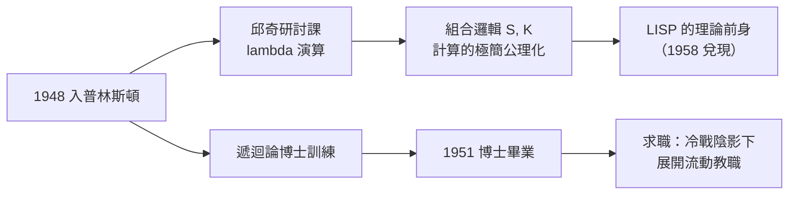

# 1.3 普林斯頓博士與 Combinatory Logic（1948–1951）

1948 年秋天，麥卡錫進入普林斯頓大學數學系。這裡是當時世界邏輯學的中心之一：邱奇在此主持邏輯研討課，馮紐曼在高等研究院（IAS），年輕的邏輯學家們在芬恩樓（Fine Hall）討論可計算性。麥卡錫在這裡度過三年，完成的博士論文題目是 **Projective Categoricity in Recursion Theory**（遞迴論中的投射範疇性，1951）——但真正的故事，是他與 **Combinatory Logic（組合邏輯）** 的相遇。

## 邱奇的門廳

- 普林斯頓的邏輯由邱奇一人撐起：他的 lambda 演算與類型論，是「函數即萬物」的世界觀（→ 詳見《邱奇傳記》）；
- 麥卡錫參加了邱奇的研討課，接觸了 lambda 演算與更早的 **Curry 與 Schönfinkel 的組合邏輯**：只靠 $S$、$K$ 兩個組合子，就能表達一切可計算函數；
- 這個思想對麥卡錫的震撼是結構性的：**計算可以被極簡地公理化**——不需要機器、不需要硬體，一組純粹的符號規則就是完整的計算宇宙；
- 十年後，這份震撼將直接變成 LISP 的語法：函數、函數應用、以遞迴定義一切（見 2.3）。

> 這是 AI 史上最重要的一條「遙遠傳承線」之一：邱奇的 lambda 演算 → 組合邏輯 → LISP 的核心語義。邱奇本人沒有造 AI，但他造了 AI 的母語（→ 詳見《邱奇傳記》第 5 章）。

## 馮紐曼的鄰居

- IAS 與普林斯頓數學系一牆之隔，馮紐曼此時正與 Goldstine 造著 MANIAC 電腦（→ 詳見《馮紐曼傳記》）；
- 麥卡錫記得在走廊上遇見馮紐曼，並向他請教自己的自動機想法；馮紐曼以一貫的風格鼓勵他把想法寫出來；
- 但此時麥卡錫的研究主流仍是數理邏輯：遞迴論、可計算性、模型論的邊角問題；
- 他在普林斯頓也結識了日後的同道：**Donald** 與日後在 Bell Labs / MIT 交會的圈子——普林斯頓這三年，他把「邏輯界的地圖」畫在了腦子裡。

## 博士論文：正規的遞迴論

- 1951 年他以遞迴論方向取得博士學位，論文研究遞迴可枚舉集的投射性質；
- 這篇論文本身並不出名，但它是麥卡錫的「**學徒作品**」：他證明了自己可以在最抽象的層面上操作計算的概念；
- 畢業後的現實問題立刻到來：冷戰初期、朝鮮戰爭開打、麥卡錫的共產黨家庭背景讓求職暗藏風險——他甚至短暫擔心過安全調查；
- 幸運的是，數學界對政治相對鈍感，他很快拿到職位，展開流動的早年教學生涯（見 2.1）。

## 組合邏輯的深遠迴響

Curry 的組合邏輯在 1951 年看來是純粹的邏輯學象牙塔，但它預言了三件大事：

- **函數式編程**：LISP（1958）、爾後的 ML、Haskell，全部是「以函數為第一公民」的後裔；
- **萬物皆可歸約**：麥卡錫日後堅持「智慧可以用形式系統表示」，其底層信念正是組合邏輯式的——複雜行為可以從極小的規則集生成；
- **程式的數學化**：程式可以像數學物件一樣被證明、被變換——這是日後程式語言理論的起點。

### 與圖靈機的兩種品味

| 傳統 | 代表 | 品味 | 後裔 |
|------|------|------|------|
| 圖靈機 | 圖靈（1936） | 機器、狀態、帶子 | 硬體、命令式語言（→《圖靈傳記》第 3 章） |
| Lambda 演算 | 邱奇（1936） | 函數、歸約、代入 | LISP、函數式編程（→《邱奇傳記》第 5 章） |

麥卡錫同時受過兩種訓練，但他心裡站在邱奇一邊——「程序應該是數學物件」。

## 求職年代的政治陰影

普林斯頓畢業後，麥卡錫的共產黨家庭背景第一次變成實際的職業風險：

- 麥卡錫主義（與他無關的同姓參議員）正值高潮，「背景調查」滲入學術界；
- 他刻意選擇政治敏感度較低的職位，避免涉密項目，教職的流動部分出於這個現實；
- 有趣的是，這段經歷沒有讓他遠離政治——他終身保持左翼關懷，只是把「理想」全數投入了學術；
- 他後來的自嘲：「我家姓 McCarthy，在 1950 年代求職，這個姓氏本身就是一面照妖鏡。」
- 這段低調期反而保護了他的研究自由：沒有人預期一個遞迴論學者會創造一門新學科。

## 事件關聯與前因後果

| 年份 | 事件 | 後續影響 |
|------|------|----------|
| 1948 | 入普林斯頓數學系 | 進入邱奇與馮紐曼的引力場 |
| 1948–1950 | 參加邱奇邏輯研討 | lambda 演算與組合邏輯入腦 |
| 1949 前後 | 與馮紐曼的走廊討論 | 確認自動機方向的合法性 |
| 1951 | 完成遞迴論博士論文 | 正規學術身分；計算的形式工具箱齊備 |
| 1951 | 畢業求職 | 進入 Bell Labs 夏季計畫與多校流動教職，見 2.1 |

**因果**：麥卡錫的普林斯頓三年，本質上是一次「**彈藥儲備**」：遞迴論給了他可計算性的語言，組合邏輯給了他「函數即程式」的語法直覺，馮紐曼給了他自動機的授權。三者都還沒有出口——AI 尚未命名，LISP 尚未存在。出口要到 1955 年之後才打開，而第一個出口，竟是在紐澤西州的一間電話公司實驗室（見 2.1）。

## 小結

- 普林斯頓三年讓麥卡錫同時擁有圖靈傳統與邱奇傳統的雙重訓練；
- 組合邏輯的「以極小規則生成一切計算」思想，是 LISP 的理論祖先；
- 博士論文（遞迴論）是正規的學徒作品，真正重要的知識儲備在研討課與走廊裡；
- 冷戰的政治背景讓他的早年職業路徑格外流動——這反而讓他廣泛接觸了數學界與工程界的多個角落；
- 1951 年夏天起，他將一邊教書、一邊在 Bell Labs 打暑期工，遇見杜林機的實踐者與**資訊論的締造者**（見 2.1）。
