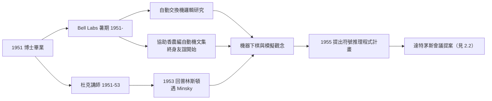

# 2.1 Bell Labs 夏天與杜克、普林斯頓教職（1951–1955）

拿到博士學位後，麥卡錫展開一段在後世看來如同「高速公路服務區」般的流動時期：杜克大學、普林斯頓、以及每年夏天去 **Bell Labs** 打工。短短四年裡，他完成了從邏輯學家到「準 AI 學者」的蛻變——而催化劑，是一部自動電話交換機與一份下棋程式。

## Bell Labs：1951 年的夏天

- 1951 年起，麥卡錫連續數年夏天在 Bell Labs 擔任短期研究員——這裡正是香農的根據地（→ 詳見《香農傳記》第 3 章）；
- 他的第一份任務極具象徵性：**研究自動電話交換機的邏輯**——用數學描述一部機器如何處理「通話」這種複雜行為；
- 在這裡他第一次近距離接觸真實的大型機器（而非紙上邏輯），也第一次聽到「用程式讓機器做聰明事」的具體討論；
- 1952 年前後，他協助香農編輯了**自動機研究**的文集——兩人從此建立持續終身的友誼與合作。

## 杜克與普林斯頓的教職

- 1951–1953 年，他在杜克大學（Duke）任數學講師，1953–1955 回到普林斯頓擔任助理教授；
- 這段期間他的正式研究仍屬數理邏輯，但興趣已明顯轉向「**機器上的邏輯**」；
- 1953 年，他與日後的關鍵人物網絡開始交織：Marvin Minsky 正在普林斯頓讀博士，兩人同層樓、常討論神經網路與機器智慧的問題——這段走廊友誼在 1955 年將開花結果（見 2.2）。

## 棋局與自動機：問題的具體化

- 在 Bell Labs，麥卡錫接觸到當時最熱的「機器下棋」議題：圖靈 1950 年的模擬棋局、香農 1950 年的下棋論文（→ 詳見《香農傳記》第 4 章）已經證明「智慧行為可以寫成程序」；
- 他逐漸把模糊的「機器能否思考」轉化為可操作的問題：**什麼樣的程式結構能承載常識與推理？**
- 1955 年，他向 Bell Labs 提出建議：研究「以符號邏輯做數學推理的程式」——這是他第一次以研究計畫的形式提出 AI 式的課題，雖未獲重視，但方向已定。

## 遇見關鍵詞：他說，是「模擬」啟發了他

麥卡錫事後總結，這段時期有兩個詞塑造了他的思想：

- **Simulation（模擬）**：1953 年前後在 Bell Labs 與學界盛行的觀念——用程式模擬任何可描述的過程；
- **自動機與邏輯的合流**：馮紐曼的自動機理論＋邱奇的 lambda 演算＋香農的開關邏輯，在 1950 年代初匯成一個問題：**能不能模擬人的智慧？**

## 為什麼流動期如此重要

後世容易把 1951–1955 看成麥卡錫的「過渡期」，實際上它是決定性的網絡期：

- **香農**給了他資訊論與自動機的權威背書（→《香農傳記》第 4 章）；
- **Minsky** 給了他神經網路與行為模擬的對照面——兩人代表 AI 的兩大氣質（符號 vs. 網路），在友誼中互相激盪；
- **Bell Labs** 給了他「真實機器」的經驗，補上普林斯頓純理論的缺角；
- 到 1955 年，麥卡錫已經是全美極少數同時精通「邏輯、程式、機器」的人——達特茅斯提案的作者資格，就是這四年攢出來的。

## 1955 年的那封信

達特茅斯提案的醞釀值得單獨一節，因為它是 AI 史的「大爆炸前夜」：

- 1955 年春，IBM 的 **Nathaniel Rochester** 主動聯繫麥卡錫：IBM 想資助「用 701 機器做符號推理」的研究；
- 麥卡錫立刻把這個機會擴大：不是一個項目，而是一場**集體的、跨機構的暑期研究**；
- 他先邀了 Minsky（普林斯頓老友），再透過 Minsky 與自己的 Bell Labs 關係拉入**香農**，最後補上 IBM 的 Rochester——四人組合各司其職：麥卡錫出構想與文筆、Minsky 出心理學視角、香農出威望與自動機理論、Rochester 出機器與錢；
- 這封信的寫作也顯示了麥卡錫的文風：開篇第一段就直陳核心主張，不加任何試探性的謙辭；
- 兩個月後 Rockefeller 基金會批准資助——史上最划算的學術投資之一，$7,500 買下了一門學科的誕生。

## 事件關聯與前因後果

| 年份 | 事件 | 後續影響 |
|------|------|----------|
| 1951 | 入杜克任講師；首赴 Bell Labs | 接觸真實機器與交換機邏輯 |
| 1952 | 協助香農編輯自動機文集 | 與香農建立合作與信任 |
| 1953 | 回普林斯頓任助理教授 | 與博士生 Minsky 同樓討論 |
| 1953–1955 | 機器下棋、模擬、符號推理的思考 | 問題從哲學轉為工程 |
| 1955 | 達特茅斯提案成形（與 Minsky、香農、Rochester） | 見 2.2 |

**因果**：這四年的因果鏈可以壓縮成一句話：**香農把麥卡錫帶進機器世界，Minsky 把麥卡錫帶進 AI 戰場**。沒有 Bell Labs 的夏天，麥卡錫可能永遠是個遞迴論學者；沒有普林斯頓的走廊，AI 的「達特茅斯建國文件」不會有那樣的人事組合。而這一切的伏筆，將在 1955 年夏天由 IBM 的 Nathaniel Rochester 接住（見 2.2）。

## 小結

- 1951–1955 是麥卡錫的「網絡建構期」：Bell Labs（香農、機器）、杜克與普林斯頓（教職、Minsky）；
- 自動交換機的研究讓「用邏輯描述複雜機器行為」成為他的拿手本領；
- 「模擬」與「自動機」兩個觀念，把「機器能否思考」翻譯成了工程問題；
- 1955 年，四個男人的提案已經成型：麥卡錫、Minsky、香農、Rochester——史上第一次 AI 會議只欠東風；
- 1956 年夏天，東風吹到新罕布夏州的達特茅斯（見 2.2）。
