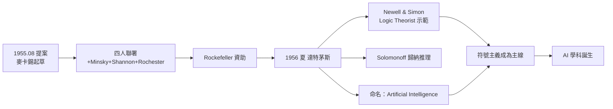

# 2.2 達特茅斯會議（1956）

1956 年夏天，在新罕布夏州漢諾威的達特茅斯學院，一場為期約兩個月的研討會悄悄舉行。參與者不到二十人，沒有媒體、沒有儀式——但正是這場會議，**發明了「人工智慧」（Artificial Intelligence）這個詞**，並把分散在數學、邏輯、心理學、工程中的零星努力，凝聚成一門有名字、有綱領的學科。提案的第一作者，是 28 歲的約翰·麥卡錫。

## 提案：一門新科學的出生證明

1955 年 8 月，麥卡錫起草提案，聯署者為 **Marvin Minsky、Claude Shannon、Nathaniel Rochester**：

- 提案的核心主張大膽得驚人：「學習或智慧的任何特徵，原則上都可以被如此精確地描述，以至於**機器可以模擬它**」；
- 提案列出七個議題：自動電腦、程式語言、神經網路、計算規模理論、學習與自我改進、抽象概念、隨機性與創造性；
- 「**Artificial Intelligence**」一詞由麥卡錫定奪——他自述，選這個詞是為了把它與 Minsky 等人研究的**控制論（cybernetics）** 區分開來：不受維納框架束縛、聚焦符號與推理；
- 經費由 **Rockefeller Foundation** 資助——四位提案人各有分量：香農是資訊論的締造者（→ 詳見《香農傳記》第 4 章），Rochester 是 IBM 701 的總設計師，Minsky 是普林斯頓的新科博士。

## 參與者與譜系

- **長輩三人**：麥卡錫、Minsky（達特茅斯新聘助理教授）、香農（Bell Labs）、Rochester（IBM）——提案四人組；
- **年輕一代**：Trenchard More、Ray Solomonoff、Oliver Selfridge、以及從普林斯頓來的**Allen Newell 與 Herbert Simon**；
- Newell 與 Simon 帶來了已經能跑的 **Logic Theorist**——史上第一個真正意義上的 AI 程式，它重證了羅素與懷海德《數學原理》中的定理（→ 詳見《羅素傳記》）；這是會議上唯一「已經成功的示範」，震撼全場；
- 等一下，第一個 AI 程式竟直接連到羅素的《數學原理》——符號邏輯主義的譜系在此完成一次公開交接：弗雷格—羅素—Gödel—邱奇的邏輯傳統，正式落到機器上（→《弗雷格傳記》《邱奇傳記》）。

## 會議進行了什麼

嚴格說，達特茅斯會議沒有統一議程，更像一場夏天的腦力營隊：

- 大家各自提案、互相批評、在走廊與黑板前激辯；
- Newell 與 Simon 示範 Logic Theorist 並提出「**物理符號系統**」的雛形思想；
- Solomonoff 講了歸納推理的機率理論——與日後卡爾納普式的歸納邏輯遙相呼應（→ 詳見《卡爾納普傳記》第 4 章）；
- Minsky 與麥卡錫討論了幾何證明與下棋程式的想法；
- 會議沒有產出一致結論，卻產出了三樣更持久的東西：**一個名字、一個網絡、一個信心**——「這件事可以做，而且值得做一輩子」。

## 命名的政治學

「人工智慧」這個名字並非中性，它是一次**學術定位的宣言**：

- 與**控制論**切割：維納的框架以回饋與類比電路為中心，麥卡錫要的是符號操作與邏輯推理；
- 與**自動機理論**切割：理論要有應用野心，不能只停留在數學；
- 為了爭取資助與期刊篇幅，「取名比解釋重要」——這是麥卡錫一生反覆強調的實用智慧；
- 香農曾建議用「自動機研究」，Rochester 等人偏好「複雜資訊處理」，都被麥卡錫否決——歷史最終記住了他的選擇（→《香農傳記》第 4 章記錄了香農在會議中的長輩角色）。

## 會議的餘波：誰去了哪裡

達特茅斯的另一項遺產是**人事地圖**——會議結束後，參與者散往各處，AI 的地理就此定形：

- **麥卡錫與 Minsky**：先後到 MIT，共組 AI 計畫——東岸的第一極（見 2.3）；
- **Newell 與 Simon**：回卡內基理工（後 CMU），以 Logic Theorist 為基礎發展「物理符號系統假說」——AI 的第二極；
- **Rochester**：回 IBM，短期內推動了西洋棋與幾何證明程式——但 IBM 高層 1959 年後對 AI 的熱情降溫；
- **Solomonoff**：繼續發展算法機率論，日後成為「通用歸納」的理論經典；
- 這張地圖的因果結構很清楚：**會議沒有產生理論共識，卻產生了四個「創業團隊」**——學科的進化靠的不是議程，是競爭中的小團體；
- 麥卡錫對此的總結一貫直接：「達特茅斯最重要的輸出就是那個名字；名字讓我們可以申請經費、開課、寫教科書。」

## 事件關聯與前因後果

| 年份 | 事件 | 後續影響 |
|------|------|----------|
| 1955.08 | 麥卡錫起草提案，四人聯署 | AI 的「建國文件」 |
| 1955.09 | Rockefeller 基金會資助到位 | 學科孵化有了資本 |
| 1956.6–8 | 達特茅斯會議舉行 | 命名誕生、網絡形成 |
| 1956 夏 | Logic Theorist 首次公開示範 | 符號主義路線確立 |
| 1956 後 | 參與者散往 MIT、CMU、IBM、史丹佛 | AI 四大基地的種子 |

**因果**：達特茅斯會議的因果鏈極其清晰：**邱奇與馮紐曼的教育**（見 1.2、1.3）→ **Bell Labs 的網絡**（見 2.1）→ **提案與命名**（本章）→ **AI 學科的誕生**。而會議本身又成為新因果鏈的起點：麥卡錫與 Minsky 因會議而在 1957 年先後到 MIT，促成 AI 史上第二個關鍵事件——LISP 的誕生（見 2.3）。

## 小結

- 1956 年達特茅斯會議是 AI 的命名典禮：麥卡錫造詞，香農、Minsky、Rochester 聯署背書；
- 會議的實質成果不在結論，而在**名字、網絡與信心**；
- Logic Theorist 的示範把羅素《數學原理》變成 AI 的第一份考卷，象徵邏輯傳統對機器的降臨；
- 「人工智慧」的命名是一次與控制論的切割宣言，決定了符號主義的早期霸權；
- 會議結束後，麥卡錫南下 MIT，與 Minsky 會合——下一段故事，是一門語言與一個實驗室的誕生（見 2.3）。
