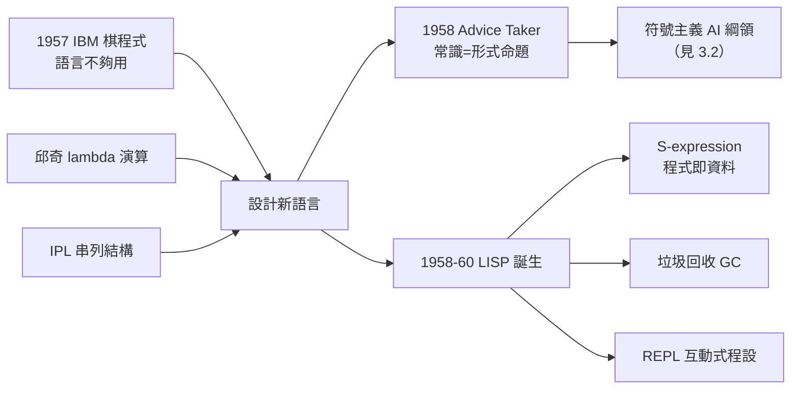

# 2.3 MIT 期間與 LISP 誕生（1957–1958）

達特茅斯會議之後，麥卡錫應 Minsky 之邀來到 MIT，兩人共同主持新成立的 AI 計畫。1957–1958 這兩年，麥卡錫完成了他一生中密度最高的創造期：一個下棋程式的思考、一份稱為 **Advice Taker** 的常識推理藍圖、以及一門改變電腦科學的語言——**LISP**。

## MIT：AI 的第二個家

- 1957 年，麥卡錫進入 MIT 電機工程系任教，與 Minsky 共組「AI 計畫」（後為 AI Lab）；
- 當時 MIT 有一台 IBM 704——全美少數的尖端大型機，兩人立即把它變成 AI 的實驗場；
- 麥卡錫的第一個大題目，是達特茅斯會議議題的延續：寫一個**會下棋、也會做數學推理**的程式。

## IBM 棋程式的教訓

- 1957 年，麥卡錫與人合作在 IBM 704 上開發西洋棋程式（呼應香農 1950 的下棋構想，→《香農傳記》第 4 章）；
- 程式遇到一個當時無解的困難：要在搜尋過程中**動態表達與操作概念**（哪些棋子被威脅、什麼是好的局面），現有語言（FORTRAN、組合語言）完全不適合；
- 他得出的結論影響深遠：**AI 需要一種新的語言**——能方便地表達符號結構、以遞迴思考、並且在執行中不斷改變；
- 這個「語言不夠用」的體會，正是 LISP 的直接前因。

## Advice Taker：常識推理的宣言

1958 年，麥卡錫發表論文 **Programs with Common Sense**，提出假想程式 **Advice Taker**：

- 主張：要讓機器有常識，就要把**常識寫成形式化的命題**，讓程式從中**推論**出行動；
- 範例（日後著名的「梯子」例子）：程式被告知一些事實（「我可以從椅子上走到梯子那裡」等），應能自己推出「為了拿到聖誕節禮物，我該爬上梯子」；
- 這份藍圖宣示了符號主義 AI 的總綱領：**智慧＝以邏輯表示知識＋以推論產生行為**；
- 它也直接引出了他日後的兩大理論工程：「情境性（situations）」與非單調推理（見 3.2）。

## LISP：兩個傳統的結婚

1958 年秋，麥卡錫著手設計 LISP（LISt Processor），1959–1960 年定稿論文 **Recursive Functions of Symbolic Expressions**。LISP 的誕生是多重血統的匯流：

- **邱奇的 lambda 演算**（→《邱奇傳記》第 5 章）：函數定義、函數應用、遞迴——LISP 的語義核心；
- **組合邏輯**（見 1.3）：以極小規則集生成一切計算；
- **IPL 語言的啟發**（Newell、Simon 為 Logic Theorist 所造）：串列（list）作為資料的通用表示；
- **FORTRAN 的教訓**：要有一個「頂層」可以直接對話——LISP 的 **read-eval-print 迴圈**由此而來，這是互動式編程的發明；
- 關鍵的技術突破：他以「**萬物皆 S-expression（符號表達式）**」統一了程式與資料——程式即資料，資料即程式；再配上**垃圾回收（garbage collection）**，讓動態記憶體管理自動化；
- 他甚至證明了 LISP 可以用自身定義——`eval` 的通用性，等於在實作層面重演了通用圖靈機的思想（→《圖靈傳記》第 3 章）。

## Time-sharing 的動機也在此萌芽

- MIT 的 IBM 704 是公用機器：一批一批地排隊用，AI 的互動實驗根本等不起；
- 麥卡錫體會到：**智慧的程式需要與環境互動**，批次處理是 AI 的敵人；
- 1959 年，他在 MIT 的備忘錄裡正式提出 **time-sharing（分時系統）**：讓多人同時「對話式」地使用一台電腦——這是電腦公用事業思想的起點（見 3.3）。

## LISP 誕生現場：幾個決定的來歷

LISP 的幾個關鍵設計，各有具體的因由，值得逐一記錄：

- **S-expression 語法**：原本只是內部表示，麥卡錫打算另設「M-expression」作為使用者語法；但實作 eval 的同事直接用了 S-expression，且大家發現「程式即資料」太好用——M-expression 永遠沒有誕生。這是「意外保存了最深刻設計」的名例；
- **垃圾回收**：串列結構讓手動記憶體管理不可行，麥卡錫與學生在 1959 年想出「從根部追蹤、回收孤島」的辦法；
- **條件式（cond）**：麥卡錫從數理邏輯的递归定義習慣出發，把「分段定義函數」直接變成語法——比 Fortran 的 IF 先進一代；
- **遞迴**：FORTRAN 不允許遞迴，LISP 把它變成常態——「以數學的方式寫程式」；
- 這些決定共同構成一件事：**LISP 是第一門按數學家直覺設計的語言**。

## 事件關聯與前因後果

| 年份 | 事件 | 後續影響 |
|------|------|----------|
| 1957 | 進 MIT，與 Minsky 共組 AI 計畫 | AI 的第二個基地成形 |
| 1957 | IBM 704 棋程式受挫於語言 | 「AI 需要新語言」的結論 |
| 1958 | 發表 Programs with Common Sense | 符號主義總綱領；Advice Taker 藍圖 |
| 1958 | 開始設計 LISP | 函數式編程時代的開端 |
| 1960 | LISP 論文發表 | S-expression、GC、REPL 成為永久遺產 |
| 1959 | 提出分時系統構想 | 電腦公用事業思想的起點（見 3.3） |

**因果**：這兩年的因果鏈是教科書級的：**下棋受挫 → 語言需求 → LISP**；**常識問題 → 形式化主張 → Advice Taker**；**互動需求 → 分時系統**。三條線都發軔於 MIT 的 IBM 704，而 LISP 又成為 Advice Taker 的載體——語言與理論互為因果。此後的 AI，凡談符號推理者，幾乎都用 LISP 寫作。

## 小結

- 1957–1958 年，麥卡錫在 MIT 把達特茅斯的承諾兌現為三件實體：AI 計畫、LISP、Advice Taker 綱領；
- LISP 是邱奇 lambda 演算、IPL、FORTRAN 教訓的綜合體，「程式即資料」是其靈魂；
- GC 與 REPL 兩項發明，影響遠超 AI，成為整個軟體工程的公共遺產（見 5.3）；
- Advice Taker 開出的「常識＝形式命題」總綱領，是麥卡錫終生理論工作的原點（見 3.2）；
- 但 MIT 的政治與資源紛爭即將到來——1962 年，麥卡錫將西行史丹佛，另起爐灶（見 3.1）。
