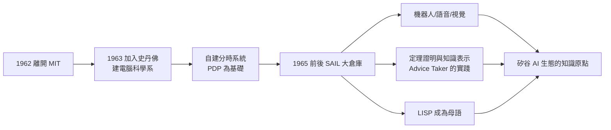

# 3.1 史丹佛 SAIL 與 AI 實驗室（1963–1970s）

1962 年，麥卡錫離開 MIT，先是短暫去伯克萊，1963 年正式加入新興的史丹佛大學。這次西遷不僅是換工作，而是一次「建國」：他要一個能同時實現**AI 研究理想**與**運算理想**（分時、互動、公用事業）的地方。十年之內，他建立起與 MIT 並列的 AI 重鎮——**SAIL**（Stanford AI Lab），並讓帕洛阿托成為日後矽谷的知識原點之一。

## 為什麼離開 MIT

- 在 MIT，AI 計畫是「合作」也是「競爭」：Minsky 與麥卡錫風格迥異——Minsky 偏好心理學式的模型、容忍雜多的機制，麥卡錫堅持邏輯與數學的純度（兩人分道後的對照，見 4.2）；
- 更現實的原因：MIT 沒有給他分時系統的實驗空間，而史丹佛願意支持他蓋一台「自己的機器」；
- 1963 年，史丹佛邀他主持**電腦科學計畫**——他成為史丹佛電腦科學系的實際建構者之一，順便把 AI 帶到了西岸。

## SAIL 的誕生

- 1963–1965 年，麥卡錫帶領團隊以 DEC PDP 系列為基礎，建造史丹佛的分時系統，並在此之上成立 AI Lab；
- 1965 年前後，實驗室落腳於校外的**波特蘭街（Plymouth Street）舊廠房**——一棟開放式的鋼構建築，成為後世傳奇的「SAIL 大倉庫」；
- SAIL 的文化由麥卡錫定調：**駭客精神＋數學嚴謹**——既歡迎半夜寫程式的怪才，也要求理論上的清楚論證；
- 實驗室以 **LISP** 為通用語言：麥卡錫把 MIT 的遺產帶到了西岸，LISP 從此是 AI 的母語（見 4.3）。

## SAIL 的黃金年代（1960s–1970s）

在麥卡錫主持下，SAIL 產出了一系列開創性的成果：

- **機器人**：Hans Moravec 的視覺導航車、Raj Reddy 與團隊的語音辨識（Reddy 後赴 CMU）；「史丹佛車」是自駕車的遠祖；
- **知識與推理**：Cordell Green 的問答系統 QA3、定理證明程式——直接實踐 Advice Taker 的綱領（見 2.3）；
- **音樂與藝術**：John Chowning 的 FM 合成（日後催生雅馬哈 DX7）；Leland Smith 的音樂排版；
- **人物網絡**：Donald Knuth 也在史丹佛，其 TeX 與《電腦程式設計藝術》與 SAIL 文化互相浸潤；Les Earnest、Whit Diffie 等日後密碼學先驅都在此進出；
- **分時的兌現**：SAIL 的系統讓數十人同時互動用機——麥卡錫 1959 年的構想（見 3.3）在此變成日常。

## 駭客文化的搖籃之一

- SAIL 與 MIT AI Lab 並列為**駭客文化的兩大源頭**：開放使用機器、分享程式、崇尚「做出來給你看」；
- 麥卡錫本人對這種文化的態度是矛盾的：他欣賞動手能力，卻常抱怨駭客不寫文件、不做理論——「實驗室的亂象是我不滿意的部分」；
- 但正是這種張力造就了 SAIL 的生產力：理論家與駭客共用一台機器、一面黑板；
- SAIL 的「開放分時＋檔案共享」習俗，日後被普遍視為**開源文化**的史前史（見 5.3）。

## DARPA 的黃金資助

- ARPA（後之 DARPA）在 1960 年代開始大額資助 AI，SAIL 是兩大受資者之一（另一為 MIT）；
- 資助的邏輯是「使命導向＋高容忍」：不做軍事機密、要求可發表的成果；
- 這種資助模式養大了整個 AI 學科，也埋下了 1970 年代資助政治化的種子——当 Lighthill 報告與 Mansfield 修正案收縮經費時，AI 第一次過冬（見 4.2、5.2）。

## 「SAIL 的矛盾」：獨裁者與自由派

麥卡錫在 SAIL 的角色有一個耐人尋味的矛盾：

- 制度上他是實驗室的**家長**：定研究方向、爭取經費、決定人事；
- 文化上他卻是**放任派**：不規定學生做什麼、不檢查上班時間、容忍倉庫裡的種種怪行；
- 他對此有自覺的解釋：「研究無法被管理，只能被供養」——管理者的工作是確保機器、經費與自由，其餘交給人；
- 這種「供養式管理」成為日後 Xerox PARC、Google X 等實驗室文化的先聲；
- 他唯一強硬的地方是**理論標準**：誰的成果經不起「問題定義清楚了嗎」這一問，在組會上就會被他當場拆解；
- 學生們又怕他又愛他：怕的是提問的鋒利，愛的是他從不占有學生的功勞。

## 事件關聯與前因後果

| 年份 | 事件 | 後續影響 |
|------|------|----------|
| 1962 | 離開 MIT（與 Minsky 分流） | 符號主義的重鎮西移 |
| 1963 | 加入史丹佛，建電腦科學計畫 | 西岸 AI 與 CS 教育的起點 |
| 1963–1965 | 自建分時系統 | 1959 構想的兌現（見 3.3） |
| 1965 前後 | SAIL 倉庫時期開始 | 機器人、語音、定理證明全面開花 |
| 1960s–70s | DARPA 黃金資助 | AI 學科制度化；也埋下過冬伏筆 |

**因果**：SAIL 的因果鏈是雙向的：**分時系統是因**（麥卡錫要互動的機器，才自建系統），**AI 成果是果**（有了互動機器，機器人與語音研究才可能）。這與他一生的信條一致：**工具先於理論的兌現**。SAIL 也反哺了矽谷——Xerox PARC、Sun、Google 的早期人物，很多都出自或路過這座倉庫。

## 小結

- 1963 年的西遷，讓麥卡錫從「AI 計畫的共同主持人」變成「一個學系的建構者＋一座實驗室的獨裁者」；
- SAIL 以分時系統為地基、LISP 為語言、邏輯與駭客並存為文化，成為 AI 與矽谷共同的知識原點；
- 機器人、語音辨識、定理證明三大方向，都是 Advice Taker 綱領的工程化延伸；
- DARPA 的資助模式養大了學科，也預定了週期性的寒冬；
- 但麥卡錫在 SAIL 期間最深的理論思考，不在機器人上，而在一個更根本的問題：**知識如何被形式化**——情境性與非單調邏輯（見 3.2）。
