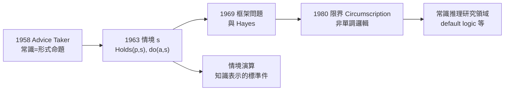

# 3.2 情境性與非單調邏輯（1960s–1980s）

如果說 LISP 是麥卡錫給電腦科學的禮物，那麼「**如何把常識形式化**」就是他給哲學與邏輯的挑戰書。從 1958 年的 Advice Taker 開始，他花了三十多年經營同一條理論線：**以邏輯表示知識**。這條線的兩大里程碑，是 1963 年的**情境性（situationalism）** 與 1980 年代的**非單調邏輯（nonmonotonic logic）**。

## 第一個難題：動態世界怎麼表示

- 邏輯（弗雷格—羅素—希爾伯特的傳統，→《弗雷格傳記》《羅素傳記》《希爾伯特傳記》）天生是**靜態**的：命題為真便恆為真；
- 但現實世界在流動：昨天在桌上的杯子今天在廚房；「移動」這個動作改變一切事實的適用範圍；
- 1963 年，麥卡錫提出 **situations（情境）** 的解法：在命題上增加一個參數 $s$，把「真」寫成 $\text{Holds}(p, s)$——事實**在情境 $s$ 中**成立；
- 動作是情境之間的函數：$\text{do}(a, s) = s'$——「在情境 $s$ 做動作 $a$，得到新情境 $s'$」；
- 這就是日後 AI 知識表示中的「**情境演算（situation calculus）**」，至今仍是教科書標準內容。

## 第二個難題：框架問題

- 情境演算立刻暴露出一個深淵：當你說「移動杯子改變了杯子的位置」，還需要補一句「**其他一切不變**」——否則邏輯上無法推論出「杯子的顏色沒變」；
- 這類「要補無窮多條不變式」的困境，就是著名的**框架問題（frame problem）**；
- 1969 年，麥卡錫與 Patrick Hayes 合寫 *Some Philosophical Problems from the Standpoint of Artificial Intelligence*，正式命名並系統化了這個問題——哲學界從此多了一個由 AI 反哺的題目；
- 框架問題成為符號 AI 的試金石：一個知識表示系統能否處理它，等於問「常識是否真的可形式化」。

## 第三個難題：非單調推理

- 傳統邏輯是**單調的**：前提增加，結論只會更多，不會消失；
- 但常識不是：「鳥會飛」——「企鵝是鳥」——「所以企鵝（通常）不會飛」。新資訊**推翻**了舊結論；
- 1980 年，麥卡錫發表 **Circumscription（限界）**：一種非單調推理的形式化——「在沒有反例的範圍內，假設例外最少」；
- 他在同一時期推動了 **epistemology vs. heuristic**（知識論層面 vs. 啟發層面）的區分，並提出 **非單調邏輯** 作為 AI 的邏輯基礎；
- 這條線開創了整個「常識推理」研究領域：default logic（Reiter）、autoepistemic logic（Moore）等，全是限界思想的旁支。

> 麥卡錫自己承認，這條路有個遙遠的哲學先聲：卡爾納普企圖以歸納邏輯形式化「合理信念」（→ 詳見《卡爾納普傳記》第 4 章）。兩人取徑不同——卡爾納普要機率式的歸納，麥卡錫要邏輯式的常識——但「**理性可以形式化**」這個宏願，是一脈相承的。達特茅斯會議上的 Solomonoff 歸納理論（見 2.2），則是同一願望的機率版。

## 一個理論家的堅持

麥卡錫在這三十年間的立場從未動搖：

- **常識是可以形式化的**——不是哲學玄談，而是工程問題；
- **邏輯是正確的表示工具**——「用邏輯做 AI」不是品味，而是必然；
- 他與 Hayex 合作的「water shortage」（缺水）規劃例子、與日後的 **formalizing common sense** 論文集（1990 出版），都是這份堅持的文件；
- 他為此遭到的批評也一以貫之：心理學家說人不這樣推理，連結派說神經網路不需要這種表示——他的回答是：「**飛機不學麻雀，但空氣動力學是真的**」（見 4.2）。

## 「表示」之爭：麥卡錫 vs. 相對主義者

1980 年代，麥卡錫的立場遭遇了來自內部的挑戰——不是連結派，而是 AI 內部的「反表示派」：

- 一批研究者（Rodney Brooks 最著名，1991 年的「大象不下棋」論文）主張：智慧不需要顯式表示，**感知—行動的直連**就夠了；
- 麥卡錫的回應一如既往地鋒利：機器人連「房間裡有沒有椅子」都說不清楚，何談智慧？行為主義的機器人只能做**反射動物**，做不了**有知識的行為者**；
- 他承認反應式系統在工程上有效，但堅持：只要任務需要「知道世界上某件看不見的事」，表示就不可繞過；
- 這場辯論在 2020 年代以新形式重演：LLM 的內部表徵算不算「表示」？它們有沒有「世界模型」？（見 5.2）
- 麥卡錫若在世，他大概率會說：有某種表示，但它是否**可檢驗、可修正、可解釋**，才是關鍵——而這正是非單調邏輯的工作定義。

## 事件關聯與前因後果

| 年份 | 事件 | 後續影響 |
|------|------|----------|
| 1958 | Advice Taker 綱領 | 常識形式化的總起點 |
| 1963 | 情境參數 $s$ 與動作函數 | 情境演算誕生 |
| 1969 | 與 Hayes 命名框架問題 | AI 反哺哲學的經典案例 |
| 1980 | Circumscription 論文 | 非單調邏輯成為獨立領域 |
| 1980s– | default logic、知識表示學派興起 | KR 領域制度化（見 5.2） |
| 1990 | 論文集 Formalizing Common Sense | 三十年工作的總結 |

**因果**：這條理論線的因果鏈極長：**弗雷格與羅素的形式邏輯**（→ 傳記）→ **Gödel 與邱奇對邏輯極限的釐清**（→ 傳記）→ **麥卡錫把邏輯變成程式的表示層**（LISP 是載體）→ **情境演算、框架問題、限界**。每一步都是「上一代的邏輯遺產被 AI 消化」的過程。而框架問題至今沒有完全解決——它提醒我們，麥卡錫選擇的是一個**以世紀為尺度**的問題。

## 小結

- 情境性、框架問題、非單調邏輯，是麥卡錫理論工作的三大支柱，共同回答「常識如何形式化」；
- 情境演算把時間與動作納入邏輯，成為知識表示的標準工具；
- 框架問題是 AI 對哲學的最大反哺之一；
- 限界（circumscription）開創非單調推理領域，是「鳥會飛、企鵝是鳥」這類常識的第一個嚴格處理；
- 這一切理論工程能夠實作，靠的是另一項他一手推動的基礎設施革命——分時系統（見 3.3）。
