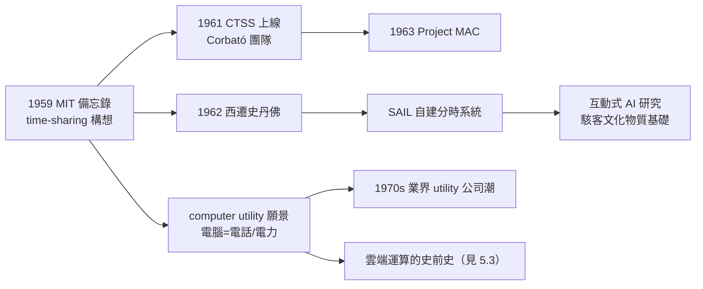

# 3.3 分時系統與電腦公用事業（1959–1970s）

麥卡錫對電腦科學的貢獻，除了 LISP 與 AI，還有一條常被低估的線：他幾乎以一己之力，把「**電腦應該像電話與電力一樣被公用化**」的想法變成了一門工程學。1959 年他提出分時系統構想；此後二十年，這個構想重塑了整個人機關係。

## 1959 年的備忘錄

- 1959 年 1 月，麥卡錫在 MIT 發表備忘錄，首次系統提出 **time-sharing**：一台電腦以極快的速度在多個使用者之間切換，讓每個人都「以為」獨佔了機器；
- 動機直接來自 AI 的需要：**互動**。下棋程式、Advice Taker 這類程式必須不斷對話、修改、再執行；批次處理（ punched card 排隊）讓研究根本無法進行（見 2.3）；
- 他的論證還有經濟學的一面：1960 年代一台電腦要數百萬美元，若一次只能服務一人，是巨大的浪費；**分時是讓貴重機器利用率最大化的數學解**；
- 他寫道：電腦應該像**電話系統**一樣——使用者隨取隨用、按量付費。這就是「**computer utility（電腦公用事業）**」的願景。

## MIT CTSS 與 Project MAC

- 麥卡錫把構想帶給 MIT 的 Fernando Corbató 團隊；1961 年 **CTSS**（Compatible Time-Sharing System）上線——史上最早的可用分時系統之一；
- 1963 年，MIT 成立 **Project MAC**，麥卡錫是六位原始提案人之一——這個計畫孕育了 Multics，Multics 又啟發了 UNIX；
- 但 MIT 的政治讓麥卡錫失望：他希望分時研究主導權在他手裡，MIT 卻選了 Corbató——這是他 1962 年西遷的關鍵原因之一（見 3.1）；
- 一場對 AI 史與作業系統史同時關鍵的「人才分流」就此發生：**MIT 得到 Project MAC，史丹佛得到麥卡錫**。

## 史丹佛的兌現：自己蓋一台

- 在史丹佛，麥卡錫終於能實現完整構想：以 PDP-1、PDP-6 為基礎自建分時系統，服務 AI Lab 與全校；
- SAIL 系統的特色是**為互動研究而生**：即時反應、圖形終端、檔案共享——「駭客文化」的物質基礎就是分時（見 3.1）；
- 他也更進一步提出「**家庭終端**」的設想：總有一天，家家戶戶都有一台終端，接上中央電腦——像接上電力網一樣；
- 1970 年前後，全美掀起了「computer utility」公司潮（如 Tymshare、National CSS），麥卡錫的話語成為業界綱領。

## 「電腦公用事業」的經濟學直覺

麥卡錫在 1960 年代反覆論證的幾點，今天讀來像雲端運算的預言：

- **規模經濟**：中央大型機＋遠端終端，比每人一台小機器便宜——計算應集中供應；
- **按量計費**：用多少算力付多少錢，如同電表；
- **服務品質的可預期性**：系統必須可靠、可擴充，這催生了後來作業系統設計的諸多標準；
- 他甚至預言過「**家電化的計算**」：終端會像電視一樣進入客廳。

## 與同時代的對照

| 人物 | 構想 | 集中 or 分散 |
|------|------|--------------|
| 麥卡錫 | 分時＋電腦公用事業 | 集中供應、終端存取 |
| Engelbart | 增強人類智能（NLS） | 互動工具、個人工作站 |
| Taylor/Licklider | 人機共生、網路 | 網際網路的前身 ArpaNet |

有趣的是，歷史走了一個迴圈：麥卡錫的「集中式公用事業」在 PC 時代被「個人電腦」打敗，卻在 2000 年代以**雲端運算**的形式全面復活（見 5.3）。

## 「如果電腦像電力一樣便宜」

麥卡錫 1960 年代的公用事業論述，最迷人的部分是那些「走得太遠」的推論——今天讀來幾乎像科幻，卻是嚴格的經濟推理：

- **算力如電力**：只要計算集中供應、按量計費，「聰明但買不起電腦的人」就能參與——這是對**運算民主化**的最早論述；
- **家庭終端改變工作**：既然終端接進家門，通勤就未必必要——他 1960 年代就寫過「遠距工作」的設想；
- **教育與終端**：他設想每個學生有一台終端，教程可以互動化——這是後來 MOOC 與教育科技的直系祖先；
- **警惕壟斷**：他同時警告公用事業模式的風險——單點供應意味著單點故障與單點權力；
- 這些推論展示了他思維的標誌性結構：**從一個技術事實出發，用經濟學推出社會後果**；
- PC 時代他的預言看似落空，雲端時代又全部歸位——「技術預言的正確常以代際為單位」。

## 事件關聯與前因後果

| 年份 | 事件 | 後續影響 |
|------|------|----------|
| 1959 | MIT 分時備忘錄 | 分時系統的理論宣言 |
| 1961 | MIT CTSS 上線 | 構想首次工程化 |
| 1962 | 因分時主導權離開 MIT | 西遷的關鍵原因（見 3.1） |
| 1963 | 參與提案 Project MAC | Multics → UNIX 的譜系 |
| 1963–1965 | SAIL 自建系統 | AI 研究的互動基礎設施 |
| 1960s–70s | computer utility 論述與業界實踐 | 雲端運算的思想原點 |

**因果**：這條線的因果鏈是：**AI 需要互動 → 互動需要分時 → 分時需要系統工程 → 系統工程養出駭客文化 → 駭客文化反哺 AI 與開源**。麥卡錫本人由 AI 問題出發，抵達了作業系統與運算經濟學——這是典型的「跨域因果」：解決一個學科的瓶頸，往往發明另一個學科。

## 小結

- 1959 年的分時備忘錄，把「互動」從奢侈品變成運算的基本形態；
- computer utility 願景是雲端運算的思想原點：集中、計費、像水電一樣可靠；
- 分時之爭促成麥卡錫西遷，直接改變了 AI 地圖（MIT vs. SAIL 雙雄並立）；
- SAIL 系統是駭客文化與開源習俗的物質溫床（見 5.3）；
- 建構這一切的理論家，在 1971 年迎來了學科對他的最高承認——圖靈獎（見 4.1）。
