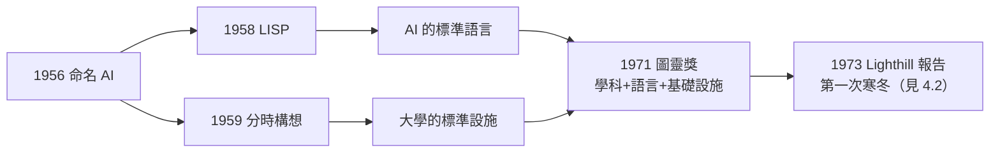

# 4.1 圖靈獎（1971）

1971 年，計算機學會（ACM）把第四屆**圖靈獎**頒給了 44 歲的約翰·麥卡錫，表彰他「對人工智慧領域的重大貢獻」——包括 LISP、分時系統的思想，以及把「機器智慧」確立為嚴肅科學的整體功業。對一個以「命名一門學科」著稱的人來說，這是歷史最工整的加冕。

## 得獎理由的三位一體

ACM 的授獎詞將貢獻歸於三個方面：

- **人工智慧**：命名並奠基——達特茅斯會議、Advice Taker 綱領、常識形式化的長期研究；
- **LISP 語言**：設計並實作——S-expression、遞迴、垃圾回收、互動式程式設計；
- **分時系統**：最早的系統性倡議者——「電腦公用事業」的理論與實踐；
- 值得注意的是：三項貢獻分屬「一門學科、一門語言、一種基礎設施」——很少有人的名字同時出現在學科史、程式語言史與系統史的三份名單上。

## 頒獎演說：對「AI 過度樂觀」的清算

麥卡錫的圖靈獎演說題為 **The Present State of Research on Artificial Intelligence**——出乎意料地清醒：

- 他坦承 1950 年代的預測（機器下棋、證明定理）遠比當時的實際進展樂觀；
- 他指出 AI 的瓶頸不在算力而在**表示**：常識的知識表示仍是未解的核心問題；
- 他重申「非單調推理」是未來的關鍵——兩年後他將發表更完整的論述（見 3.2 之 1980 年限界）；
- 這份誠實使他的得獎不同於慶功宴：**這是一個創建者對自己學科的中期檢討**。

> 圖靈獎本身即以圖靈命名——那位 1950 年寫下「機器能思考嗎」的人（→ 詳見《圖靈傳記》第 4 章）。麥卡錫是第一批把圖靈之問變成學科的人之一，1950 年的問題在 1971 年獲得了制度性的回音。

## 1971 年前後的 AI 氣氛

得獎時的 AI 正處於第一次巔峰：

- DARPA 資助充沛，MIT、SAIL、CMU、史丹佛四大基地鼎立；
- LISP 已是 AI 的標準語言，分時系統已是大學的標準設施；
- 但批評也在累積：英國的 **Lighthill 報告**（1973）即將猛烈抨擊 AI 兌現不足，經費冬天將至（見 4.2、5.2）；
- 麥卡錫的演說在那個時點上，像是一次「**巔峰時的降溫**」——他的清醒在 1974 年後被證明是準確的。

## 得獎者的自我評價

- 麥卡錫私下對獎項態度淡然——他更在意的是**問題是否被解決**；常識推理在 1971 年顯然還沒有；
- 他持續把獎金與名氣兌換成研究資源與學生支持；
- 對照同年齡層的獲獎者：Knuth（1974，程式設計藝術）、Minsky 與 Simon、Newell（1969/1975，AI 同儕）——1970 年代的圖靈獎幾乎是 AI 與軟體工程的內部會議；
- 姚期智日後（2000 年）也將獲此獎，兩人都在計算理論與應用的交界處工作（→ 詳見《姚期智傳記》）——圖靈獎的譜系本身就是「計算」概念不斷擴張的歷史。

## 圖靈獎當年的競爭格局

把 1971 年的授獎放回 ACM 的年表裡看，能讀出學界判斷的訊息：

- 1969 年首獎得主是 **Alan Perlis**（ALGOL、程式設計教育）——ACM 先肯定「軟體作為學科」；
- 1970 年是 **Wilkinson**（數值分析）——肯定計算的數學基礎；
- 1971 年輪到麥卡錫——**ACM 選擇把第三座獎給「未來」**：一個當時仍被質疑的領域；
- 這在 1971 年是有勇氣的決定：Lighthill 報告（1973）即將宣告 AI 失敗，ACM 等於提前兩年押注；
- 麥卡錫得知得獎時的反應（據同事轉述）很麥卡錫：「很好，這代表學科存在了。獎是給學科的，我只是剛好還活著。」
- 他的謙遜有一半是真心、一半是策略——把獎項的意義導向學科制度化，正是他要的結果。

## 事件關聯與前因後果

| 年份 | 事件 | 後續影響 |
|------|------|----------|
| 1956–1960 | 命名 AI、造 LISP | 得獎的主體功業 |
| 1959–1965 | 分時系統倡議與實作 | 得獎理由之一 |
| 1969 | 框架問題論文 | 理論貢獻的深化 |
| 1971 | 獲圖靈獎 | AI 學科首次獲最高承認 |
| 1973 | Lighthill 報告 | 得獎後兩年，寒冬降臨 |

**因果**：圖靈獎是 1956–1960 黃金五年的「複利結算」。但也需注意因果的方向：**獎項承認學科，學科卻隨即進入寒冬**——制度性承認往往出現在領域泡沫的頂點，這個模式在 AI 史上重複多次（1980 年代專家系統、2010 年代深度學習，見 5.2）。麥卡錫的演說之所以可貴，正在於他在頂點說了誠實的話。

## 小結

- 1971 年圖靈獎確認了麥卡錫的「三位一體」功業：AI 學科、LISP、分時系統；
- 得獎演說的清醒（表示是瓶頸、非單調推理是關鍵）預示了 1980 年代的理論重心；
- 得獎時的 AI 正在巔峰，Lighthill 風暴已在路上——創建者與批評者幾乎同時登場；
- 圖靈獎的命名本身，使麥卡錫的獲獎成為圖靈之問的一次制度性回音；
- 巔峰之後是路線之辯：與老友 Minsky 的分岔、與連結派的对決（見 4.2）。
