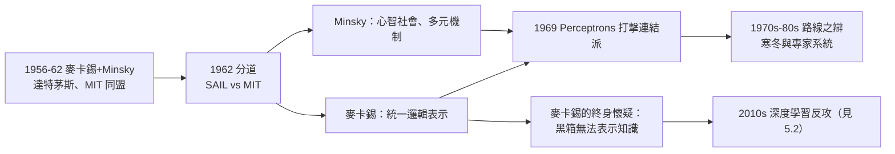

# 4.2 與 Minsky、與符號主義路線之辯、對連結派的懷疑（1970–2000）

AI 的前四十年，幾乎所有重大路線之爭都與麥卡錫有關：與老友 Minsky 的學術分岔、與心理學派的方法之辯、以及對**連結派（connectionism）** 長達半世紀的懷疑。這些論戰塑造了 AI 的地形圖，也定義了麥卡錫作為「符號主義守門人」的歷史角色。

## 與 Minsky：從同志到分岔

- 1950 年代的麥卡錫與 Minsky 是 AI 的「雙子星」：達特茅斯共同提案、MIT 共組實驗室；
- 1962 年分道後，兩人走上不同道路：麥卡錫赴史丹佛堅守邏輯，Minsky 留 MIT 轉向「心智社會（society of mind）」式的多元機制觀；
- 分歧的實質：麥卡錫相信**統一的邏輯表示**是智慧的基礎；Minsky 認為心智是許多無智能小機器的聯盟，不需要統一表示；
- 這場分歧沒有決裂——兩人終身互相尊重、互相調侃——但它劃出了符號 AI 內部的兩大流派（SAIL vs. MIT AI Lab）；
- 1969 年 Minsky 與 Papert 出版 *Perceptrons*，重創神經網路研究——Minsky 扮演了連結派的「劊子手」，麥卡錫則扮演更持久的「懷疑者」（見下）。

## 符號主義的防線

1970–1980 年代，AI 內外對符號路線的批評排山倒海，麥卡錫是防線上最一致的人：

- **對 Dreyfus 的哲學批評**（「電腦不能有常識」），他的回應是：批評者混淆了「實作困難」與「原則不可能」；
- **對「常識太模糊無法形式化」**，他反駁：模糊的常常只是我們還沒把問題問清楚——數學史上「無窮」「機率」都曾被如此指控；
- 他與 Nilsson、Genesereth 等史丹佛同事把「**邏輯主義 AI**」制度化为課程與教科書，影響了整個 1980 年代的知識表示學界（見 5.2）；
- 他的口號式回應後來廣為流傳：「**我們要的不是會下棋的程式，而是有常識的程式**」——批評 AI 會下棋卻不懂常識，恰好是他先說的。

## 對連結派的懷疑

麥卡錫對神經網路的懷疑持續終身，論點有三：

1. **可解釋性**：網路是黑箱，無法回答「為什麼」，而智慧行為需要可檢驗的理由；
2. **表示問題**：連結派沒有回答知識如何表示——它繞過了問題而非解決問題；
3. **正確性**：他相信推理的正確性來自邏輯結構，而非統計相關性；「機率可以修正信念，但不能替代信念」；

- 諷刺的是，這些批評在 2010 年代深度學習狂潮中被重新提出，只是這次連結派贏了（見 5.2）；
- 麥卡錫晚年在部落格上仍筆戰不輟，他對 Hinton 一系的工作保持禮貌但明確的保留態度（→ 詳見《Hinton傳記》）：「**神經網路是有用的工程，但是否是『智慧』的正確理論，是兩回事**」；
- 這場論戰的最佳註腳或許是：他自己承認，符號 AI 四十年也沒兌現承諾——雙方都在付學費。

## AI 冬天的親歷者

- 1973 年 Lighthill 報告重創英國 AI；1975 年前後美國 DARPA 收緊資助（Mansfield 修正案效應）——**第一次 AI 寒冬**；
- 麥卡錫的因應是「深化理論」：他認為寒冬的病因正是 1960 年代許諾過頭、根基太淺；
- 1980 年代專家系統帶來短暫繁榮與第二次寒冬（1987–），他對專家系統的評價一貫尖銳：「**沒有常識模組的知識庫是沙上之塔**」；
- 他在寒冬中寫下的限界與非單調邏輯（見 3.2），成為凍土下繼續生長的根。

## 論戰的文體：麥卡錫如何寫作

麥卡錫的論戰之所以難以回應，一半在論點，一半在**文體**：

- 他永遠**先給對方最強的形式**：引用對方論文、複述其論證，然後指出一個未經證實的跳躍；
- 他偏愛**反例而非長篇反駁**：一個「你的理論解釋不了的玩具情境」，勝過十頁雄辯；
- 他的幽默是**工程師式的**：「我不反對你的機器人，我反對的是它會撞牆。」
- 他把哲學論戰寫成**問題清單**——讀者讀完不是被說服，而是發現自己欠了一堆答案；
- 這種文體影響了整個符號 AI 學派：史丹佛出身的論文都以「問題定義」開篇；
- 代價是他樹敵頗多——被拆穿的一方往往記恨於文風而非論點。論戰的歷史，一半是思想史，一半是性格史。

## 事件關聯與前因後果

| 年份 | 事件 | 後續影響 |
|------|------|----------|
| 1962 | 麥卡錫與 Minsky 分道 | 符號 AI 內部雙流派並立 |
| 1969 | Perceptrons 出版 | 連結派進入寒冬 |
| 1973 | Lighthill 報告 | 第一次 AI 寒冬 |
| 1980s | 專家系統興衰 | 第二次寒冬；麥卡錫批評知識庫無常識 |
| 1986 前後 | 反向傳播復興連結派 | 麥卡錫的懷疑成為少數派 |
| 2000s | 部落格論戰 | 符號 vs. 統計之辭延續至 21 世紀（見 5.2） |

**因果**：這段歷史的因果主軸是「**許諾與兌現的張力**」：1956 年的命名許諾過高（見 2.2），1970 年代的兌現不足引來清算；連結派的復興同樣是「工程成功、理論欠帳」。麥卡錫的角色是**記帳人**——他堅持區分「能用」與「懂了」，這個區分在深度學習時代反而變得更加重要（見 5.2）。

## 小結

- 與 Minsky 的分岔劃出符號 AI 內部的兩大傳統：邏輯的統一性 vs. 機制的多元性；
- 麥卡錫是 AI 史上最持久的批評應對者：對哲學、對心理學、對連結派，他的回答都指向同一件事——**把問題形式化**；
- 他對連結派的三點懷疑（可解釋、表示、正確性）在深度學習時代被重新撿起討論；
- 兩次 AI 寒冬他都親歷，他的結論「根基太淺」也是他投入非單調邏輯的原因；
- 在理論與論戰之外，1980 年代的另一條戰線是 LISP 本身的標準化——見 4.3。
