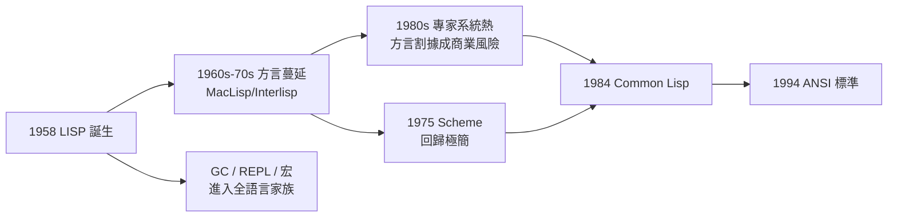

# 4.3 LISP 標準化與程式語言史定位（1980–2000）

1980 年代，LISP 從「AI 的母語」變成「商業 AI 的戰場」：專家系統熱潮帶動 LISP 機（Lisp machine）產業，也帶來方言割據。這個十年以 **Common Lisp** 的誕生收尾，而麥卡錫在這段歷史中的角色很特別——他是**創造者，但不是獨裁者**：標準化由社群完成，他樂於退居精神領袖。

## 方言的戰國時代

- 到 1980 年初，LISP 已分裂出 MacLisp、Interlisp、ZetaLisp、Franz Lisp 等主要方言，互不相容；
- 專家系統的商業熱潮放大了分裂的代價：企業不敢押注隨時會死的方言；
- LISP 機公司（Symbolics、LMI）靠硬體+方言綁定賺錢，也加深了壁壘；
- 標準化的呼聲在 1981 年由 ArpaNet 上的社群自發啟動——這是網路時代「開源治理」的早期標本。

## Common Lisp：1984

- 以 Richard Steele、Guy Steele 為主的「scavenger hunt」社群過程，於 1984 年出版 **Common Lisp the Language**（CLtL1）；
- Common Lisp 的原則是「**最大公約數＋前瞻擴充**」：納入詞法作用域（源自 Scheme，1975，Sussman 與 Steele）、CLOS 物件系統、condition 系統；
- 麥卡錫對此的態度極具他的風格：他**沒有主導**，只提了幾條意見，並公開說「Common Lisp 有些複雜，但它是有紀律的複雜」；
- 1988 年 ANSI 啟動標準化，1994 年 ANSI Common Lisp 定案——LISP 成為第一個有 ANSI 標準的函數式語言。

## Scheme 的插曲與麥卡錫的評語

- 1975 年 Sussman 與 Steele 做出的 Scheme，用「applicative order＋lambda 形式」回歸麥卡錫 1960 論文的最純粹版本；
- 麥卡錫對 Scheme 的「極簡主義」欣賞有加——那正是他當年論文的品味；
- 他晚年對 Common Lisp 的龐雜有些惋惜：「**如果重來一次，我會做得更小**」——這句話成為語言設計史上被反覆引用的教訓；
- 函數式譜系的其餘分支（ML、Haskell、日後的 Scala、Clojure、JavaScript 的 first-class functions）全是 lambda 演算—LISP 血統的遠親（→《邱奇傳記》第 5 章）。

## 程式語言史上的定位

把 LISP 放回程式語言年表，可見其位階之高：

| 年份 | 語言 | 傳承 |
|------|------|------|
| 1957 | FORTRAN | 命令式、批次 |
| 1958 | LISP | 函數式、互動、GC |
| 1972 | C | 系統程式、指標 |
| 1975 | Scheme | LISP 極簡化 |
| 1984 | Common Lisp | LISP 標準化 |
| 1995 | Java/JavaScript | GC 與動態性進入主流 |

- **垃圾回收（GC）**：1959 年麥卡錫為 LISP 發明，今日 Java、Python、Go、JavaScript 全部內建——這是「AI 發明、全世界繼承」的典型；
- **REPL 與互動開發**：LISP 1958 年首創，今日的 Jupyter、瀏覽器 console 都是它的後代；
- **程式即資料（homoiconicity）**：宏（macro）系統、領域特定語言（DSL）的思想源頭；
- **樹狀結構與遞迴**：JSON、XML、DOM 的「巢狀符號表示」直系血親。

## 1980s–90s 的麥卡錫與 LISP

- 專家系統泡沫在 1987 年破裂，LISP 機產業崩潰，LISP 在主流工業界退潮——「**AI 的冬天也是 LISP 的冬天**」；
- 但在學界 LISP 仍是 AI 教科書的通用語（Norvig 的 *Paradigms of AI Programming*, 1992 是巔峰之作）；
- 麥卡錫在這二十年的定位是**史官**：他寫了 *History of Programming Languages* 中的 LISP 章節，留下關於設計決策（GC、S-expression、遞迴）的第一手敘述；
- 他一句被引用最多的話是：「**LISP 的成功證明了想法比實作重要；它的方言亂象證明了標準比英雄重要**」。

## 創造者的退場哲學

麥卡錫在 LISP 標準化中的「不主導」，本身就是一段值得記錄的歷史：

- 1981 年的標準化討論中，社群曾討論是否請他「定奪」爭議——他婉拒了；
- 他的理由是原則性的：「語言應該服務使用者社群，而不是服務發明者的自尊；我 1960 年的品味不該是 1984 年的枷鎖。」
- 但他保留了**批評權**：Common Lisp 定稿後他公開列出「如果是我會改的三件事」（更小的核心、更簡的函數語義、放棄一些歷史包袱）；
- 這種「**讓位而不沉默**」的姿態，成為語言社群治理的範例——對照同期某些語言的「教主式」治理，高下立見；
- 他晚年總結：語言的命運由生態決定，不由品質決定——「LISP 的挫折不在設計，在於它太早出現，沒有等到自己的生態位」；
- 這句話在 2000 年代 Clojure 與函數式復興時，被反覆引用為預言。

## 事件關聯與前因後果

| 年份 | 事件 | 後續影響 |
|------|------|----------|
| 1981 | 社群啟動標準化討論 | 網路治理的早期實踐 |
| 1984 | Common Lisp the Language | 方言整合、商業信心恢復 |
| 1987 | 專家系統泡沫破裂 | LISP 機產業崩潰 |
| 1990 | 麥卡錫出版 Formalizing Common Sense | 理論遺產結集（見 3.2） |
| 1994 | ANSI Common Lisp | 函數式語言首個 ANSI 標準 |
| 1990s | GC 與函數式觀念被主流吸收 | Java/JS 時代的語言基因 |

**因果**：這段的因果鏈是「**泡沫加速了標準化，崩潰保存了遺產**」：商業熱潮讓方言分裂不可容忍，才有了 Common Lisp；LISP 機崩潰逼 LISP 退守學界，反而讓 GC 與函數式觀念以「融入其他語言」的方式活下去。麥卡錫 1960 年發明的三件套（GC、REPL、遞迴語義），在 1990 年代成為所有主流語言的預設配置（見 5.3）。

## 小結

- Common Lisp（1984/1994）是社群治理的產物，麥卡錫選擇退居精神領袖而非主導者；
- Scheme 的極簡復歸，證明 1960 年論文的品味經得起時間檢驗；
- LISP 對程式語言史的貢獻（GC、REPL、homoiconicity、函數式語義）在 1990 年代被主流全面吸收；
- 專家系統泡沫與 AI 寒冬（見 4.2）共同構成 LISP 的工業史轉折；
- 進入 2000 年，創造者的生命也進入最後一章——晚年、去世與紀念（見 5.1）。
