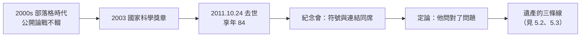

# 5.1 晚年、去世與紀念（2000–2011）

進入二十一世紀，麥卡錫已七十多歲，但他比大多數同輩更早擁抱了新媒介：他是最早上網寫**部落格**的圖靈獎得主之一，在上面與全世界論戰常識推理、氣候、政治。2011 年 10 月 24 日，他在史丹佛附近的家中去世，享年 84 歲——距達特茅斯會議剛好 55 年。

## 晚年的三件事

### 1. 部落格與公開論戰

- 2000 年代，麥卡錫在自己網站與部落格上持續發文，題目橫跨：常識推理的形式化、未來學（太空移民、經濟）、以及政治評論；
- 他以一貫的直率批評過度樂觀與過度悲觀的兩邊：既駁斥「AI 永遠不可能」，也駁斥「AI 快要超人類」；
- 他晚年反覆強調的未竟事項仍是：**常識知識庫與非單調推理的工程化**——「我們已經知道怎麼開始，卻還沒開始認真做」。

### 2. 榮譽的收尾

- 2003 年，獲頒美國國家科學獎章（National Medal of Science）——美國科學界的最高 civilian 榮譽；
- 首屆（1985）IJCAI 卓越研究獎早已入手；日本政府亦曾授勳表彰其學術貢獻；
- 他對這些榮譽的態度一貫淡然，真正的熱情仍放在未解的問題上。

### 3. 對「AI 去了哪裡」的歷史評述

- 他不滿意「AI 失敗了」的敘事，也不滿意「AI 成功了」的浮誇；他的定調是：「**AI 是一門進展比預期慢、但從未停止的科學**」；
- 他承認符號路線的工程緩慢，也警告統計路線的理論空洞——這個「兩邊不討好」的立場，成為他留給 2010 年代最重要的遺言（見 5.2）。

## 2011：去世與紀念

- 2011 年 10 月 24 日深夜，麥卡錫在史丹佛住所去世；
- 葬禮與紀念會上，符號 AI 與連結派、駭客與教授、學生與論敵同席——AI 史上很少有人的告别式能同時聚集這些人；
- 各界悼詞的共同點驚人地一致：**「他問對了問題」**——機器能否思考、常識能否形式化、計算能否公用化；
- 他的子女（Susan、Timothy、Sarah）與第三任妻子 Carolyn Talcott——她本人也是電腦科學家——陪伴他走完最後一程。

## 同代人陸續謝幕

| 年份 | 人物 | 關係 |
|------|------|------|
| 2011.10 | 麥卡錫（84 歲） | AI 命名者、LISP 之父 |
| 2016.1 | Minsky（88 歲） | 達特茅斯共同提案人、終身論友 |
| 2018.3 | 香農已於 2001 謝幕 | 達特茅斯長輩（→《香農傳記》第 5 章） |

- 達特茅斯四人組在半個多世紀內先後離世，一個時代正式落幕；
- 而他們播下的種子恰在此時迎來爆發：2012 年 AlexNet、2016 年 AlphaGo——符號 AI 的建築師們沒能看到深度學習的全盛，Minsky 幾乎趕上，麥卡錫停在黎明前五年（見 5.2）。

## 紀念的具體形式

麥卡錫身後，各界的紀念方式本身就是一部「影響力清單」：

- **史丹佛**設立紀念講座與檔案區，SAIL 舊倉庫的故事被反覆講述；
- **ACM 與 IJCAI** 的訃文都把「命名 AI」放在第一句——歷史記住了他的第一項功業；
- **程式語言社群**（LISP、Scheme、Clojure 各社群）以各自的致敬文紀念這位語言之父，GC 與 REPL 是共同的關鍵詞；
- **部落格時代**的紀念更私人：無數工程師寫下「我第一次讀 Recursive Functions 論文的震撼」——他的 1960 年論文至今仍在程式設計課的必讀清單上；
- 紀念會上有人引用他自己的話作為墓誌：「**He who refuses to do arithmetic is doomed to talk nonsense.**」（拒絕算術的人註定胡言）——這句話總結了他的全部風格：把每個大問題化成可以計算的問題。

## 事件關聯與前因後果

| 年份 | 事件 | 後續影響 |
|------|------|----------|
| 2000 | 退休名譽教授，持續寫作 | 部落格成為理論遺產的公共檔案 |
| 2003 | 國家科學獎章 | 國家層級的蓋棺肯定 |
| 2005–2010 | 對 AI 兩條路線的最終評述 | 「進展慢但未停止」的定調 |
| 2011.10.24 | 去世 | AI 學科失去建國一代 |
| 2012 | AlexNet 引爆深度學習 | 建築師們的問題以新方式被接手 |

**因果**：麥卡錫的去世與深度學習的爆發在時間上緊貼，構成 AI 史最富張力的巧合：**提出問題的人離開時，問題正以他不信任的方法被推進**（見 4.2、5.2）。但紀念的一致基調表明：無論方法如何更迭，「表示知識」的問題——他花了一生的問題——仍在每一代 AI 的議程上。

## 小結

- 晚年麥卡錫以部落格持續論戰，最後的關切仍是常識推理的工程化；
- 2003 年國家科學獎章完成榮譽的收尾；2011 年去世，達特茅斯一代漸次謝幕；
- 他留下的定調——「AI 是進展慢但未停止的科學」——是對兩種極端敘事的最好解毒劑；
- 他的告别式聚集了所有路線的人，因為每條路線都欠他一份「問題清單」；
- 他的理論遺產在他身後經歷了挫折與復興的完整循環——見 5.2。
