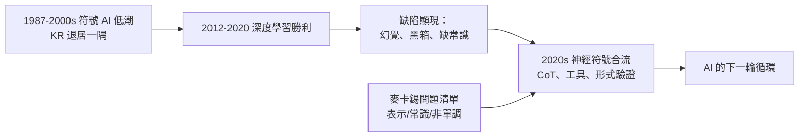

# 5.2 符號 AI 的挫折與復興：知識表示與常識推理（1980–2026）

麥卡錫死後十五年，AI 走完了一個巨大的循環：深度學習征服一切、符號方法被宣告過時、然後——在大語言模型時代——「常識、推理、可解釋」重新成為核心議題。回頭看，他堅持一生的三個論點（表示、常識、非單調推理）以複雜的方式在 2020 年代獲得了部分平反。

## 挫折：符號 AI 的低潮（1990–2010）

- LISP 機崩潰（1987）與兩次寒冬之後，主流 AI 研究轉向**統計學習**；
- 知識表示（KR）領域倖存但退居一角：描述邏輯（description logic）成為語意網（Semantic Web，1999–2007）的邏輯底層——W3C 的 OWL 語言是非單調與形式邏輯思想的直接後裔；
- Cyc 計畫（Lenat，1984–）企圖人工編寫百萬條常識命題——這是 Advice Taker 綱領的最大規模實踐，也是最大規模的受挫：手工知識工程的速度趕不上世界；
- 麥卡錫對 Cyc 的態度是「方向正確、方法可疑」：他認為常識知識庫該有，但**要讓機器自己學與推**，而不是全靠人餵。

## 深度學習的反攻（2012–2020）

- 2012 年 AlexNet、2016 年 AlphaGo、2017 年 Transformer——連結派全面勝利（→ 詳見《Hinton傳記》）；
- 符號 AI 被主流敘事視為「歷史」；麥卡錫式的批評（黑箱、無法解釋、缺乏常識）被當作酸葡萄；
- 但諷刺的是，正是深度學習的缺陷驗證了麥卡錫的三點懷疑（見 4.2）：
  - **對抗樣本與幻覺**：模型以統計相關性作答，毫無「理由」可言；
  - **無法信任**：無法給出可檢驗的推理鏈；
  - **常識仍缺**：模型會寫詩，卻答不好「杯子從桌上掉下去會怎樣」這類物理常識題。

## 復興：神經符號與 LLM 時代（2020–2026）

- 2020 年代，兩條路線開始合流：
  - **神經符號（neuro-symbolic）**：以神經網路做感知，以符號系統做推理與驗證——自駕車、數學證明輔助（如形式化數學與定理證明器）中已現雛形；
  - **LLM 與工具/形式化結合**：大模型被接到符號求解器、程式直譯器、知識圖譜上，用外部符號系統補推理的洞；
- 「Chain-of-thought」提示使 LLM 產生顯式的推理步驟——這在哲學上正是麥卡錫式的訴求：**推理應該可表示、可檢驗**；
- 非單調推理的課題以新面目回歸：LLM 的「信念修正」「例外處理」，正是 1980 年限界（circumscription）要解的問題（見 3.2）；
- 研究界重新閱讀麥卡錫：Advice Taker、情境演算、限界成為常識推理 benchmark 與 agent 架構討論的標準引文。

> 這場復興有一個跨越百年的呼應：卡爾納普 1950 年代的歸納邏輯（→ 詳見《卡爾納普傳記》第 4 章）夢想「把理性決策形式化」，達特茅斯會議上 Solomonoff 的歸納機率理論（見 2.2）是其計算版，而今日 LLM + 機率推理則是其工程版。形式化常識的宏願，三代人接力。

## 麥卡錫問題清單的現況（2026 視角）

| 麥卡錫的問題 | 現況 |
|--------------|------|
| 常識能否形式化 | 部分形式化（情境演算、描述邏輯）；LLM 以隱式方式部分掌握 |
| 非單調推理 | 理論成熟；LLM 時代以信念修正的形式重新需要它 |
| 框架問題 | 在物理模擬與 agent 架構中仍活躍 |
| 知識表示 | 知識圖譜＋向量表示的混合體是主流 |
| 機器能否思考 | 仍開放；但「智慧=符號處理」的獨斷已被雙方共同放棄 |

## 「什麼是 AI 的下一個冬天」：麥卡錫式提問的當代價值

麥卡錫留給 2020 年代最有價值的，或許不是任何具體結論，而是**他的提問方式**：

- 他會先問：這個系統**知道什麼**？以什麼形式知道？——這是表示問題，對 LLM 同樣成立；
- 他會問：它**能改主意嗎**？面對反例，信念修正的機制是什麼？——這是非單調推理問題；
- 他會問：它能**說出理由**嗎？理由可以被機器檢查嗎？——這是可解釋性問題；
- 他會問：這些能力是**學到的還是寫死的**？知識能否積累、傳遞、驗證？——這是 Advice Taker 的原始問題；
- 這四問構成一份「麥卡錫測試」：任何自稱有常識的系統都應接受它；
- 2026 年的 agent、知識圖譜、形式驗證與 LLM 的結合，本質上是在不同架構下重答這四問——鐘擺會繼續擺，問題清單不會過時；
- 這正是麥卡錫作為「問題定義者」的最終地位：**他留下一套提問，比留下任何答案都持久**。

## 事件關聯與前因後果

| 年份 | 事件 | 後續影響 |
|------|------|----------|
| 1984 | Cyc 啟動 | Advice Taker 綱領的最大實踐與教訓 |
| 1999 | 語意網/OWL | 邏輯 AI 在 web 標準中延續 |
| 2012 | AlexNet | 連結派全面接管 |
| 2017 | Transformer | LLM 時代開啟 |
| 2022 | ChatGPT | 常識與可解釋重新成為核心議題 |
| 2020s | 神經符號復興 | 麥卡錫的問題清單被重新接手 |

**因果**：這七十年的因果節奏是「**鐘擺**」：符號許諾過高 → 寒冬 → 統計勝出 → 統計的缺陷重現符號要解的問題 → 合流。麥卡錫在鐘擺兩端都留下了定理與警告——他的正確不在「符號必勝」，而在「**無論用什麼模型，知識的表示與推理的正確性都是繞不開的問題**」。

## 小結

- 1990–2010 符號 AI 退潮，KR 以描述邏輯、語意網、Cyc 的形式苟存，教訓是「手工知識工程不可擴展」；
- 2012–2020 深度學習勝利，卻以幻覺與黑箱重演了麥卡錫的三點批評；
- 2020 年代神經符號合流、CoT 與形式化工具興起，麥卡錫的問題清單被重新接手；
- 麥卡錫的最終定位：不是「勝利的一派」的旗手，而是**問題的正確定義者**；
- 而他身後留下的工程遺產（LISP、GC、分時）比理論更早、更全面地滲入現代運算——見 5.3。
