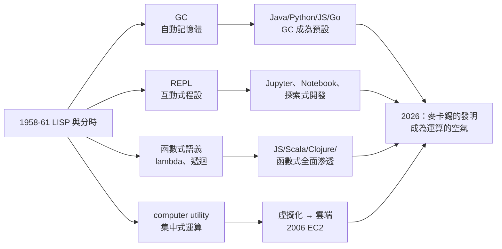

# 5.3 LISP、GC、分時對現代運算的遺產（1980–2026）

麥卡錫常說，他最滿意的作品不是任何一個 AI 程式，而是 **LISP**——因為它活得比所有批評都久。二十一世紀的程式設計師每天使用的垃圾回收、互動式直譯器、函數式語法、雲端訂閱式運算，全是 1958–1961 年那個 MIT 地下室裡發明的思想。這一章總結麥卡錫的工程遺產如何成為現代運算的「空氣」。

## 遺產一：垃圾回收（GC）

- 1959 年，麥卡錫為 LISP 發明 GC：程式不必手動還原記憶體，系統自動找出「不再被引用」的物件回收之；
- 這個發明改寫了「程式設計師的心智負擔」：從記憶體管理中解放，專注於邏輯；
- 傳播史：LISP（1959）→ Smalltalk（1970s）→ Java（1995，GC 成為主流語言標配）→ Python、JavaScript、Go、C#——**今日最流行的語言全部內建 GC**；
- Rust 的出現（2015）證明了對稱命題：即使在手動記憶體的陣營，人們也在尋找「不靠 GC 的自動安全」——無論哪邊，麥卡錫定義的問題（自動記憶體安全）都仍是中心議題；
- 他的 GC 想法還催生了「**不變式與堆的數學**」——日後形式化驗證、指標邏輯（separation logic）的研究對象。

## 遺產二：互動式程式設計（REPL）

- LISP 的 read-eval-print 迴圈發明了「**對話式編程**」：寫一行、立刻看到結果；
- 這條線直通 1970 年代的 UNIX shell、1990 年代的 Python IDLE、2000 年代的 IPython，以及 2010 年代的 **Jupyter Notebook**——資料科學的標準工作台；
- 「**探索式程式設計**」今日是一切科學計算、機器學習工作流程的預設：模型訓練、資料分析、快速原型，全在 REPL 邏輯上運轉；
- 麥卡錫當年的動機很純粹：AI 的程式要與環境對話（見 2.3），互動式工具是這個對話的人機介面。

## 遺產三：函數式與「程式即資料」

- 一等函數、遞迴、lambda 語法：從 Scheme 到 JavaScript 的 `function`，從 Haskell 到 Scala、Clojure——**函數式思想已滲入所有主流語言**（→《邱奇傳記》第 5 章的譜系）；
- Homoiconicity（程式即資料）的直接後代：LISP 宏、SQL 的查詢即資料、JSON 配置即程式、以及 LLM 時代的「**prompt 即程式**」——自然語言提示本身就是一種被直譯的 S-expression；
- LISP 沒有贏得市場，卻贏得了「**觀念的全部**」：Paul Graham 的名言可為註腳——「每種語言都在變得越來越像 LISP」。

## 遺產四：分時 → 雲端

- 1959 年的 computer utility 願景（見 3.3），在 PC 時代被埋沒，於 2000 年代全面復活：
  - **虛擬化**（1970s IBM CP/CMS，分時技術的直系後代）→ **雲端運算**（2006 AWS EC2）：按量計費、彈性供應、像電力一樣取用；
  - **瘦客戶端**的復活：瀏覽器即終端機，Chromebook 是 1965 年「家庭終端」設想的量產版；
  - **多租戶（multi-tenancy）**：一台伺服器安全地服務成千上萬陌生使用者——正是分時系統要解的原題；
- 今日運算的商業形態（SaaS、按用量付費、集中式資料中心）與麥卡錫 1961 年的描述幾乎逐字吻合；
- 他的經濟學論證（規模經濟＋計量收費）成為雲端產業的商業教科書。

## 開源文化與駭客倫理的分時根源

- SAIL 與 MIT 的分時系統培養了「**檔案共享、程式公開、用戶互助**」的習俗；
- 這條線經 Unix 社群、1983 年 Stallman 的 GNU 計畫、1991 年 Linux，成為今日的**開源運動**；
- 麥卡錫本人不是開源政治家（他甚至批評過某些駭客文化現象），但**分時系統的物質條件**（共用機器＋共享檔案）是駭客倫理的溫床——基礎設施塑造文化的又一例證（見 3.1、3.3）。

## LLM 時代的最後一次驗證

有趣的是，麥卡錫的遺產在 2020 年代的大語言模型浪潮中又完成了一次驗證：

- **LISP 與 S-expression**：LLM 對符號結構（JSON、S-expression、Lisp 程式碼）的處理能力，證明「巢狀符號表示」是智慧系統的通用介面——訓練資料裡六十年的 LISP 代碼成為模型的邏輯教材；
- **REPL**：2020 年代的「程式碼直譯器代理」（code interpreter agents）把 REPL 變成 AI 的手——麥卡錫發明的互動迴圈，如今由 AI 自己使用；
- **分時**：LLM API 的呼叫模式正是「computer utility」：集中供應、按 token 計費、終端（chat 介面）在手；
- **GC**：連記憶體管理的思想都在回歸——agent 的「上下文回收」問題，就是垃圾回收問題的變體；
- 一位 2011 年去世的學者，他的四項發明全部成為 AI 新紀元的基礎設施——這種「跨世代的複利」，在電腦科學史上罕有匹敵者。

## 事件關聯與前因後果

| 年份 | 發明 | 現代後裔 |
|------|------|----------|
| 1958 | LISP 語言 | 函數式編程、JS、Clojure |
| 1959 | 垃圾回收 | Java、Python、Go 的 GC |
| 1959 | 分時構想 | 虛擬化、雲端運算 |
| 1960 | REPL | Jupyter、瀏覽器 console |
| 1960 | 程式即資料 | 宏系統、DSL、prompt 工程 |
| 1965 | SAIL 共享檔案文化 | 開源運動的史前史 |

**因果**：這些遺產的共同因果特徵是「**發明於 AI、成熟於別處**」：GC 為了符號計算而生，卻成為企業軟體的標配；分時為了 AI 互動而生，卻成為雲端的原型；REPL 為了棋程式而生，卻成為資料科學的工作台。**麥卡錫用解 AI 問題的方式，順手解了整個運算業界的問題**——這是「基礎研究外溢」的教科書案例。

## 小結

- GC、REPL、函數式語義、分時——四項 1958–1961 年的發明，全部成為 2026 年運算的預設；
- LISP 輸了市場、贏了觀念，「所有語言都在變得像 LISP」；
- computer utility 願景以雲端運算的形態全面兌現，商業邏輯與其 1960 年代論證一致；
- 分時系統的共享文化是開源運動的物質溫床；
- 回到全書起點：1927 年波士頓移民家庭裡自學的孩子，最終同時改變了「機器如何思考」與「人如何使用機器」——一個人同時是兩部歷史的作者，這就是麥卡錫的完整遺產。
