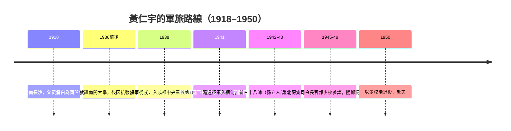

# 01.1 軍旅歲月：抗戰、緬甸與「底層的凝視」

## 一、案發現場：一個排長的帳本

每一樁思想懸案，都有它的第一現場。黃仁宇案的第一現場，不在任何圖書館或書房，而在1940年代中國軍隊的行軍帳篷裡——一個年輕軍官攤開的、永遠對不攏的帳本。

這個細節值得放在開頭：**日後以「數目字管理」震動史學界的黃仁宇，最初接觸「數目」，不是在統計課上，而是在部隊的伙房與軍械庫門口。** 士兵領不到足額的彈藥與糧餉；名冊上的兵額與實際列隊的人數對不上；師級單位的財政像一個沒人敢打開的黑箱。他在戰場上看到的敵人固然是日軍，但在戰場背後，他看到另一個更沉默的敵人——**一個無法用數目精確管理的國家**。這個凝視，將跟隨他三十年，橫越太平洋，最終凝結成一套解釋中國為何「未能現代化」的大歷史理論。

要理解《萬曆十五年》為何長成那個樣子，必須先回到這些帳篷。

## 二、長沙世家與「遲到的革命者之子」

黃仁宇，1918年生於湖南長沙。他的父親黃震白，是同盟會時代的老革命——這一出身在黃仁宇的自述《黃河青山》中反覆浮現：父親那一輩人推翻帝制、締造民國，滿懷著「革命成功之後中國自然會好」的期待，然而民國帶來的卻是軍閥割據與更深的混亂。黃震白晚年退出政治、任職基層，把對革命的失望收進沉默裡。

這份家世給了黃仁宇雙重的遺產。其一是**問題意識**：他從小就知道，「趕走了皇帝」不等於「建立了國家」——一個現代國家需要的遠不止一紙約法。其二是**距離感**：父親的失落教會他不迷信任何口號，凡是宣稱一步到位的方案，他一律先用懷疑的目光打量。日後他對國民黨「在上層變革、不動下層結構」的批評，對共產黨「翻轉下層卻築起新高牆」的觀察，根子都在長沙那個沉默的舊革命者家中。

黃仁宇先就讀南開大學。就在此時，盧溝橋的炮聲響起，南開校園被日機炸毀——中國近代史上第一所被整體炸毀的大學。輟學、流亡，然後是那個時代知識青年的標準岔路：繼續讀書，還是投筆從戎？黃仁宇選了後者。多年後他在回憶中說得平淡，彷彿這不是選擇而是呼吸：**國家都沒了，讀書做什麼？**

## 三、軍校、排長與長沙會戰

他考入成都中央軍校第十六期。這所戰時速成的軍校，訓練的粗糙程度本身就是一個時代證詞：裝備匱乏、教材陳舊、教官素質參差——一個倉促動員的國家的縮影。1940年前後畢業後，他被派往第十四師，先任排長，後調任參謀，隸屬鄭洞國麾下，親歷1941年前後的長沙會戰。

在長沙前線，黃仁宇完成了他對中國軍隊的第一次「實地調查」。他日後反覆講述的細節，皆非英雄敘事：士兵的草鞋在冬季行軍中磨穿，餉銀經層層盤剝到手所剩無幾；機關槍的數量以「挺」計而非以「營」計；傷兵的後送系統近乎不存在。他在自述中承認一個令後世讀者心驚的事實——**他做排長時，甚至無法給全排每個士兵配發一支狀況良好的步槍**。這不是勇氣問題，是國家能力的問題。

正是在這裡，「底層的凝視」成形了。軍官學校教的是地圖上的戰略，而排長看到的是地圖上看不見的東西：一雙赤腳、半袋糙米、一挺卡殼的機槍。**歷史的成敗，不在將軍的地圖上，而在士兵的草鞋裡。** 這句話黃仁宇沒有這樣寫過，但他一生的寫作都在證明這句話。

## 四、緬甸：野人山與瓦魯班

1942至1943年，黃仁宇隨中國遠征軍入緬甸，這是他軍旅生涯的高峰，也是他凝視的深化。他被派往新三十八師——孫立人的部隊——擔任聯絡參謀之類的職務，隨部隊在緬北的叢林與山地中作戰，親歷野人山地區的艱苦轉進與後來反攻階段的瓦魯班之役。

緬甸經驗給了他三層震撼。

**第一層：現代化裝備一旦存在，中國士兵立刻能打。** 遠征軍接受美式補給與訓練的部隊，戰鬥力與國內戰場判若兩軍。這證明了問題不在「民族性」——中國士兵不比任何人差——而在於供應與組織系統。這一觀察，日後成為他反駁一切「國民性論述」的底牌。

**第二層：後勤即命運。** 緬北戰役本質上是一場補給戰。誰能修路、誰能空投、誰的卡車能開到前線，誰就贏。黃仁宇在叢林裡看到的，是「數目字」以最原始也最殘酷的方式決定生死：油料的桶數、彈藥的噸位、擔架的容量。**現代戰爭是帳本的戰爭**——而他所屬的國家，帳本是糊塗的。

**第三層：他親手觸摸過死亡。** 黃仁宇在緬甸曾中彈負傷，也在戰鬥中近距離目擊同袍與日軍士兵的死。他日後寫作那種冷靜到近乎冷酷的筆調——不煽情、不控訴、把人物放進結構的夾縫裡觀察——的氣質根源，就是這片叢林。見過太多口號與死亡之間的落差的人，很難再對任何宏大敘事保持虔誠。

## 五、長春：親眼目擊一個政權的帳本崩潰

抗戰勝利後，黃仁宇調任東北保安司令長官部少校參謀，隨鄭洞國進駐長春。這一段經歷，他當時未必意識到分量，但它直接餵養了他數十年後的《從大歷史的角度讀蔣介石日記》。

在東北，他以參謀之職接觸到國民黨軍政系統的內部視角：軍隊吃空餉已成常態化的會計技術；師級單位的財政是一筆誰也說不清的爛帳；通貨膨脹以月為單位摧毀官兵的實際所得；而高層的戰略部署與前線的資源現實之間，隔著一道無法測量的鴻溝。長春圍城前後的崩解，在他眼中不只是軍事失敗，而是**一個政權的帳本當眾破裂**——它無法統計自己的資源，因此無法指揮自己的命運。

共產黨為何贏？黃仁宇的答案與當時流亡者的悲憤敘事不同，也與後來教科書的意識形態敘事不同。他的答案冷得像參謀報告：**哪一方能把人力、糧食、彈藥以可核查的數目動員起來，哪一方就贏。** 國民黨的統治是「上層的統治」，數目從未穿透到基層；共產黨以土地革命重建了基層的統計與動員。成敗在帳本，不在口號。

## 六、偵查結論：「數目字管理」的軍中起源

把線索收攏。黃仁宇日後的核心理論——中國傳統社會「無法作數目字上的管理」（mathematically unmanageable），故無法進入現代——通常被讀者理解為純粹的史學命題，用來解釋萬曆十五年的明朝。但本節的偵查顯示，這個命題的原始碼是**1940年代的行軍帳篷**：

一個士兵的草鞋，是一次補給統計的失敗；一個吃空餉的連隊，是一張假名冊；一場輸掉的會戰，是一系列無法彙總的數目。當他把這套凝視投向四百年前的明朝——皇帝無法核查全國田賦，文官集團以道德話語代替技術治理——兩個時代在他腦中疊印了。**萬曆十五年的官僚們，與長春的參謀們，面對的是同一個敵人：一個大到無法用數目掌握的國家。**

這就是「底層的凝視」的力量：它不是立場，而是方法。從底層看，歷史不是帝王將相的動機史，而是稅率、糧秣、槍械完好率與運輸能力的總和。黃仁宇把這個方法命名為「大歷史」（macro-history），但它的出生證明上，寫的職業是：排長。

1950年，他以上校銜（自述所記為少校職務退役，階級記載在其自述與回憶文字間略有出入，據其自述為少校）離開軍隊，遠走美國。帶走的行李很輕：一個問題，和十萬個看過的數目。

## 本節要點

- 黃仁宇1918年生於長沙，同盟會元老之子；抗戰爆發後自南開輟學從軍，成都中央軍校第16期出身。
- 歷任排長、參謀，親歷長沙會戰與中國遠征軍緬北作戰（野人山、瓦魯班），並曾負傷。
- 戰後任東北保安司令長官部少校參謀，在長春近距離目擊國民黨政權的財政與動員崩解，此經驗直接餵養《從大歷史的角度讀蔣介石日記》。
- 「數目字管理」的問題意識源於軍中底層經驗：補給不足、吃空餉、師級財政黑洞——現代化成敗繫於一國能否以數目穿透基層。

## 延伸對照

- 明帝國的財政困局與王朝終局，見 [../../世界史/國家滅亡史/1644-明朝.md](../../歷史探案/世界史/國家滅亡史/1644-明朝.md)。
- 一條鞭法：帝國試圖「用白銀把統治數目化」的一次失敗嘗試，見 [../../世界史/東亞史/1581-一條鞭法與白銀帝國.md](../../歷史探案/世界史/東亞史/1581-一條鞭法與白銀帝國.md)。
- 同一時代西方對「數目字管理」的完成式——亞當．斯密筆下的國民財富核算，見 [../../世界史/世界發展史/1776-國富論與獨立.md](../../歷史探案/世界史/世界發展史/1776-國富論與獨立.md)。
