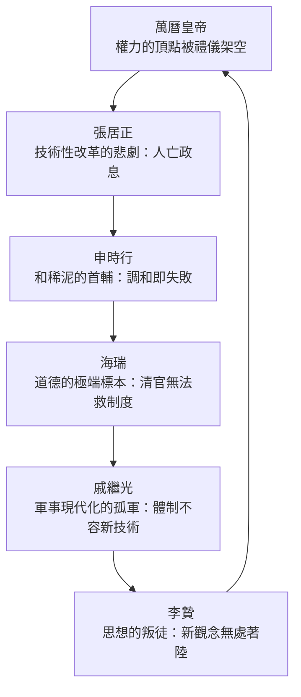
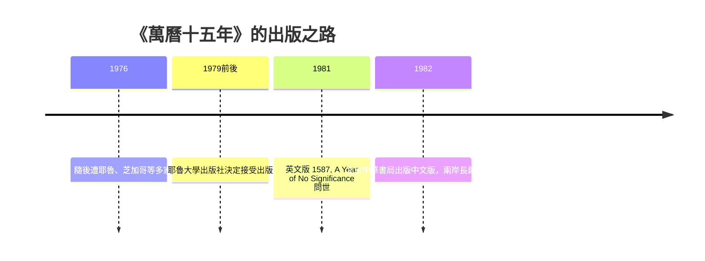

# 01.3 《萬曆十五年》：被退稿多次的奇書

## 一、案發現場：一疊退稿信

1970年代後半，美國的出版社與大學出版社的收發室裡，流轉過一疊與眾不同的退稿信。被退的書稿是一部分析1587年明朝的著作，作者是一位紐約州立大學紐帕茲分校的華人教授。退稿理由大同小異：**沒有注釋體系，不是嚴格的學術著作；不是連貫的敘事，又不是標準的通俗讀物；體裁——六篇相互關聯的人物傳記——不倫不類。** 耶魯、芝加哥等大學出版社的評審意見，反覆在「不合規範」四個字上打轉。

據黃仁宇自述，這部完成於1976年前後的英文稿（1587, A Year of No Significance）在多家出版社間輾轉被拒，歷時數年。最終，耶魯大學出版社在1979年前後決定接受這部「規範之外的書」，英文版於**1981年**問世。接著是更不可思議的下半場：中文版《萬曆十五年》於**1982年由北京中華書局出版**——一部由前國民黨軍官寫成、在美國被大學出版社挑挑揀揀的書，以簡體字版在中國大陸正式出版，隨後通行兩岸，暢銷數十年，成為中文世界影響最深遠的歷史讀物之一。

一疊退稿信，一個出版傳奇。懸案的問題是：**評審們看得見的「缺陷」，為何恰恰是這本書力量的來源？**

## 二、寫作動機：教室裡的無力感

退稿信解釋不了這本書為何被寫出來。動機要回到紐帕茲的教室。

黃仁宇在紐帕茲給美國大學生教中國史。他很快撞上教學的牆：學生不需要再多一套斷代知識——他們記不住明朝的年號與官名，記住了也沒有意義。學生真正想知道的，是那個大而無當的問題：**「為什麼這個文明如此悠久、如此精緻，卻沒有自己走向現代？」**

把這個問題翻譯成課堂可用的形式，斷代史做不到，專題史也做不到——問題本身是縱貫的。黃仁宇的解法，是在1587年這個「全年無大事」的年份上開一刀：**萬曆十五年，四海昇平，無戰爭、無政變、無天崩地裂——但正是在這個無事之年，這個帝國所有導致它最終無法自我更新的結構，都已完備且靜靜運轉。** 用他自己的話說：大明帝國已經走到了它發展的盡頭，而當時的人渾然不覺。這是「大歷史」的第一次公開亮相：不問人物對錯，只問結構是否還有出路。

這個設計同時解決了寫作難題：它必須讓完全不懂中國的美國學生讀得下去，又必須承載嚴肅的結構分析。傳記，是唯一同時滿足兩者的載體。

## 三、六個人物的偵查結構

《萬曆十五年》的章節結構，表面是六篇人物傳，實際是一張**相互鎖死的結構診斷圖**：六個人，六種身份，六次試圖讓帝國運轉得更好的努力，六次失敗——而且失敗的方式互為因果。

**萬曆皇帝**：帝國名義上的最高決策者，實際上被文官集團以禮儀與成憲架空。他想立自己喜歡的兒子為太子而不可得，最終以數十年不上朝的消極抵抗報復整個體制。黃仁宇的診斷：**當制度以道德代替法律，連皇帝本人都是囚徒。**

**張居正**：帝國最後一次技術性改革的主持者（清丈田畝、一條鞭法，見延伸對照）。他死後被清算，改革人亡政息。診斷：在無法以數目核查的體制裡，任何改革只能依附於個人權勢，因此必然隨個人倒台。

**申時行**：張居正的繼任者，看透了改革的代價，選擇做「和稀泥的大師」，以調和文官集團的裂縫為職業。診斷：**當結構性問題無解，能幹的首輔只能把崩潰的日子往後挪。**

**海瑞**：帝國道德的極端樣本——清到無可挑剔，也無用到無可挽救。他試圖用最嚴格的道德標準行事，卻被整個官僚系統當成不便處置又不敢使用的怪物。診斷：道德是體制的裝飾語言，不是運轉機制。

**戚繼光**：抗倭名將，帝國少數清醒的軍事現代化者。他在文官體制的夾縫中勉強練出新軍，張居正一倒即遭棄置。診斷：**一個視技術為「奇技淫巧」的體制，連自己的國防現代化都容不下**——這一節與黃仁宇的軍旅經驗重疊得最深。

**李贄**：離經叛道的思想家，質疑一切正統，最終在獄中自刎。診斷：帝國沒有為異端思想提供任何著陸點，新觀念只能是私人絕望。

六人合觀，是同一句判詞：**1587年的中國，所有個體都清醒或半清醒，但體制不容許任何清醒轉化為改變。** 這就是「大歷史的失敗」——不是某人的失敗，是結構的失敗。

## 四、退稿的理由，成書的理由

現在回到退稿信。評審們的指控全部屬實：無注釋體系（書末的資料來源說明不是學院式的逐腳注）、六傳體不合斷代史規範、敘事與分析混融。但本書的偵查顯示，這些「缺陷」每一項都是設計：

- **不用逐腳注**，因為目標讀者是課堂上的學生，不是評審委員；
- **用六個人物**，因為結構分析必須有人物才讀得下去——這是新聞訓練的殘留；
- **敘事與分析混融**，因為他的論點本來就長在故事裡：戚繼光的困境本身就是論證。

換句話說，這本書是軍旅（問題）、新聞（文體）、學院（檔案）三種訓練的合流產物，而1980年前後的美國大學出版社的評審制度，恰恰是為單一訓練的產品設計的過濾器。**書沒有錯，是格子的尺寸錯了。**

耶魯的最終接受，坊間常歸功於個別賞識的學人與編輯的支持（據其自述，過程中確有學界友人多方奔走推薦）；具體內情文獻記載不一，但結果無可爭議：1981年英文版問世後，學界與讀書界同時接受——它既被史家認真對待，又被普通讀者一口氣讀完。

## 五、下半場：1982，中華書局

更富戲劇性的是中文版的命運。1982年，北京中華書局出版簡體字版《萬曆十五年》——此書作者曾以國民黨少校身份在東北與共軍對峙三十七年，如今他的書成為中國大陸大學生與知識分子的必讀書。此後數十年，此書在兩岸反覆再版，長銷不衰，「大歷史」一詞進入中文日常語彙，無數讀者透過它第一次理解「結構」與「道德敘事」的區別。

這個結局有一個冷峻的註腳：黃仁宇本人一生以「講給英語世界聽」為職志，而他最大的讀者群在中國。**一個用英文寫作的歷史學家，最終以中譯本改變了中文世界。** 他晚年的《黃河青山》以極大的篇幅自辯其學術處境，讀來不無孤憤；但他大概知道，《萬曆十五年》已經替他贏了那場退稿信們所代表的戰爭。

## 六、偵查結論：奇書的公式

把三節線索合併，可以寫出一條「奇書公式」：

$$
\text{奇書}=\underbrace{\text{軍旅的問題}}_{\text{數目字管理}}\times\underbrace{\text{新聞的文體}}_{\text{六傳並置}}\times\underbrace{\text{學院的檔案}}_{\text{明實錄與財政史料}}\times\underbrace{\text{退稿的淬鍊}}_{\text{十易其稿}}
$$

連乘的意義：任何一項為零，此書不存在。沒有緬甸的叢林，就沒有「為何無法數目字管理」的問題；沒有密西根的新聞碩士，就沒有讓美國學生讀得下去的文體；沒有博士訓練，就沒有支撐全書的明史檔案；沒有多年退稿，就沒有把每一句話磨到極限的十易其稿。《萬曆十五年》不是天才的靈光，是一個人用前半生的每一種身分，向同一個問題發起的合圍。

而被退稿的歷史還給了它最後一重公道：**凡是評審制度放行的書，往往只有評審制度在讀；凡是評審制度拒絕過的書，反而必須靠讀者一票一票重新投出它的地位。《萬曆十五年》兩岸數十年的長銷，就是這場投票的結果。**

## 本節要點

- 《萬曆十五年》英文稿1976年前後完成，被耶魯、芝加哥等多家大學出版社以「無注釋體系、體裁不合規範」為由多次退稿，1979年前後終獲耶魯接受，1981年英文版出版。
- 中文版1982年由北京中華書局出版，隨後在兩岸長銷數十年，「大歷史」成為中文世界的重要概念。
- 寫作動機源於紐帕茲教學：學生需要的不是斷代知識，而是「為何明代無法走向現代」的結構性解答；1587年這個「無事之年」正是結構診斷的切口。
- 全書以萬曆、張居正、申時行、海瑞、戚繼光、李贄六人構成鎖死的結構診斷圖：六種改革努力、六次體制性的失敗。
- 退稿理由（無注釋、六傳體、敘事混融）正是該書力量的設計來源：軍旅、新聞、學院三種訓練的合流產物。

## 延伸對照

- 張居正改革的核心——一條鞭法與帝國的白銀財政，見 [../../世界史/東亞史/1581-一條鞭法與白銀帝國.md](../../歷史探案/世界史/東亞史/1581-一條鞭法與白銀帝國.md)。
- 1587年診斷的終局——六十四年後的崩潰，見 [../../世界史/國家滅亡史/1644-明朝.md](../../歷史探案/世界史/國家滅亡史/1644-明朝.md)。
- 同一時代的西方正以另一套「數目字管理」組織國家與市場，見 [../../世界史/世界發展史/1776-國富論與獨立.md](../../歷史探案/世界史/世界發展史/1776-國富論與獨立.md)。
