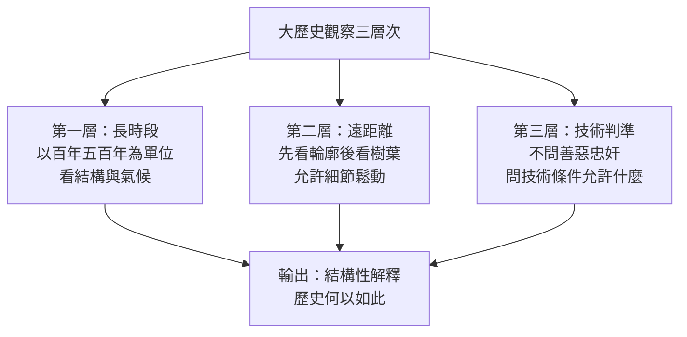

# 02.1 何謂大歷史：從技術的角度長時間遠距離看歷史

## 一、案發現場：一個自創名詞的誕生

每一樁思想懸案，都始於一個不合常規的動作。黃仁宇的動作是：**自創一個史學界沒有的名詞**——「大歷史」（macro-history）。

這個名詞不是從任何學院課綱裡抄來的。1970年代，黃仁宇在紐約州立大學紐普茲校區教書，講授中國史，面對的窘境是：西方學生對中國歷史的印象，是由無數人名、年號、政爭、宮廷陰謀堆積而成的迷宮——皇帝換了一百多位，宰相記不住幾個，朝代興亡像流水帳。傳統敘事把歷史寫成了**人的故事**，卻沒有寫出**結構的邏輯**。學生背得越多，越糊塗。

黃仁宇的解法不是把故事講得更好聽，而是**把鏡頭整個拉遠**。他後來在《萬曆十五年》《中國大歷史》《資本主義與二十一世紀》中反覆示範的，是一種近乎工程製圖的操作：先畫等高線，再畫建築物，最後才輪到窗框上的雕花。他自創「大歷史」一詞，正是要宣告：**歷史學家的工作，不是評判歷史人物的道德，而是說明歷史何以如此——以技術上的條件、長時間的尺度、遠距離的視野。**

本案要偵查的是：這個方法從何而來？它究竟在操作上做了什麼？它與同時代其他宏觀史學——尤其是法國年鑑學派——是同路人還是陌路？

## 二、核心操作：三個拉遠的動作

「大歷史」不是一個理論體系，而是一套**操作程序**。拆開來看，是三個連續的「拉遠」動作。

### 動作一：拉長時間尺度

傳統史學的計時單位是年——某年某月某人做了某事。黃仁宇把計時單位改成**百年與五百年**。

最著名的示範是《中國大歷史》。全書以不到二十萬字處理三千餘年，平均每個世紀分不到七頁。在這個尺度下，許多「重大事件」縮小成噪點，而原本被忽略的慢變數浮出水面：**土地兼併的速率、貨幣制度的成熟度、文官考試的規模、財政稅收能否數目字管理**。黃仁宇一再強調，秦漢以降兩千年，中國的核心問題其實只有一個——一個如此龐大的農業帝國，在缺乏現代商業法律與金融工具的條件下，如何維持中央集權的「間架性設計」？朝代興亡，不過是這個結構性難題反覆求解、反覆失敗的迭代紀錄。

用他的話說：**在長時段下，人物的善惡像天氣，結構的條件像氣候。天氣天天變，氣候幾百年才變。大歷史研究的是氣候。**

### 動作二：拉遠觀察距離

黃仁宇最愛用的比喻，是從飛機上看泰晤士河（他也用過看紐約哈德遜河的版本）：在飛機上俯瞰，看不到河面上的帆影與岸邊的行人，卻看得見河流蜿蜒的**總體方向**——它如何繞過山地、趨向海洋。反之，站在河邊，帆影清晰、行人可辨，卻永遠說不清這條河往哪裡去。

這個比喻裡藏著一個大膽的取捨：**遠距離必然犧牲細節的精確，換取輪廓的正確**。黃仁宇承認大歷史「不斤斤計較書中人物是否說了某句話」，細節上允許鬆動，但主張：只要長時段的輪廓對了，中間的個案即便有所疏漏，也不影響整體判斷。這就像氣象學不需要知道每一朵雲的水分子數量。

### 動作三：改換解釋的判準——技術取代道德

這是最具革命性、也最引起爭議的一步：**判斷歷史，不以道德為準，而以技術條件為準。**

黃仁宇所謂「技術」，指的是一個社會在當時所擁有的組織能力、財政工具、法律架構、通訊與運輸手段——即「數目字管理」的可行性。他要問的不是「這個皇帝昏不昏」「這個大臣忠不忠」，而是：**在當時的技術條件下，什麼樣的政策根本不可能執行？什麼樣的改革必然失敗？**

三個動作合起來，可以用一張圖表示大歷史觀察的三個層次：

## 三、靈感來源偵查：飛行員、工程師與兩位宏觀史家

一個方法不會憑空出現。追查「大歷史」的出身，至少有三條線索。

**線索一：軍人與工程師的思維習慣。** 黃仁宇的人生軌跡極不「史學院」：天津南開大學理工科輟學，抗戰從軍，在國軍擔任排長、參謀，隨遠征軍入緬甸，戰後又負責過軍中的後勤與文書業務。他晚年自述，從軍經歷教會他的，是**一切宏論都要落到補給線、編制表、彈藥數字上**——口號再動人，前線的士兵還是要吃飯，部隊還是要靠火車與卡車移動。這種後勤學的眼光，正是「技術解釋」的胚胎：歷史的勝敗，先看補給，再論忠奸。工程學的訓練則給了他「間架性設計」的概念——中國帝制在他眼中就是一項超大規模、卻缺乏統計與商業法律支撐的土法工程。

**線索二：宏觀史學的時代刺激。** 戰後的英語世界，湯因比的《歷史研究》以二十一個文明為單位比較興衰，斯賓格勒的《西方的沒落》更早以文明的生命週期為框架。這兩人的體系後來在學院裡聲譽下跌——框架太大、證據太疏。但對黃仁宇而言，它們證明了一件事：**歷史可以以文明為單位書寫，而不必以王朝為單位。** 他吸收的是這個「尺度上的野心」，卻拒絕了兩人的思辨玄學——湯因比的文明「挑戰與回應」律、斯賓格勒的文明「宿命」論，都帶著近乎先知口吻的規律宣稱；黃仁宇的大歷史自始至終拒絕宣稱歷史規律，只宣稱歷史條件。這一區別，將在 02.3 節成為關鍵。

**線索三：個人命運的長時段消化。** 黃仁宇半生顛沛：抗戰流亡、軍中目睹基層士兵的悲慘、來台後又赴美國從大一讀起、年近五十才拿到博士、六十一歲被紐普茲校區解聘。他自述寫大歷史，也是為了給自己一生的際遇找一個**不靠怨恨、也不靠頌揚**的說法——「我讀歷史，是為了把自己前半生的經歷看得清楚」。這種動機使他的方法帶有一種冷靜的宽恕：如果歷史的挫敗是技術條件的產物，那麼個人的仇恨就失去了對象。這是方法的起源，也是方法的溫度。

## 四、對照偵查：大歷史與年鑑學派，同路人還是陌路？

把「大歷史」放進同時代史學的地圖，最近的鄰居是法國年鑑學派——尤其是布勞岱爾（Fernand Braudel）的「長時段」（longue durée）。兩者看似驚人地相似，實則貌合神離。

**相似之處**確實醒目。布勞岱爾主張歷史時間分三層：幾乎不動的地理與生態時間（以世紀計）、緩慢的社會經濟時間（以十年計）、快速的個人事件時間（以日計），且史學應優先研究前兩層。黃仁宇「拉長尺度、看重結構、輕視個人事件」的操作，與之幾乎同構。兩人都把「事件史」降級為表面的泡沫。

**分歧之處**同樣關鍵，至少有三點：

1. **單位不同。** 布勞岱爾的長時段以**地中海**這類地理—經濟世界為單位，近乎自然史；黃仁宇的單位始終是**國家**——他關心的是中國作為一個政治經濟體如何在數目字管理上欠賬五百年。年鑑學派往生態與物質生活下沉，黃仁宇往財政與法律上爬。
2. **方法論自覺不同。** 年鑑學派建立了量化序列、價格史、人口史的精密工具箱；黃仁宇坦言大歷史是一種**敘事的藝術**，證據上允許「粗線條」，近似史家筆法而非社會科學。學院因此批他「不嚴謹」，他則回敬：先有輪廓，再談細節。
3. **終極關懷不同。** 布勞岱爾要「讓歷史成為科學」；黃仁宇要回答一個始終縈繞的現實問題——**中國為什麼在現代化上如此艱難，以及這段艱難如何被安放**。大歷史對他而言不是純學術，而是遺囑式的交代。

至於同時代正在興起的微觀史——金茲堡的《乳酪與蛆蟲》、娜塔莉・戴維斯的《馬丹・蓋赫返鄉記》——則站在大歷史的對角線上：一個用顯微鏡看一個磨坊主，一個用望遠鏡看五百年。微觀史家會說：望遠鏡裡根本看不見人。黃仁宇的回答是：**顯微鏡裡根本看不見路。** 兩者其實是互補的鏡片，只是各自的信奉者常常只肯拿一種。

## 五、小結與判讀

偵查至此，「大歷史」的身分已經清楚：它不是理論，而是**一套關於「看」的操作程序**——拉長尺度、拉遠距離、改換判準。它的血統一半是軍中後勤與工程製圖，一半是湯因比與斯賓格勒示範過（又跌過跤）的宏觀野心；它的鄰居布勞岱爾與它共用望遠鏡，卻瞄準不同的星空。

這個方法的全部力量與全部風險，都繫在同一點上：**尺度一換，判斷就換。** 拉遠之後，忠奸善惡模糊了，結構條件清晰了——但「模糊忠奸」是洞察還是逃避？這正是下一節要審理的爭議核心：當黃仁宇宣布以技術解釋對抗道德解釋時，他發動的是史學的「哥白尼式轉向」，還是一次對史學天職的棄守？

---

## 本節要點

1. 「大歷史」（macro-history）是黃仁宇自創的名詞，核心不是理論而是操作：**長時間尺度（百年五百年）、遠距離觀察（先輪廓後樹葉）、技術判準（不問道德問條件）**。
2. 靈感來源有三：軍旅後勤與工程學的思維習慣、湯因比與斯賓格勒的宏觀史學刺激（取其尺度、拒其玄學）、以及以大歷史消化個人半生際遇的動機。
3. 與年鑑學派的布勞岱爾共用「長時段」視野，但單位（國家而非地理世界）、方法（敘事筆法而非量化序列）、關懷（中國現代化的安放而非史學科學化）皆不同；與微觀史構成望遠鏡與顯微鏡的互補對角。

## 延伸對照

- **布勞岱爾《地中海與菲利普二世時代的地中海世界》**：長時段概念的原始出處，可與《中國大歷史》並讀，比較「以海為單位」與「以國為單位」的差別。
- **[1644-明朝](../../歷史探案/世界史/國家滅亡史/1644-明朝.md)**：明朝滅亡正是大歷史尺度下的標本——在百年尺度看，崇禎的勤勉與魏忠賢的奸惡都不是主因，財政技術與組織能力的欠賬才是。
- **湯因比《歷史研究》**：宏觀尺度的先驅與反面教材，其「挑戰與回應」定律展示了尺度放大後的誘惑與危險。
