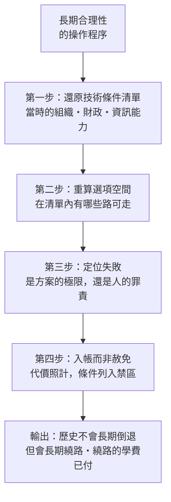

# 02.3 長期合理性：歷史不會長期倒退，但會長期繞路

## 一、案發現場：一個史學家的「危險立場」

每一樁思想懸案，都有一個最容易被誤認為「立場曖昧」的現場。黃仁宇的現場是：**一個在中國近代史上受盡顛沛的人，拒絕譴責任何一方。**

案情本身並不複雜。黃仁宇半生與中國革命的激流貼身相處：抗戰從軍，在緬甸戰場看見同袍如何死去；戰後在國民黨軍中任職，目睹這支軍隊在基層組織與補給上的潰爛；1949年之後，他的兄長留在大陸經歷運動，他自己在海外觀察毛澤東時代的三十年。以常理推之，這樣一個人寫史，理應寫成一份控訴狀。

然而他寫出的，是《中國大歷史》與一系列文章中那種近乎冷酷的平靜：國民黨的失敗、共產黨的勝利、毛澤東的功過，都被放進同一個解釋框架裡，**既不歌頌，也不控訴**。他甚至說出過讓兩邊都不舒服的話——他承認毛澤東的某些舉措有其一時的歷史功能，也承認其代價慘重；他說過大意如此的話：**毛澤東的失敗，也是中國歷史整體經驗的一部分**，今後的中國要在這份經驗之上繼續走，而不是假裝這一段可以撕掉重來。

這個立場在兩岸都招致攻擊：左邊嫌他不夠肯定革命，右邊嫌他替暴政緩頰。本案要偵查的是：這份「不譴責」的平靜，究竟是小市民的鄉愿，還是一套史學方法的邏輯終點？答案是後者——它的名字叫「長期合理性」（long-term rationality of history）。

## 二、概念的解剖：三句話

「長期合理性」可以拆解成三句話，每一句都需要驗證。

**第一句：歷史上的反動、失敗與倒退，在當時的技術與組織條件下，皆有其合理性。**

這裡的「合理」不是「正當」，而是**「可理解、有其條件上的必然」**。黃仁宇的操作是：把任何一段看似荒謬的歷史，還原到當時的技術清單上重算一遍。毛澤東時代的計畫經濟與群眾動員，在事後的市場標準看來是災難；但若還原到1950年代——一個百年戰亂後的農業國，既無資本家階級、無法律體系、無統計工具，卻要在超級大國對峙的世界裡求生存——以國家權力直接組織剩餘、強行提取農業剩餘以積累工業資本，是**僅有的幾個可選技術方案之一**，而且短期內確實建立了重工業骨架。它的失敗（大躍進、文革）不是偶然的瘋狂，而是這個方案在其內在邏輯上必然撞上的牆：**沒有價格信號的動員，能量可以集中，卻無法分配；可以衝刺，卻無法持續。** 合理性屬於起點，災難屬於極限——兩者都是同一組技術條件的產物。

**第二句：歷史不會長期倒退，但會長期繞路。**

這是黃仁宇的原話語意的轉述與濃縮。他多次表示，大歷史的視野給他的最大安慰，是**從長時段看，中國沒有被浪費**——鴉片戰爭以來一百五十年的挫敗、革命、內戰，不是一段應當被詛咒的歧途，而是這個龐大農業社會在缺乏現代組織工具的條件下，被迫付出的**改裝費用**。太平天國、洋務、維新、革命、內戰、建國、文革、改革，在百年尺度上看，是同一個問題（如何把一個傳統農業帝國改裝成能在數目字上管理的現代國家）的**一連串試錯**。每一次試錯都失敗，每一次失敗都排除了下一輪的一個錯誤選項。路沒有白走，只是繞得極痛。

用數學的語言說，這接近一種**統計式的樂觀**：單次試錯的成敗是隨機的，但只要問題的解存在、且試錯不被中斷，長期序列的期望值為正——歷史在統計上不會永遠倒退。但黃仁宇刻意不使用機率的玄學（見第四節），他寧可說得更樸素：**條件不變，錯誤會重複；條件改變了，重複就會停止。** 中國在1978年後走出繞路，不是因為終於出現了聖人，而是因為技術條件——外部市場、組織遺產、數十年工業積累——終於湊齊了一條走得通的路。這個判斷與姊妹書以「1978年重新接線」為主軸的分析，正好在這一點上接頭。

**第三句：承認合理性，不是赦免代價。**

這是整個概念最容易被誤讀的地方。黃仁宇的立場是：解釋不是寬恕，理解不是赦免。大躍進餓死的人、文革中被毀的人生，其苦難**不因「有其條件上的必然」而減少一克**。「長期合理性」提供的只是：不在受害者的名單上再添加一批「罪人」的名字了事，而是弄清楚**是什麼條件製造了這些苦難，以確保同樣的條件不再重來**。這是一種把憤怒從「人物」轉移到「條件」的史學——憤怒沒有被取消，只是被重新編了址。

## 三、案件的應用：如何安放國共與毛澤東

把三句話套用到近代史的具體判決上，可以看出黃仁宇與各種流行敘事的分歧點。

**對國民黨：** 流行的兩種敘事是「貪腐活該失敗」與「被蘇俄陰謀所害」。黃仁宇的判決是：國民黨是一個**上層的政權**，它在1927年後只完成了城市與財稅的表面統一，從未有能力改造農村基層——而當時中國人口八成在農村。不是國民黨的官員個個貪腐，而是**它手上沒有把國家權力伸進村莊的技術工具**。共產黨恰好提供了這套工具（階級鬥爭的動員技術），於是贏得了組織農村的競賽。技術條件解釋了成敗，忠奸只是結果的裝飾。

**對共產黨與毛澤東：** 黃仁宇的判決更為精細，也更兩面不討好。他承認毛澤東時代完成了一件國民黨做不成的事——**把國家權力第一次真正貫通到每個村莊，重造了基層組織**，這是後來一切現代化（包括改革開放）的前提；同時他毫不掩飾這個過程與後續運動的殘酷與荒謬。他的總結式立場是：毛澤東的試驗以極其沉重的代價，把「以意識形態動員替代經濟法則」這條路**走到了盡頭、證明到了反面**；這個反面的證明，本身成為1980年代全民共識的基礎——「不折騰」三個字背後，是整整一代人用親身經歷換來的數據。**失敗被計入了經驗，經驗構成了後來的路基。** 這就是「毛澤東的失敗也是中國歷史整體經驗的一部分」的完整含義：不是辯護，是入帳。

## 四、思想譜系鑑定：與黑格爾、馬克思的決定性差異

「長期合理性」聽起來極像黑格爾——「歷史中的理性」（the rational in history）、著名的「理性的狡計」：連暴君與戰爭也在不知不覺間為理性鋪路。聽起來也像馬克思——歷史有方向，曲折是螺旋。鑑定工作必須嚴格，因為這正是本案最微妙的爭點：**黃仁宇借用的是這兩位的問題，卻拒絕了他們的答案。**

差異至少有三處，且每一處都是本質性的：

1. **拒絕目的論。** 黑格爾與馬克思的歷史都有**終點**——絕對精神的自我實現、共產主義的必然到來；歷史哲學的任務是指出這個方向。黃仁宇的大歷史**沒有終點**。他不宣稱歷史走向任何地方，只宣稱：在給定條件下，某些路走不通、某些問題遲早要解決。方向感來自「排除法」，不來自「預言」——這是工程師的排除故障，不是先知的啟示錄。
2. **以統計代替定律。** 黑格爾式與馬克思式的「必然」是定律式命題：就算過程有曲折，結果註定。黃仁宇的「不會長期倒退」是大數法則式的：**單次成敗無常，長期序列受條件約束**。差別在於反事實的態度——定律派的「必然」不可證偽；條件論的判斷隨時可以被「條件改變」修正。1978年的中國若依然閉關，「長期合理性」不會替它開路，只會繼續描述一個被鎖死的系統。合理性屬於條件，不屬於命運。
3. **不許諾進步的保險。** 黑格爾與馬克思的世界裡，苦難最終會被揚棄、被兌現成更高的階段；歷史的帳，哲學替它結清。黃仁宇的框架裡**沒有這個結算機制**——繞路的學費付了就是付了，死去的人不會在更高階段裡復活。「長期合理性」唯一擔保的是：苦難若被正確理解，可以轉化為「不再重犯」的經驗；而這個轉化**需要後人去做，不是歷史自動完成的**。用他的話說，歷史家的任務是「將歷史上的大事發生之因果，向前後關聯」——關聯清楚之後，責任仍留在人手裡。

因此，最準確的鑑定結論是：黃仁宇把「歷史中的理性」從**形上學**降級成了**會計學**——不問歷史意欲何往，只問歷史已經支付了什麼、換回了什麼、哪些條件已被標記為不可再入。這個降級，正是「長期合理性」相對於德國思辨傳統的全部謙遜與全部力道。

## 五、反方證詞與結案

反方的證詞一如既往地鋒利。第一條：**「合理性」的邊界在哪裡？** 若任何失敗在「當時條件下」皆可宣告合理，這個概念就沒有證偽的可能——大躍進合理，那麼還有什麼不合理？黃仁宇的回應存在真實的張力：他的判準（「有無其他可行技術方案」）需要具體的歷史考證支撐，而他在多數場合並未逐案完成這個考證，「合理性」有時被用得太順手。第二條：**「不會長期倒退」是否已經越界？** 這句話本身就是一個小型的目的論預支——若拒絕預言，就應該連「不會倒退」也不承諾。黃仁宇對此的回答是經驗性的：那不是預言，是對人類組織學習能力的一個基於既往紀錄的判斷——而紀錄，確實站在他這一邊：五千年裡，沒有一個文明因為繞路而永遠消失於自身。

結案陳詞可以這樣寫：「長期合理性」是黃仁宇整個史學方法的最後一塊拼圖：**大歷史（02.1）提供了望遠鏡，技術解釋（02.2）提供了顯微鏡之外的判準，而長期合理性提供了安放痛苦的帳本。** 三者合一，他完成了對自己半生顛沛的交代，也完成了對一個民族百年繞路的交代——不控訴，不歌頌，不許諾，只入帳。這個交代未必令人舒服，但正如他自己所說的立場：**在長時段裡，最誠實的安慰不是「一切都會好起來」，而是「沒有一段路是白繞的」——前提是，後人必須讀懂帳本。**

---

## 本節要點

1. 「長期合理性」指：歷史上的反動、失敗與倒退，在**當時的技術與組織條件下皆有其合理性**（可理解的必然），歷史**不會長期倒退，但會長期繞路**；繞路的代價是真實的，不因合理而赦免。
2. 其應用：國民黨之敗在於缺乏組織農村的技術工具；毛澤東時代以沉重代價重建了基層組織、又把「意識形態動員替代經濟法則」的路證明到反面——**失敗被計入整體經驗，成為後來轉向的路基**，這是「入帳」而非「辯護」。
3. 與黑格爾、馬克思的決定性差異：**非目的論、無終點預言，以大數法則式的條件判斷代替歷史定律，且不設「苦難最終被揚棄」的結算機制**——歷史的理性被從形上學降級為會計學。

## 延伸對照

- **黃仁宇《黃河青山》（回憶錄）**：「長期合理性」最私人、也最坦率的出處——一個人如何用自己的方法消化自己的時代。
- **[1991-蘇聯解體](../../歷史探案/世界史/國家滅亡史/1991-蘇聯解體.md)**：長期合理性的對照組——蘇聯七十年的繞路同樣「有其條件上的必然」，但其終點不是改裝而是解體，可檢驗「不會長期倒退」的判斷在何種條件下失效。
- **[1687-牛頓與科學革命](../../歷史探案/世界史/世界發展史/1687-牛頓與科學革命.md)**：牛頓式「以數量關係解釋自然」的勝利，正是黃仁宇「數目字管理」信念背後的認識論原型——把世界的解釋權，從善惡敘事交給條件與計量。
- **黑格爾《歷史哲學講演錄》**：與本節並讀，可看清「歷史中的理性」在形上學版本與會計學版本之間的距離。
