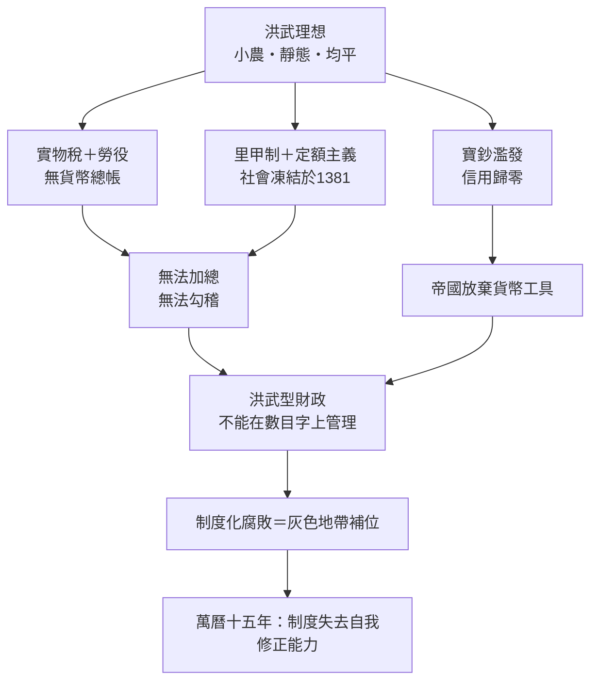

# 03.2 明代個案：洪武型財政為何讓帝國「不能在數目字上管理」

## 一、案發現場：一本兩百年不更新的國家帳簿

1572年，張居正出任內閣首輔，着手清查帝國家底。他派人核對天下田畝時，發現了一個荒謬的事實：**帝國的稅冊，基本上還是兩百年前洪武年間的那一套。** 土地已經幾度易手，河湖已經淤墾變遷，人口已經翻了倍，而賬面上的田畝、稅額、戶口，卻仍然凝固在明太祖朱元璋定的框架裡，動也不動。

黃仁宇用英文寫作《十六世紀明代中國之財政與稅收》（Taxation and Governmental Finance in Sixteenth-Century Ming China）時，把這個發現寫成了一項指控：明朝的財政制度**自始就不是為了反映現實而設計，而是為了把現實凍結起來而設計**。他後來為這個診斷創造了一個總括性的術語——**「洪武型財政」**。本節的任務，就是勘驗這具「不能在數目字上管理」的完整屍體，找出每一處致命傷。

## 二、死因解剖（一）：實物稅——一個拒絕貨幣的帝國

洪武型財政的第一根支柱，是**以實物與勞役為主的稅收體制**。米麥、絹布、馬匹、以及老百姓的無償勞動，構成帝國財政的主體；白銀與貨幣反而被刻意邊緣化——朱元璋甚至一度禁止金銀交易。

黃仁宇指出，這個設計的後果是災難性的效率黑洞：全國數千個縣各自徵收實物，再以**原始的運輸方式**層層轉運到數百個使用點。南方的米運到北方軍鎮，運費可能數倍於米價本身；同一個縣的倉庫裡，可能同時堆著幾十種互不通用、品級各異的實物。整個帝國像一家**不用貨幣記帳的巨型企业**——沒有統一的價值尺度，就没有總帳；没有總帳，就没有管理。黃仁宇的評斷一針見血：明朝的財政「是一個大雜燴，而不是一個系統」。

用會計的語言說：**實物經濟讓帝國失去了「加總」的能力。** 一石米與一匹絹如何相加？答案是加不起來。加不起來，就無法在數目字上管理。

## 三、死因解剖（二）：里甲制與定額主義——把社會凍結在1381年

第二根支柱是**里甲制**：以一百一十戶為一里，輪流應役，戶籍、田籍、賦役冊三位一體，把每個人社會性地釘死在土地與登記冊上。配合它的，是一種黃仁宇稱之為「定額主義」的財政哲學——**每個州縣的稅額一經確定，便希望永不再變**。

這背後是朱元璋的一整套治國理想：小農、均平、靜態、可預期。他用道德的簡化取代數據的管理——**與其建立複雜而必須不斷更新的稽核體系，不如把世界設計得不需要更新。** 田不許大規模買賣，戶不許自由遷徙，職業世襲（軍戶、匠戶、灶戶），連服裝、住房規格都有等級規定。

然而社會不會配合靜止。不出百年，土地兼併、人口流動、戶籍逃亡已使里甲名存實亡；但**帳冊不能改**——一改就會觸動千絲萬縷的既得利益與行政慣性。於是出現了黃仁宇反覆描述的怪象：官冊上的世界與現實世界是兩個平行宇宙，官員們心知肚明，卻只能「照冊辦事」。**數據的不連續，從技術缺陷升級為制度原則。**

## 四、死因解剖（三）：寶鈔——一場信用自殺

第三根支柱是**寶鈔**。明初發行不兌現紙幣，卻沒有任何準備金與回籠機制，純粹印鈔支付軍費與官俸。結果 predictable 到近乎教科書：寶鈔在發行數十年內貶值到只剩票面價值的零頭，民間自動退回白銀與銅錢。朝廷的對策不是改革，而是**強令用鈔、禁用白銀**——禁不住，就假裝寶鈔還存在，官定價格照舊。

黃仁宇對此案的評語極重：這是帝國**親手摧毀了自己唯一的貨幣工具**。此後明朝政府對經濟的貨幣面近乎失明：白銀事實上通行全國，卻沒有官方鑄幣、沒有法定銀兩成色標準、沒有中央銀行。十六世紀美洲與日本白銀大量流入，帝國的貨幣供給竟由海外市場與私商決定——**一個兩億人口的帝國，把貨幣主權外包了。** 當白銀輸入波動時（如明末），整個賦稅體系隨之痙攣，這是1644年崩局的經濟引信之一（見 [../../世界史/東亞史/1581-一條鞭法與白銀帝國.md](../../歷史探案/世界史/東亞史/1581-一條鞭法與白銀帝國.md)）。

## 五、死因解剖（四）：低稅率與「存留」——一個注定餓瘦的政府

第四根支柱最反直覺：**明帝國的總稅負低得驚人**，且一旦確定便不再調整；徵收所得又按比例切成「起運」（解中央）與「存留」（留地方）兩塊，存留部分微薄到地方衙門連正常運轉都困難。

黃仁宇算過這筆帳：明帝國以世界最大的經濟體之一，供養著全世界最**窮**的大政府——官俸低到官員無法體面生活，軍餉低到衛所制瓦解，地方行政經費薄到必須依賴**體制外的陋規與常例**才能運作。於是一個致命的結構成型了：

> **帳面上的帝國是一套（清廉、低稅、道德），實際運轉的帝國是另一套（灰色收入、額外攤派、私下核算）。**

這正是 03.1 節所說「私利退出帳面」的帝國級演示。整個官僚系統被迫用非正式制度運轉，而**非正式制度是無法稽核的**。清官海瑞試圖按帳面規則認真徵稅、禁止陋規，結果發現自己在制度上寸步難行——黃仁宇說他是「古怪的模範官僚」，因為他是唯一把假帳當真帳的人。

## 六、唯一的活口：張居正的「數目字化」突擊及其極限

面對這具垂死的制度，1570–80年代出現了一次孤注一擲的搶救——**張居正改革**。兩大手術：

1. **土地清丈**（1578–1582）：重新丈量全國田畝，把兩百年來隱匿、飛灑、詭寄的土地重新登記入冊，使稅基回歸真實。這是條件一「真實」的一次遲到補課；
2. **一條鞭法**（全國推廣於1581）：把名目繁雜的實物稅、勞役**合併折銀**，按畝計徵。這是三條件的集成版：以貨幣統一價值尺度、簡化為單一稅目、使數據可以加總勾稽（見 [../../世界史/東亞史/1581-一條鞭法與白銀帝國.md](../../歷史探案/世界史/東亞史/1581-一條鞭法與白銀帝國.md)）。

黃仁宇承認這是明代距離「數目字管理」最近的一次，但他同時診斷出這次突擊的**三重極限**：

- **缺下層結構**：清丈與折銀依靠的是**人**（張居正個人的權威）而非**制度**（獨立的登記、審計、司法體系）。人亡政息是必然——張居正死後被抄家清算，改革無人守靈；
- **缺貨幣制度**：折銀徵稅的前提是有穩定的銀本位，而明廷恰恰沒有貨幣政策可言。一條鞭法把農民暴露在全球白銀波動之下，帝國卻無調節工具；
- **缺司法保障**：數目字管理的最終裁判是法院與產權登記，明帝國的最終裁判卻是道德與人事。帳目之爭隨時會變成道德之爭、黨爭之爭。

一條鞭法因此像一場**沒有更換引擎、只擦亮了儀表板的搶修**：車子又開了幾十年，但底盤未變。

## 七、結案陳詞：1587年，「無事」作為死因

《萬曆十五年》英文書名是 *1587, A Year of No Significance*——「無事之年」。黃仁宇選擇這一年，正是要揭示最深的病灶：**那一年什麼大事都沒發生，而這正是最大的事。**

萬曆十五年（1587）前後：張居正已死並遭清算，清丈的成果無人維護；海瑞與戚繼光先後在寂寞中死去；年輕的萬曆皇帝正在學會消極怠工。整個體制**沒有崩潰、沒有危機、沒有敵人**——只是徹底喪失了自我修正的能力。每個人都看到了問題，沒有人能改變任何事；所有的技術問題都被翻譯成道德問題，所有的改革衝動都被消化成人事糾紛。

黃仁宇的大歷史判詞是：**1644年的滅亡，早在1587年甚至1381年就已寫好判決書**（見 [../../世界史/國家滅亡史/1644-明朝.md](../../歷史探案/世界史/國家滅亡史/1644-明朝.md)）。明朝不是亡於崇禎，不是亡於流寇與滿洲，而是亡於洪武型財政那一紙設計圖——亡於一個帝國選擇了用道德簡化替代數據管理的瞬間。三百年後，當英國人用國債與銀行把信用變成數目字時（03.3節），明朝的帳簿還鎖在兩百年前的定額裡。

## 本節要點

- **洪武型財政**四大支柱：實物稅（失去價值尺度，無法加總）、里甲制與定額主義（數據凍結、拒絕更新）、寶鈔濫發（貨幣信用自毀、主權外包）、低稅率與存留制（政府餓瘦、灰色地帶制度化運轉）。
- 核心診斷：明朝財政**自始就不是為了反映現實而設計，而是為了凍結現實而設計**——用道德簡化替代數據管理。
- 張居正的清丈與一條鞭法是一次真實的「數目字化」突擊，但缺乏下層結構、貨幣制度與司法保障三項前提，終成**人存政舉、人亡政息**。
- 1587年「無事」＝制度自我修正能力的徹底喪失；1644年只是判決的執行。

## 延伸對照

- [../../世界史/國家滅亡史/1644-明朝.md](../../歷史探案/世界史/國家滅亡史/1644-明朝.md)：本案的終局現場。
- [../../世界史/東亞史/1581-一條鞭法與白銀帝國.md](../../歷史探案/世界史/東亞史/1581-一條鞭法與白銀帝國.md)：一條鞭法與白銀流通的技術細節。
- [../../世界史/東亞史/0780-兩稅法與財政國家.md](../../歷史探案/世界史/東亞史/0780-兩稅法與財政國家.md)：唐代已見「貨幣化財政」的先聲，對照明代的倒退。
- [../../世界史/工業革命史/1494-複式簿記.md](../../歷史探案/世界史/工業革命史/1494-複式簿記.md)：同時代西方正在把「可稽核」練成日常技術。
- 本書 03.1 節：三條件命題；03.3 節：正面案例的三段驗證。
