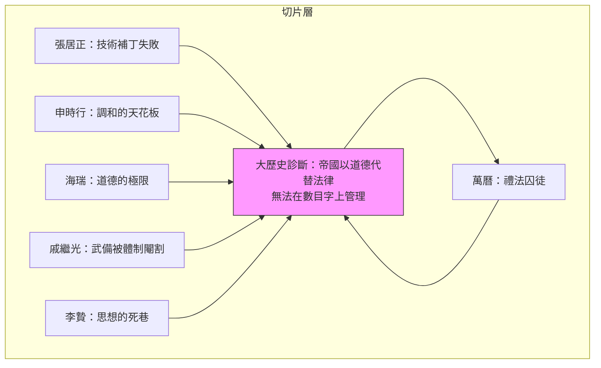
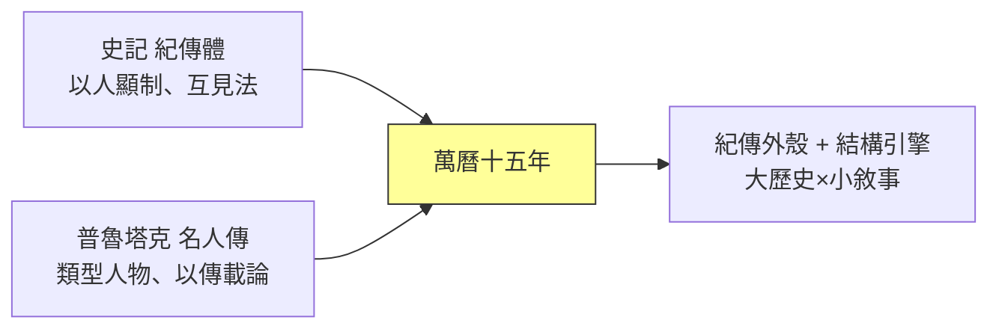

# 04.1 敘事史學：讓六個人物帶出整套制度

## 一、案發現場：一本「不像史學專著」的史學專著

1982年前後，《萬曆十五年》（1587, a Year of No Significance）的英文稿在美國多家大學出版社之間輾轉被拒，最後由耶魯大學出版社接受出版；中文版稍後由黃仁宇自行翻譯、在北京出版，意外成為海峽兩岸歷年長銷不衰的歷史讀物。這本書留下了幾個「不該如此卻偏偏如此」的細節，值得當作懸案的第一現場來勘查。

**細節一：全書沒有一個貫穿的「主角事件」。** 書名點出的萬曆十五年——西元1587年——在史事上幾乎是「空年」：沒有大戰、沒有政變、沒有天災級的危機。黃仁宇自己說，這一年「四海升平，全年並無大事可敘」。一個歷史寫作者，放著萬曆三大征、放著國本之爭不去正面強攻，偏偏挑一個表面平靜的年份下刀——這在傳統史學的取材邏輯裡近乎自毀。但正是這個「無事之年」，成為他解剖整個明帝國制度的切片位置：**無事，恰恰證明問題不在事件而在結構；連最能幹的人放在最正常的年份，也一事無成。**

**細節二：全書只有六章，六個人物，卻自稱寫的是「大歷史」。** 萬曆皇帝、首輔張居正、首輔申時行、清官海瑞、將領戚繼光、思想家李贄——兩位首輔、一位皇帝、一位法官型官僚、一位軍人、一位異端文人。六個人不構成一個事件鏈，彼此的章節之間也沒有強烈的因果接力。用社會科學的標準看，這是抽樣；用傳記的標準看，這是六篇散立的合傳。可是讀完全書的人幾乎都有一個共同感受：**自己讀到的不是六個人的故事，而是一整套制度的病歷。**

**細節三：這本「邊緣學者的書」同時打動了兩個互不往來的讀者群。** 學院裡的明史專家承認它的問題意識（儘管多有保留），大眾讀者則把它當作歷史寫作的範本传閱——在中國大陸，它長期名列歷史類暢書榜，被無數後來的通俗史寫作者奉為啟蒙。一本書同時被學界「忍受」、被大眾「崇拜」，這個反差本身就是線索。

三個細節指向同一個偵查方向：黃仁宇發明了一種寫作技術——**用人物作切片，用切片顯影制度，用制度的診斷托起「大歷史」的論旨**。本章節的任務，是把這項技術拆開來檢驗：它從哪裡繼承（司馬遷？普魯塔克？），它如何運作，它又為何能同時騙過學術規範、打動大眾讀者。

## 二、六個人物，六種制度困境：切片的顯微鏡學

《萬曆十五年》最精巧的設計，在於六個人物不是六個「例子」，而是六種**制度困境的化身**。黃仁宇的寫法是：每個人都是他那個位置上最認真、最有能力的人，而他們全部失敗——失敗的原因不在個人，在制度。逐一驗屍如下：

| 人物 | 制度位置 | 困境的核心 |
|---|---|---|
| 萬曆皇帝 | 天子，禮法的化身 | 皇帝本人是制度的囚徒：連立儲、出巡、練兵都無法自主，最後以數十年怠政作消極罷工 |
| 張居正 | 首輔，行政的化身 | 想以私人督責彌補技術不足，人亡政息，身後被清算 |
| 申時行 | 首輔，調和的化身 | 看清了張居正的下場，改以「誠意」與調劑折衝維持體制運轉，被譏為和事佬 |
| 海瑞 | 地方官，道德的化身 | 以本朝最高道德標準行事，卻發現整個財政與法律結構無法支持這種道德 |
| 戚繼光 | 軍官，武備的化身 | 在文官體制壓制武人的結構裡，只能在夾縫中練出一支新軍，終仍被棄 |
| 李贄 | 士人，思想的化身 | 發現官方意識形態無法自圓其說，卻找不到新的思想工具，自刎於獄中 |

六張切片指向同一個診斷：**這個帝國以道德代替法律、以禮儀代替行政、以文官集團的均質平衡代替技術化的國家治理。** 當整個體制拒絕在「數目字上管理」——拒絕把財政、軍事、法律建立在可以量算、可以核銷的基礎上——那麼無論誰坐在哪個位置，都只能在「陽」（道德的表面文章）與「陰」（私慾與實際操作）的裂縫之間耗盡自己。

用一張圖表示這個顯微鏡結構：

注意這個結構的偵查學妙處：**六個案例彼此獨立，卻收斂到同一個結論**。這在方法上等於做了六次控制變數——換了位置（皇帝／首輔／官僚／軍人／思想家）、換了人格（怠惰／強毅／圓融／清峻／務實／狂狷），結果不變。剩下的唯一變數，就是制度本身。這正是黃仁宇想說的：1587年的問題，不是人的問題。

## 三、「大歷史」與「小敘事」的張力：望遠鏡與顯微鏡的合體

黃仁宇給自己的方法取名「大歷史」（macro-history）：不糾纏個別人物的善惡、個別事件的成敗，而以數百年為尺度，追問一個文明的制度結構能否完成「在數目字上管理」的現代化轉型。按這個定義，大歷史似乎應該寫成結構分析、統計長時段、比較帝國史——總之是社會科學的樣子。

但《萬曆十五年》的實際寫法恰恰相反：**一整本書幾乎全是「小敘事」**——萬曆在宮廷儀式中的疲憊、張居正死後抄家的淒涼、海瑞買肉的傳聞、戚繼光的私人著述、李贄獄中的最後一剪。望遠鏡的論旨，用顯微鏡的材料來寫。這個張力不是缺陷，而是全書真正的發動機。

它的運作原理可以拆成三步：

1. **以小敘事供給「質感」。** 個人故事的細節讓讀者產生在場感，這是大眾閱讀的燃料。黃仁宇甚至不惜採用心理推想與場景重建——萬曆的心情、申時行的苦衷——這些在實證史學裡屬於危險動作，在敘事裡卻是必需品。
2. **以小敘事充當「證據」。** 關鍵在於：黃仁宇選擇的細節不是趣聞，而是**制度的投影**。萬曆的怠政不是性格史，是禮法體制窒息皇權的證據；海瑞的孤立不是清官傳奇，是道德話語與財政現實脫節的證據。每一個小場景都偷偷攜帶一條結構性的注腳。
3. **以重複收斂完成「證明」。** 六章讀完，讀者並沒有被灌輸一個論文式論點，而是**自己走完了六次同一個結構**，歸納是讀者自己做出的。這是敘事史學最高明的地方：結論彷彿是現場自己浮現的，作者只是偵探，不是檢察官。

用一個式子概括：

$$
\text{大歷史論旨} \;=\; \bigcap_{i=1}^{6} \text{人物}_i \text{的制度困境}
$$

六個小敘事的「交集」，就是大歷史的結論。張力於是轉化為互補：小敘事提供可讀性與個案證據，大歷史提供統攝框架與問題意識；缺了前者，那是枯燥的結構論文；缺了後者，那是六篇好看的歷史小品。**《萬曆十五年》的奇蹟，是讓讀者在讀故事時不知不覺完成了一次結構分析的推理。**

## 四、譜系追查：司馬遷、普魯塔克與紀傳體的現代轉世

這種「以人物帶制度」的寫法並非無源之水。追查譜系，至少有兩條明顯的血緣線。

**第一條：中國的紀傳體。** 司馬遷《史記》以本紀、列傳為骨架，表面是人物傳記，實際是把一個時代的制度、戰爭、經濟、思想分攤到人物身上——《貨殖列傳》寫經濟，《酷吏列傳》寫司法，《游俠列傳》寫社會秩序的灰色地帶。紀傳體的深層邏輯正是：**制度不可見，人物可見；以可見之人，顯不可見之制。** 黃仁宇的六章結構，無論他本人如何標榜新方法，骨架上就是一部微型紀傳體——六章合傳，互見其制。甚至「以失敗者寫時代」的筆法也直承太史公：項羽非成王者，而〈項羽本紀〉恰是秦亡之際最鋒利的切片。

**第二條：普魯塔克的《希臘羅馬名人傳》。** 普魯塔克以對傳形式並置希臘、羅馬人物，自言其目的不在編年記事，而在「以人物為鏡，照見德性與命運」。這條線經文藝復興進入西方傳記傳統，其特徵是：**人物是道德與結構問題的載體，傳記是論述的寓體。** 黃仁宇六人中「清官／能臣／武將／異端」的類型配置，與普魯塔克式的類型人物學明顯同構。

兩條血緣在黃仁宇身上合流，並各自被改造：司馬遷的紀傳體被抽掉了「褒貶筆法」的道德評斷（黃仁宇對人物普遍抱持「制度性同情」——連張居正的專權、萬曆的怠政都被寫成結構的產物），普魯塔克的德性之鏡被換成了**結構之鏡**——照出的不再是人格典範，而是制度的天花板。換言之，黃仁宇做的是一次跨文明的舊技術改裝：**紀傳體的外殼，社會科學的引擎。**

## 五、如何「騙過」學術規範又打動大眾：兩套驗收標準的縫隙

現在回到第三個細節：這本書為何能在學院與大眾兩個市場同時存活？答案藏在「騙過」一詞的引號裡——不是造假，而是**它恰好卡在兩套驗收標準的縫隙上，兩邊各取所需**。

對大眾讀者，它的賣點顯而易見：有人物、有場景、有心理、有命運感；結論宏大而簡潔（「以道德代替法律」「數目字管理」），讀完可以帶走一句話。這是通俗歷史寫作的一切成功要素。

對學院讀者，它過關的藉口則微妙得多：

1. **史料是扎實的。** 《萬曆十五年》的人物與主要情節均有《明實錄》、奏疏、文集、地方志的依據，腳註做得規矩。批評者可以挑剔解釋，很難指認編造。**敘事的外衣底下，墊著實證的襯裡**——這使它有別於純粹的歷史演義。
2. **問題意識是學院的。** 「中國為何不能在數目字上管理」「明代財政的技術缺陷」——這些是當時明清經濟史的正經題目（黃仁宇的博士論文《明代的漕運》與《十六世紀明代中國之財政與稅收》正是其學術底盤）。大眾看到故事，學者看到題目。
3. **方法論的模糊是故意的。** 黃仁宇從不把「大歷史」定義成可操作的研究程序，而是一種**寫作姿態與解釋視角**。這使它無法被學術規範正式收編，也無法被正式開除——它站在規範的門檻上，門內的人皺眉，卻不便趕人。

這個「半學半俗」的縫隙位置，是理解下一節「黃仁宇現象」的伏線：它帶來影響力的乘數，也埋下被兩邊同時夾擊的命運。**縫隙是自由的，也是無人供取暖的。**

## 六、技術清單：黃仁宇敘事法的可拆解零件

把《萬曆十五年》的手法拆成可清點的零件，大約有五件：

1. **反高潮的切入點。** 以「無事之年」開篇，用平靜反襯結構性的死局——第一頁就完成問題的陌生化。
2. **人物即論點。** 不設議論章，每個人物的命運本身就是一個分論點；「互見」於六人之間的，是同一個制度。
3. **制度性同情。** 對所有人物免除道德審判，代之以「換誰都一樣」的結構歸因——這使全書獲得一種冷峻的公平感，也是它被批評「為失敗者開脫」的來源。
4. **中英雙語的句法節奏。** 黃仁宇先以英文思考寫作、再自譯中文，其長句、插入語與冷靜的反諷語氣，給中文歷史寫作帶來一種陌生化的「翻譯體」質感——這種質感後來被大量模仿，成為兩岸「歷史非虛構」文體的隐性標準之一。
5. **一句話可帶走的核心概念。** 「數目字上管理」「以道德代替法律」——概念的可複述性，決定了書的傳染力。

## 本節要點

- 《萬曆十五年》以1587年這個「無事之年」為切片位置，證明問題不在事件而在結構。
- 六個人物是六種制度困境的化身；六個獨立案例收斂到同一診斷（以道德代替法律、無法數目字管理），方法上等於六次控制變數。
- 大歷史（望遠鏡）與小敘事（顯微鏡）的張力，透過「細節攜帶結構注腳、六案重複收斂」轉化為互補。
- 譜系上承司馬遷紀傳體（以人顯制）與普魯塔克名人傳（以傳載論），外殼是紀傳，引擎是社會科學。
- 其成功在於卡在學術與大眾兩套驗收標準的縫隙：史料扎實、題目學院、文體通俗、概念可複述。

## 延伸對照

- 明帝國以道德與禮法維持低成本統治、終因技術落後而崩解的完整過程，見 [../../世界史/國家滅亡史/1644-明朝.md](../../歷史探案/世界史/國家滅亡史/1644-明朝.md)——可視為《萬曆十五年》診斷的長時段驗證。
- 黃仁宇「數目字管理」概念的學界批評與「黃仁宇現象」，見下一節 04.2。
- 以同樣「切片顯影結構」的眼光看二十世紀中國的另一次制度斷裂，見 [../../世界史/國家滅亡史/1949-中華民國大陸.md](../../歷史探案/世界史/國家滅亡史/1949-中華民國大陸.md)。
