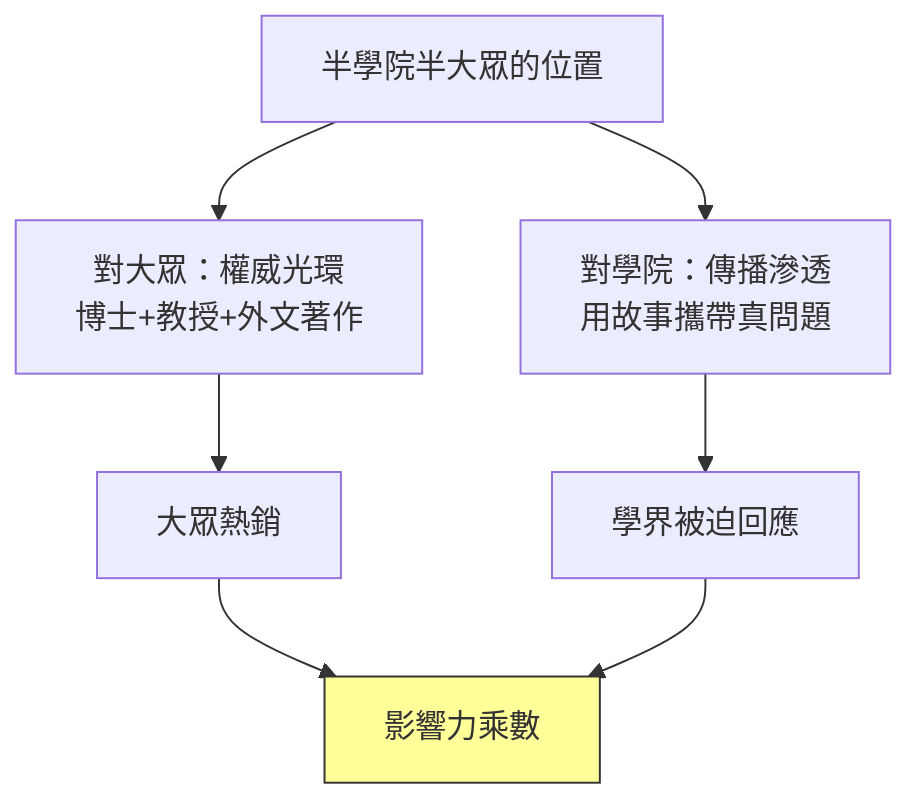

# 04.2 學界風波：批評、辯護與「黃仁宇現象」

## 一、案發現場：一本暢銷書的兩張成績單

如果把《萬曆十五年》的接受史當作另一樁懸案來勘查，現場同樣留下了刺眼的反差。

**細節一：大眾市場的熱度與學院內部的冷感，長期並存。** 這本書在兩岸長銷數十年，被列入各種「改變歷史閱讀」的書單；但在明史專業的系所裡，它很少被當作可以引用的研究文獻，研究生被提醒「可以讀，引用要小心」。一本歷史書同時擁有最高的大眾聲望與曖昧的專業地位——這個落差需要解釋。

**細節二：批評的火力點，集中在方法而非史實的個別考訂。** 學界對黃仁宇的質疑並非「某年某事弄錯了」的零星指正，而是成建制的批評：概念粗糙、解釋目的論、經濟分析過度簡化。批評的規格之高，恰恰說明它被當成「一個方法」來審判，而不只是「一本書」。

**細節三：批評最狠的地方，恰是影響力最大的地方。** 「數目字管理」在學者看來經不起推敲，卻成為中文世界流行了四十年的分析口頭禪。**錯的東西為何傳得最廣？** 這是本案最核心的謎團。

## 二、批評的火力清單：四條主攻線

逐一清點學院陣營的主攻線，大致四條。

### 火力一：「數目字管理」被指為粗糙的概念工具

黃仁宇反覆使用「在數目字上管理」（mathematically manageable）作為全部分析的樞軸：傳統中國無法在數目字上管理，現代化的本質就是完成這個轉型。批評者指出至少三個漏洞：

1. **傳統國家並非沒有數目。** 明清的賦役冊籍（魚鱗冊、黃冊）、錢糧奏銷制度，本身就是龐大的數字管理系統；問題在於數字失真、激勵扭曲，而非「沒有數目字」。批評者認為黃仁宇把「管理失靈」壓縮成「無法量化」，丟失了中間層次的制度分析。
2. **概念無法操作化。** 什麼程度算「可以數目字管理」？有無閾值？可否測量？這個概念在社會科學意義上不可證偽，更像修辭而非理論。
3. **倒果為因之嫌。** 把「現代國家能力」的表現之一（量化治理）說成現代化的「本質」，有以單一維度定義複雜過程之嫌。

### 火力二：經濟基礎的複雜性被抹平

黃仁宇的明史出身是財政史——《十六世紀明代中國之財政與稅收》是英語世界早年少見的明代財政專著。但弔詭的是，批評者認為他的「大歷史」恰恰**背叛了自己最專業的領域**：把明代財政的多層次實態（寶鈔的通膨、折色的混亂、里甲與一條鞭法的區域差異、地方經費的自籌慣性）壓縮成一句「技術無法展開」。經濟史家會問：同樣的財政框架，為何清代一度運轉得更好？為何江南與華北差異巨大？大歷史的宏鏡頭，把這些中觀層次全部虛焦了。

### 火力三：大歷史的「目的論」與「決定論」

黃仁宇的敘事有個總方向：中國漫長的「不能用數目字管理」的階段，是通向現代轉型的一段「長期革命」——明清的失敗、民國的嘗試、乃至共產革命的動員，都被他讀成**為建立現代財政國家所做的層層鋪路**。批評者指出，這是典型的目的論（teleology）：把後來發生的事，讀成先前一切的意義所在；歷史彷彿有預定終點，過程只是工具。決定論的指控隨之而來：個人的選擇、偶然的作用、道路的多重可能，在這個框架裡都沒有位置——而這恰恰與他自己在《萬曆十五年》裡「連皇帝都不得自由」的洞見互相矛盾。

### 火力四：史料的技術性檢驗

其明代財政研究被同行嚴格檢驗，數字取捨、譯名、對原始文獻的解讀均有被指摘之處；部分明史學者認為其對《明實錄》與地方志材料的運用有先設結論、再選證據之嫌。這一火力線最「內傷」：因為黃仁宇的學術信譽恰恰建立在他「做過實證財政史」的底盤上，底盤若被質疑，上層的大歷史敘事便連同失重。

## 三、辯護方：黃仁宇的自我辯護與同情者的說法

黃仁宇本人對批評的回應，集中見於回憶錄《黃河青山》與多篇序跋，其策略有三：

1. **重新劃定賽場。** 他堅稱「大歷史」不是與專題研究競爭的替代品，而是「長時間、遠距離、寬視野」的**補充視角**；專題家在顯微鏡下挑戰望遠鏡，是範疇錯置。
2. **承認粗線條，但宣稱必要。** 他以「先有輪廓、再有細節」自辯：在中文世界長期缺乏宏觀綜合的情況下，先提供一個可供攻擊的框架，本身就是學術分工。
3. **把批評歸因於立場。** 他暗示部分批評來自學院對「非科班在職研究者」的門戶之見——這一點需要標明是**其自述立場**，不可當作客觀事實，但也不是全無影蹤（見下節的經歷）。

同情者的辯護則走另一條線：**評價一本書，要看它提出的問題是否成立、能否引導後續研究，而非它的理論是否精緻。**「數目字管理」作為理論不合格，作為**問題**卻極具生產力——此後數十年中文學界關於國家能力、財政現代化、量化治理的大量研究，無論贊成或反對，都在回答它劃定的問題。批評者贏了論文，黃仁宇贏了議程。

## 四、體制的屈辱：美國學院的邊緣化

要理解黃仁宇與學院的緊張，必須回到《黃河青山》自述的一段經歷（以下均據其自述）。

黃仁宇以國民黨軍隊軍官的資歷赴美，四十多歲才在密西根大學取得博士學位，之後長期在紐約州立大學紐帕茲分校（New Paltz）任教——這是一所教學型而非研究型的大學，在美國學術階序裡位處邊緣。據《黃河青山》自述，1990年代他退休前遭校方解聘，這一「以屈辱姿態離開教職」的經歷，被他本人寫成理解自己學術命運的關鍵：**一個自認掌握了新史觀的人，被制度的邊緣反覆確認為無關緊要。**

這段經歷有兩層偵查意義。

**第一層：它解釋了文體的選擇。** 失去學院講席的人，寫作只剩大眾市場一條路。黃仁宇後期大量轉向中文寫作、面向兩岸讀者，與其在美國學院的處境互為因果——不是先有「雅俗共賞的戰略」，而是先有被學院除名的處境。

**第二層：它把「學院批評」染上了人事的顏色。** 批評者指其方法粗糙，支持者則指出批評的激烈程度超出了學理需要，其中難免攙雜對「非學院嫡系」的排斥。本書在此必須標明：這層動機推測屬於評論範圍，無法實證；但「批評強度與影響力不成比例」這一現象本身，是可以客觀記錄的。

## 五、「牆內開花牆外香」的倒轉：兩岸讀者的熱烈接受

黃仁宇的接受史呈現一個罕見的方向：**在美國學院牆內開的花，牆外（中文世界）異常地香，香到回頭蓋過了牆內。** 《萬曆十五年》中文版問世後，先在台灣，繼而在1980年代的中國大陸成為現象級讀物——彼時大陸剛經歷史學長期被意識形態框架壟斷的年代，讀者第一次看到：歷史可以這樣寫——不喊口號、不劃階級、以人寫制、冷靜而帶著宿命的蒼涼。需求的真空遇上供給的稀缺，造就了「黃仁宇熱」。

在這股熱潮中，兩岸學人與文化界人物也曾公開表達推崇或參與討論——例如余英時曾對其史學表達過有保留的欣賞與批評並存的意見，龔鵬程等評論者亦對「黃仁宇現象」有專文分析（**此處所列均屬他人評論，僅代表評論者立場**，本書不代為背書任何具體評語）。可以客觀記錄的是：對黃仁宇的評價在中文文化圈呈「大眾熱、學院溫、評論界吵」的三層結構。

## 六、診斷：「黃仁宇現象」的成因——半學院半大眾位置的乘數效應

現在解開核心謎團：**為何一個在兩邊都「不及格」的位置，反而放大了影響？**

拆解成四個機制：

1. **權威的可信外包裝。** 對大眾讀者，黃仁宇的博士學位、明史專著、美國教職，構成「這不是演義，是真學問」的擔保。他的故事因此比通俗作家的故事多一層信用。半學院身分是大眾市場的資產。
2. **真問題的走私通道。** 對學院而言，他的理論粗糙，但問題真實。學者可以輕鬆反駁「數目字管理」，卻無法否認「傳統中國國家能力的技術缺陷」是個重要題目。半大眾的文體讓真問題繞過學術出版的慢車道，直接抵達下一代讀者——包括未來的學者。
3. **批評即傳播。** 學界的每一次嚴厲批評，客觀上都在替這本書做「值得被認真對待」的背書。罵得越規格化，書的「問題意識」就越顯得重要。**爭議是他影響力的免費廣告。**
4. **位置無人競爭。** 純學院著作讀者有限，純通俗著作缺乏信用；卡在中間、且以中文寫作面向兩岸的宏觀史家，當時幾乎是空位。黃仁宇獨佔了一個生態位。

總結成一個命題：**黃仁宇現象不是「好作品遇上好時代」的簡單故事，而是「身分的錯位 × 文體的混血 × 學院的圍剿」三者相乘的結果。** 每一項單獨看都是損失，連乘起來卻是傳播學上的最優解——這與他本人「大歷史由無數個人困境連乘而成」的方法論，形成一個近乎自反的呼應。

## 本節要點

- 學界批評四條主攻線：數目字管理概念粗糙且不可操作化、經濟基礎複雜性被抹平、大歷史有目的論與決定論之嫌、明代財政研究受技術性檢驗。
- 黃仁宇以「補充視角」「先輪廓後細節」自辯；同情者主張其價值在問題的生產力而非理論的精緻度。
- 據《黃河青山》自述，其長期任職紐帕茲教學型大學、退休前遭解聘，這一邊緣處境與其轉向中文大眾寫作互為因果（屬其自述）。
- 接受史呈「大眾熱、學院溫、評論界吵」三層結構；牆內開花牆外香再倒轉為牆外更香。
- 「黃仁宇現象」＝身分錯位 × 文體混血 × 學院圍剿的連乘：權威包裝、問題走私、批評即廣告、生態位獨佔，四機制相加放大影響。

## 延伸對照

- 《萬曆十五年》敘事技術的拆解，見 04.1。
- 晚年以蔣介石日記重寫抗戰內戰、把「數目字管理」貫徹到近現代史的三部曲，見 04.3。
- 傳統帝國財政—軍事結構與其崩解的實證長時段，見 [../../世界史/國家滅亡史/1644-明朝.md](../../歷史探案/世界史/國家滅亡史/1644-明朝.md)。
- 大陸政權更迭作為黃仁宇「長期革命」敘事的終點現場，見 [../../世界史/國家滅亡史/1949-中華民國大陸.md](../../歷史探案/世界史/國家滅亡史/1949-中華民國大陸.md)。
