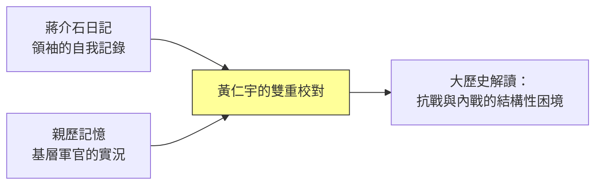
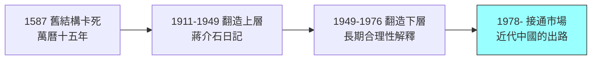

# 04.3 近現代三部曲：從蔣介石日記到大歷史的當代延伸

## 一、案發現場：一個史家晚年最冒險的三步棋

黃仁宇晚年的寫作路線，在旁人眼裡近乎自毀：一個已因《萬曆十五年》獲得巨大中文讀者市場的作者，不去複製成功公式（再寫一本明清敘事史），反而連續押下三步風險極高的棋——**用自己親身參與過的戰爭當研究對象、用尚未全面開放的領袖日記當核心史料、替二十世紀最受爭議的兩位人物提供「長期合理性」式的解釋**。每一步都注定觸怒一批讀者。

三本書構成所謂晚年三部曲的骨架：

1. **《從大歷史的角度讀蔣介石日記》（1994）**——以蔣介石日記為軸，重讀抗戰與國共鬥爭；
2. **《地北天南敘古今》**——古今中外的散論合集，把「大歷史」的視角延伸到各時空；
3. **《近代中國的出路》**——正面陳述其「長期革命」史觀，論證中國如何在數百年結構困境中尋得出路。

加上自傳《黃河青山：黃仁宇回憶錄》（身後出版），這批晚期文本可以合併偵查：**它們到底是《萬曆十五年》方法的延伸，還是黃仁宇思想的總自供？** 本節的答案是：兩者皆是，且必須合併閱讀才能看清。

## 二、獨一無二的資格：親身參與者＋史家的雙重身分

要評估《從大歷史的角度讀蔣介石日記》的價值，先要確認一個事實：**黃仁宇是極少數同時具備「當事人」與「受過訓練的史家」兩種資格的二十世紀中國史作者。**

- **當事人的一面**：他抗戰從軍，任國民黨軍隊的排長、參謀，隨鄭洞國部在滇緬戰場服役，親歷國軍的基層實態——士兵的素質、補給的匱乏、軍隊的社會性質。這不是檔案知識，是身體知識。
- **史家的一面**：他此後在密西根大學接受完整史學訓練，博士論文做明代財政，具備處理原始文獻的方法訓練。

這個雙重身分在方法上意味著什麼？**他讀蔣介石日記時，能同時用兩套參照系校對**：日記裡說部隊「士氣高昂」，他知道基層實況可能是什麼樣子；日記裡的戰略焦慮，他能對照自己親歷的後勤數字。一般史家只有一套參照系（文獻），他多了另一套（記憶）。這是任何後繼研究者都無法複製的優勢。

當然，雙重身分也是雙重風險：記憶會美化或屈折，當事人難免為自己參與的陣營辯護。偵查者必須記住：**這本書的證據地位是「一位親歷者對另一份親歷文獻的解讀」——兩層證詞，都帶著立場的指紋。**

## 三、重讀抗戰與內戰：日記裡的結構性困境

《從大歷史的角度讀蔣介石日記》的核心論點，可以用一句話概括：**蔣介石的失敗，主要不是人格或道德的失敗，而是一個「上位於數目字管理門檻之下」的國家的失敗，蔣是這個結構的執行人而非設計者。**

黃仁宇從日記中讀出的圖景是：

1. **抗戰是在「無法動員」的條件下打的。** 1937年的中國，財政、兵役、後勤皆無法在數目字上管理——軍隊由地方派系拼成、兵源靠抓丁、糧餉層層截留。蔣以日記反覆記錄的焦慮（軍隊素質、財政枯竭、列強觀望），在黃仁宇筆下不是藉口，而是**結構證據**：一個前現代財政國家被迫打一場現代總體戰。
2. **蔣的策略是「以時間換結構」。** 黃仁宇認為蔣深知無法速勝，其持續抗戰的真正目的，是拖到國際結構改變——讓中國的生存問題被更大的世界戰爭吸收。從大歷史看，這個賭注最終兌現（1941年後中國成為同盟國一員），但代價是把政權的內部潰敗延後而非治癒。
3. **內戰之敗，敗在「改造中國的競標」輸給了更徹底的動員機器。** 黃仁宇的著名論斷是：共產黨完成了國民黨做不到的事——把中國基層社會第一次徹底組織起來、翻造了財政與動員的下層結構。以此論，他甚至把國共鬥爭讀成**同一場「長期革命」的兩個階段**：前者建立上層，後者翻造下層，中國至此才勉強站上「數目字管理」的門檻。

第三點是全書最冒犯蔣方讀者、也最觸怒另一方的論斷——它把階級鬥爭的革命，重新解釋成一場**技術性的國家建造工程**。

## 四、最引爆的論點：毛澤東的「長期合理性」

黃仁宇更大膽的一步，是對毛澤東時代提供了一個「長期合理性」式的解釋（此為黃仁宇本人的解釋框架，本書僅記錄與分析，不代表認可）。

其論旨大意是：**從數百年的大歷史尺度看，毛澤東時代的土地革命、集體化與全面動員，是在特定歷史條件下替中國完成「翻造下層結構」的必要工程**——把億萬小農第一次納入可組織、可動員、可計數的體系，儘管代價慘烈、手段粗暴，但在「長期的合理性」尺度上，它為此後的現代化預鋪了基礎。換言之，他主張把毛時代的功罪放到數百年的尺度上結算，而不是用當代道德標準立即宣判。

這個解釋引起了兩極反應，且兩極的方向值得注意：

- **來自自由派與受害經歷者的批評**：這是替暴政提供歷史豁免——「長期合理性」把數千萬人的苦難工具化，是史家最不該犯的冷血。批評者認為，一個方法若能在任何尺度上「合理化」任何災難，它就失去了評價能力。
- **來自另一端的批評**：黃仁宇對國民黨與蔣介石的「結構性同情」則被指為替失敗者開脫——同一套方法，兩邊都覺得他在替對方緩頰。

這個「兩邊同時開火」的格局，恰恰暴露了大歷史方法的內在張力：**它宣稱放棄道德評斷、只做結構解釋，但解釋總是不可避免地成為某種辯護。** 當你說「悲劇在結構而不在人」，聽在受難者耳中，就是「凶手無罪」。黃仁宇始終沒有解決這個問題；或許，它根本無法解決，只能被寫作者自覺地攜帶。

## 五、《黃河青山》：回憶錄作為思想的總自供

《黃河青山》在其身後出版，篇幅宏大，表面是自傳，實則是黃仁宇全部著作的**總自供狀**。其偵查價值有三：

1. **它交出了方法的自傳性起源。** 沒有親歷過國軍基層的潰敗，就不會終生追問「中國的軍隊與財政為何無法現代化」；沒有在美國學院邊緣受辱（見 04.2），就不會把「大歷史」當成孤身奮戰的旗幟。**他的史學問題，全部可以追溯到他的人生創口。**
2. **它把「大歷史」還原成一種個人信念。** 書中坦承，大歷史不僅是方法，更是他對自己一生顛沛（從軍、敗戰、流亡、求學、失業）的**救贖性解釋**：個人的挫折若能放進數百年的結構敘事，便有了意義。這一自供使批評者獲得彈藥（大歷史是心理補償？），也使同情者更理解其執念的純度。
3. **它是理解其未竟計畫的鑰匙。** 晚年黃仁宇在《資本主義與廿一世紀》之後，反覆醞釀把「數目字管理」的框架推向更當代的課題——資本主義的精神條件、中國融入世界資本主義體系之後的走向，乃至二十一世紀的全球結構。這些計畫隨其2000年去世而未竟，留下的斷簡提示：**他的大歷史本來還要繼續往前走，走進讀者的「現在」。**

## 六、三部曲在大歷史體系中的位置

把黃仁宇的全部著作排成一條證據鏈，可以看清三部曲的功能：

$$
\underbrace{\text{《萬曆十五年》}}_{\text{診斷：舊結構如何卡死}} \;\rightarrow\; \underbrace{\text{《資本主義與廿一世紀》}}_{\text{對照：數目字管理的西方案例}} \;\rightarrow\; \underbrace{\text{晚年三部曲}}_{\text{近現代：中國如何被迫改造}}
$$

三部曲回答的正是前兩步留下的問題：**既然舊結構卡死、西方方案又不會自動降臨，中國用了什麼代價完成改造？** 他的答案——國民黨翻造上層、共產黨翻造下層、改革開放接通市場——構成一條完整的「長期革命」敘事。這條敘事的目的論色彩（見 04.2 批評線三）在三部曲中達到濃度峰值，但它也有一個批評者少於正視的優點：**它把1949與1978放進同一條結構連續線**，而非斷代式的「罪與救」。以事後四十餘年的眼光回望，這條連續線的解釋力，比它問世時看起來更強。

## 本節要點

- 晚年三部曲（《從大歷史的角度讀蔣介石日記》《地北天南敘古今》《近代中國的出路》）是「長期革命」敘事的正面陳述，與《萬曆十五年》《資本主義與廿一世紀》構成完整的證據鏈。
- 黃仁宇的獨特資格＝親身參與者（滇緬從軍）＋受訓史家；讀蔣介石日記時有雙重參照系，但雙重身分亦帶來雙重立場風險。
- 其重讀抗戰內戰的核心論斷：蔣敗於結構而非人格；共產黨完成基層翻造，國共鬥爭是同一場國家建造工程的兩個階段。
- 對毛澤東的「長期合理性」解釋引發兩極開火，暴露大歷史方法「解釋即辯護」的內在張力。
- 《黃河青山》是其思想的總自供：方法源自人生創口，大歷史兼具史學與救贖的雙重性質；「資本主義與廿一世紀」之後的延伸計畫隨其去世而未竟。

## 延伸對照

- 敘事方法的拆解，見 04.1；學界批評與「黃仁宇現象」的成因，見 04.2。
- 抗戰—內戰以降大陸政權更迭的實證過程，見 [../../世界史/國家滅亡史/1949-中華民國大陸.md](../../歷史探案/世界史/國家滅亡史/1949-中華民國大陸.md)。
- 「長期革命」敘事的終點——市場化改造的展開，可與 [../../世界史/國家滅亡史/1991-蘇聯解體.md](../../歷史探案/世界史/國家滅亡史/1991-蘇聯解體.md) 對照：同樣的基層翻造遺產，蘇聯與中國在轉型上走出了不同的路。
- 1587年診斷的長時段驗證，見 [../../世界史/國家滅亡史/1644-明朝.md](../../歷史探案/世界史/國家滅亡史/1644-明朝.md)。
