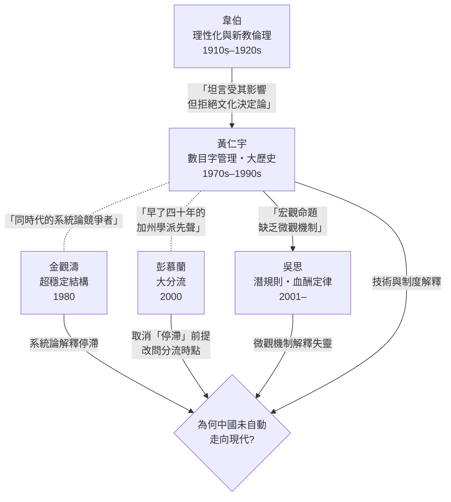
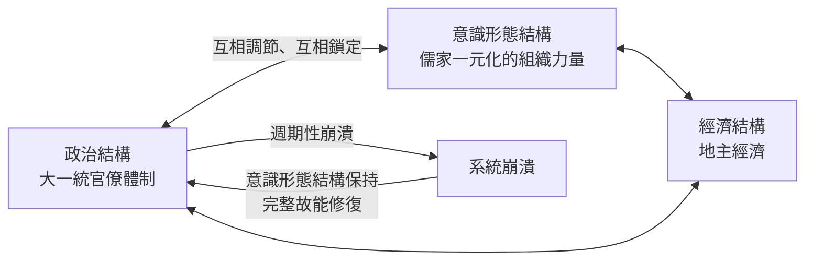

# 5.2 對話：黃仁宇與韋伯、吳思、金觀濤、彭慕蘭

## 一、案發現場：一個獨行俠的譜系問題

黃仁宇生前以「獨行俠」自居——非典型學術出身、被同行排擠、自創「大歷史」名號，彷彿整個中文史學界無人與他同路。但懸案偵查的原則是：**沒有思想是憑空出生的。** 把黃仁宇放回二十世紀解釋「中國為何停滯／分流」的思想星圖上，會發現他與四位關鍵人物——韋伯、吳思、金觀濤、彭慕蘭——構成四場未能當面進行、卻極具生產力的對話。本章的任務，是替他補開這四場對話會議，並在每一場裡標明：誰繼承了誰，誰反駁了誰，誰與誰其實在說同一件事。

先給出全案的思想譜系圖，然後逐一審理：

注意這張圖的樞軸：四場對話全部圍繞同一個問題——**為何中國未能自發走向現代？** 黃仁宇的獨特位置在於：他比吳思早二十年提出宏觀命題，比彭慕蘭早二十年放棄國民性解釋，與金觀濤同代而答案不同，對韋伯則是既受惠又叛離。

## 二、第一場對話：黃仁宇與韋伯——繼承理性化，拒絕文化決定論

1904至1905年，韋伯發表《新教倫理與資本主義精神》，提出一個後來支配整個世紀的問題：為何資本主義誕生於西歐而非其他高度發達的文明？他的答案是「理性化」——把一切生活領域納入可計算、可預期、系統性經營的過程，而新教倫理為此提供了心理動力。

黃仁宇與韋伯的關係，是他本人多次公開承認的：「我的歷史觀之形成，曾受韋伯的影響。」《資本主義與廿一世紀》開篇即以韋伯的定義為討論起點，他對「資本主義」的界定——一種以數目字管理的組織體系——完全是韋伯式理性化概念的技術化改寫。威尼斯、荷蘭、英國的三段驗證（見本書3.3），骨架上就是韋伯「西方為何理性化」命題的史學落地。

但繼承之處恰是分道之處。韋伯在《中國的宗教》裡認為，儒教倫理缺少與世界緊張關係的超越性格，故中國無法自發產生資本主義——這是**文化決定論**的經典版本。黃仁宇對此的背離是釜底抽薪式的：

> 「我認為中國之不能即在數目字上管理，是技術問題，不是道德問題，也不是思想問題。」

這句話把韋伯問題裡的文化變數整個抽掉，換成制度與技術變數：中國不是因為儒家「心態」不能現代化，而是因為洪武型財政把帝國鎖死在低水平簡化治理上（見本書3.2）；一旦技術條件（統計、法律、金融、信用）到位，同一批「有儒家包袱」的華人社會照樣完成數目字管理——台灣與香港就是活證據。**同文同種，兩種命運，文化解釋當場出局。**

偵查上的判決：黃仁宇繼承了韋伯的問題（資本主義=理性化=可計算性）與方法（比較文明、理想型分析），但把答案的落點從「心靈」搬到「制度」。他等於替韋伯做了一次「去文化化」的手術——這也是他與整個戰後「儒家倫理與東亞經濟」論戰（從列文森到余英時的《中國近世宗教倫理與商人精神》）保持距離的深層原因：在他看來，那場論戰問錯了變數。

## 三、第二場對話：黃仁宇與吳思——宏觀命題終於等到微觀機制

2001年，長期在農村調查、辦過雜誌的記者吳思出版《潛規則：中國歷史中的真實遊戲》，提出「潛規則」一詞：在正式制度之下，實際支配社會運行的是另一套不成文但雙方心照的規矩——官吏的「陋規」、下級對上級的「孝敬」、事主與衙役之間的默契交易。他隨後以「血酬定律」補充：暴力掠奪的收益決定暴力集團的行為邏輯。

吳思自認受黃仁宇影響，並把「潛規則」定位為對「數目字管理」命題的補充。這場對話是四場中結構最漂亮的，因為兩人恰好拼出一條完整的因果鏈：

$$
\underbrace{\text{帝國不能在數目字上管理}}_{\text{黃仁宇：宏觀制度命題}}
\;\Longrightarrow\;
\underbrace{\text{真實數據不可得、正式規則不可行}}_{\text{銜接環節}}
\;\Longrightarrow\;
\underbrace{\text{潛規則接管日常運行}}_{\text{吳思：微觀行為機制}}
$$

黃仁宇斷言明代財政「不能在數目字上管理」，但他給出的是總帳層面的證據（稅額三百年的凝固化、戶部無法稽核全國實況，見3.2）；**基層的官吏與胥吏如何在帳面上動手腳、如何把正式稅率偷換成實際盤剝，黃仁宇沒有系統展開**——這正是吳思用無數地方檔案與案例填補的空白。換言之：

- 黃仁宇回答「**為什麼**這個帝國必然依賴潛規則」——因為正式的數字管道不存在，道德話語替代技術治理；
- 吳思回答「潛規則**如何**在日常層面運轉」——陋規的行情、博弈的均衡、清官為何比貪官更難生存。

用一個比喻：黃仁宇畫出了大壩潰決的地質圖，吳思拍了滲漏處的水滴特寫。兩者合併，「數目字管理為何失靈」才從一句斷言變成一個可驗證的機制。潛規則理論同時也埋下反例的種子：如果潛規則如此頑固，那麼單純引進統計技術與法律條文（黃仁宇的藥方）是否足夠？這是黃仁宇體系留給後人的接口——技術條件必須包括「讓潛規則失去租金空間的稽核能力」，否則數目字管理只是新帳面上的舊帝國。

## 四、第三場對話：黃仁宇與金觀濤——兩種系統論，一個停滯之謎

1980年，《興盛與危機》問世，金觀濤與劉青峰提出「中國封建社會的超穩定結構」：中國傳統社會是一個由三個子系統構成的巨型系統——

三個子系統互相適應、互相鎖定，使社會呈現「超穩定」性：每逢王朝崩潰，系統不是被新結構取代，而是被原有結構修復重建——故有王朝循環而無結構演化。停滯的根源不在技術落後，而在**結構的自我修復能力**。

這場對話的特殊之處在於：金觀濤與黃仁宇是**同時代、同問題、同屬系統論、且同樣被學院邊緣化**的競爭者，兩人甚至共享一批1980年代的大陸讀者。但他們的答案差在關鍵一環：

| 比較項 | 金觀濤：超穩定結構 | 黃仁宇：數目字管理 |
| --- | --- | --- |
| 停滯的原因 | 子系統互相鎖定，崩潰後被原結構修復 | 缺乏「在數目字上管理」的技術條件 |
| 意識形態的角色 | 鎖定機制的核心，儒家是系統的黏合劑 | 只是替代數字治理的**症狀**，非病因 |
| 打破停滯的路徑 | 結構被外力衝擊到無法修復 | 技術與組織條件（統計、法律、金融）到位 |
| 對「現代化」的定義 | 走出超穩定結構的演化 | 實現數目字管理 |

分歧的要害在於：**意識形態是病因還是症狀？** 金觀濤認為儒家意識形態是鎖死系統的主動力；黃仁宇認為道德治國不過是數字能力闕如時的替代品——先有洪武型財政的技術簡化，後有道德話語的過度膨脹，順序不可倒置。這個分歧有實證後果：若金觀濤為真，則思想解放（新啟蒙）是現代化的先決條件；若黃仁宇為真，則制度與技術建設（哪怕思想尚未「啟蒙」）亦可先行——改革開放恰恰是後者的歷史驗證：中國的轉型不是先完成思想革命，而是先接通價格、統計、產權的技術管道。

但金觀濤對黃仁宇也有一記真正的回馬槍：黃仁宇能解釋帝國「為何不能數目字管理」，卻不易解釋**為何技術條件遲遲不能自發累積**——宋代的財政技術明明一度領先，為何總在臨界點上退回？「超穩定結構」恰好是這個「退回機制」的系統論說明。**黃仁宇給了靜態診斷，金觀濤補了動態病理**——兩者並置，才是完整的答案。

## 五、第四場對話：黃仁宇與彭慕蘭——早了二十年的「分流」先聲

2000年，彭慕蘭出版《大分流》，引爆「加州學派」革命：直至十八世紀中葉，江南與英格蘭核心區的發展水平相當，雙方都困於「生態瓶頸」；英格蘭的突破靠兩個偶然——煤礦的地理位置與美洲殖民地資源，而非制度或文化優越。此說正面衝擊「歐洲例外論」，也順帶質疑韋伯式問題本身。

懸案的驚人之處在於：**黃仁宇在1970年代已經主張了彭慕蘭結論的一半。** 他在《十六世紀中國之財政與稅收》與後續著作中反覆強調：中西之別不在國民性、不在文明本質，而在「技術上的差距」——具體地說，是財政統計、貨幣金融、法律信用這些組織技術的差距。他甚至在《萬曆十五年》的〈《萬曆十五年》和我的大歷史觀〉中明言，中國的現代化挫折應從技術不能配合處求解，從技術的角度看，歷史問題是可以量化、可以比較的。用今天的分類學說：**黃仁宇是制度技術論者，而「以技術差距取代文化本質」正是加州學派的方法論宣言。** 當彭慕蘭把煤與殖民地拉進解釋時，黃仁宇若在場，想必會同意其前提（拒絕國民性）而質疑其結論的另一半。

衝突點在於對「分流原因」的定性。彭慕蘭的方案是**偶然性與資源稟賦**——若非煤與美洲，工業革命未必發生在歐洲；黃仁宇的方案是**制度技術的可累積性**——英國能通過英格蘭銀行（1694）把國債變成可交易的信用工具，通過財政國家的統計能力動員戰爭資源，而明清帝國即便擁有同樣的煤，其洪武型財政也無法把資源變成持續的制度能力。彭慕蘭把分流歸於運氣，黃仁宇把它歸於組織——**運氣解釋單次分流，組織解釋持續領先。** 事實上，彭慕蘭本人也承認制度因素在十八世紀之後的分量；而黃仁宇從不否認十八世紀之前雙方水平相近。因此這場對話的公允判決是：**部分相容（皆拒文化決定論、皆承認晚至十八世紀仍可比較），部分衝突（偶然稟賦 vs 制度技術）。** 相容的部分證明黃仁宇的先見，衝突的部分暴露其盲點——他對地理與生態因素幾乎無感，這是大歷史觀「制度單變數化」的代價。

## 六、總審理：四場對話拼出的完整拼圖

把四場對話的判決合併，可以拼出一幅完整的圖：

1. **韋伯給了問題（理性化）**，黃仁宇把答案從文化搬到制度；
2. **吳思補了機制（潛規則）**，使宏觀命題落地為微觀運作；
3. **金觀濤補了病理（超穩定的修復機制）**，解釋技術累積為何屢屢中斷；
4. **彭慕蘭檢驗了前提（分流而非本質優劣）**，黃仁宇以制度累積性回應其偶然論。

四場對話共同指向一個結論：**黃仁宇的數目字管理命題，是整條「中國為何停滯」研究鏈條的樞紐環節**——它上承韋伯之問，下接吳思之機制，旁攝金觀濤之系統、彭慕蘭之分流。任何單獨一家都不完整；而把四家併在一起看，黃仁宇的位置不是被取代，而是被反覆印證為**不可或缺的轉接器**。

## 本節要點

- 黃仁宇與韋伯：繼承「資本主義=理性化=可計算性」的問題意識，但以「技術問題非思想問題」拒絕新教倫理式的文化決定論。
- 與吳思：潛規則是「數目字管理為何失靈」的微觀機制；黃仁宇解釋「為何必然依賴潛規則」，吳思解釋「潛規則如何運轉」，兩者構成宏觀命題×微觀機制的完整鏈條。
- 與金觀濤：兩種系統論答案的競爭——意識形態是病因（超穩定結構）還是症狀（數目字闕如的替代品）？改革開放「制度先行、思想未先行」的路徑偏向黃仁宇，但宋代技術中斷之謎仍需金觀濤的修復機制來解釋。
- 與彭慕蘭：黃仁宇早在1970年代即以「技術差距」取代「國民性」解釋中西分流，與加州學派方法論部分相容；但在分流原因上，偶然稟賦（彭）與制度技術的累積性（黃）構成真正的衝突。

## 延伸對照

- 英國「財政—金融組織」的細節，見 [../../世界史/世界發展史/1694-英格蘭銀行.md](../../歷史探案/世界史/世界發展史/1694-英格蘭銀行.md)：英格蘭銀行正是黃仁宇「數目字管理」三段驗證的終點站，也是他與彭慕蘭分歧的實證戰場。
- 停滯與鎖定的跨文明比較，可參照 [../國家為何衰敗/README.md](../../歷史探案/書籍/國家為何衰敗/README.md)：「汲取性制度自我維持」的論證與金觀濤的超穩定結構、吳思的潛規則形成三方互證。
- 黃仁宇如何以明代個案支撐宏觀命題，回看本書 3.2；三段驗證的展開見 3.3。
