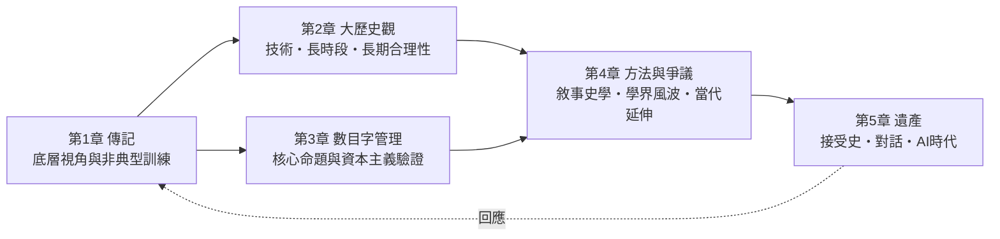

# 黃仁宇

> Ray Huang (1918–2000)
> ——一個人的大歷史：從緬甸的敗兵到萬曆十五年的史家

黃仁宇是二十世紀中文史學界最「不像史家」的史家：47 歲才拿到博士學位，61 歲出版《萬曆十五年》卻被中文學界多方退稿，最終以一本薄薄的小書改寫了兩岸幾代人的歷史閱讀方式。他的一生本身就是一樁懸案：**為何一個半路出家、屢遭學界排擠的老兵，能提出影響遠超學院之外的「大歷史觀」與「數目字管理」？**

本書以「偵查式」筆法審理此案。核心論旨：**黃仁宇的史學 = 傳奇性人生經驗（底層視角）× 非典型學術訓練（跨學科技術語言）× 對「為何中國現代化失敗」的切身追問**。三者缺一，都得不到那個獨特的答案——把歷史的解釋權從道德人物轉交給制度與數字。

## 目錄

* 第1章-傳記：從長沙到紐約——一個老兵的二次人生
    * [1.1-軍旅歲月：抗戰、緬甸與「底層的凝視」](01.1-軍旅歲月：抗戰、緬甸與「底層的凝視」-1937-1949.md)
    * [1.2-密西根的博士：四十七歲的重新開始](01.2-密西根的博士：四十七歲的重新開始-1964-1975.md)
    * [1.3-《萬曆十五年》：被退稿多次的奇書](01.3-《萬曆十五年》：被退稿多次的奇書-1979-1982.md)
* 第2章-史學思想（上）：大歷史觀的方法
    * [2.1-何謂大歷史：從技術的角度長時間遠距離看歷史](02.1-何謂大歷史：從技術的角度長時間遠距離看歷史-1970-1979.md)
    * [2.2-技術解釋對抗道德解釋：歷史學的「哥白尼式轉向」](02.2-技術解釋對抗道德解釋：歷史學的「哥白尼式轉向」-1974-1982.md)
    * [2.3-長期合理性：歷史不會長期倒退，但會長期繞路](02.3-長期合理性：歷史不會長期倒退，但會長期繞路-1988-1999.md)
* 第3章-史學思想（下）：數目字管理與資本主義
    * [3.1-核心命題：現代國家的分野在於能否在數目字上管理](03.1-核心命題：現代國家的分野在於能否在數目字上管理-1970-1979.md)
    * [3.2-明代個案：洪武型財政為何讓帝國「不能在數目字上管理」](03.2-明代個案：洪武型財政為何讓帝國「不能在數目字上管理」-1368-1644.md)
    * [3.3-資本主義與廿一世紀：威尼斯、荷蘭、英國的三段驗證](03.3-資本主義與廿一世紀：威尼斯、荷蘭、英國的三段驗證-1990-1999.md)
* 第4章-方法、敘事與爭議
    * [4.1-敘事史學：讓六個人物帶出整套制度](04.1-敘事史學：讓六個人物帶出整套制度-1979-1982.md)
    * [4.2-學界風波：批評、辯護與「黃仁宇現象」](04.2-學界風波：批評、辯護與「黃仁宇現象」-1980-2000.md)
    * [4.3-近現代三部曲：從蔣介石日記到大歷史的當代延伸](04.3-近現代三部曲：從蔣介石日記到大歷史的當代延伸-1994-2000.md)
* 第5章-遺產：一個人的大歷史
    * [5.1-接受史：為何影響力在學院之外、兩岸之內](05.1-接受史：為何影響力在學院之外、兩岸之內-1982-2000.md)
    * [5.2-對話：黃仁宇與韋伯、吳思、金觀濤、彭慕蘭](05.2-對話：黃仁宇與韋伯、吳思、金觀濤、彭慕蘭-1970-2001.md)
    * [5.3-尾聲：AI 時代的數目字管理與黃仁宇的未竟之問](05.3-尾聲：AI 時代的數目字管理與黃仁宇的未竟之問-2000-2024.md)

## 全書結構

## 核心概念速查

| 概念 | 一句話定義 | 本書位置 |
| --- | --- | --- |
| 大歷史（macro-history） | 從長時段、遠距離、技術角度縱覽歷史 | 2.1 |
| 數目字管理 | 以真實、連續、可稽核的數字治理國家 | 3.1 |
| 技術解釋 | 用制度與組織的技術條件取代善惡評斷 | 2.2 |
| 洪武型財政 | 以道德與人事替代數據的低水平簡化治理 | 3.2 |
| 長期合理性 | 歷史上的失敗亦有當時技術條件下的合理性 | 2.3 |

## 引用說明

本書與探案庫的《國家為何衰敗》《國家如何才能在數目字上管理》《工業革命為何出現在歐洲》互為姊妹篇；史料連結採相對路徑指向 `../../世界史/` 與 `../../科技史/`。
