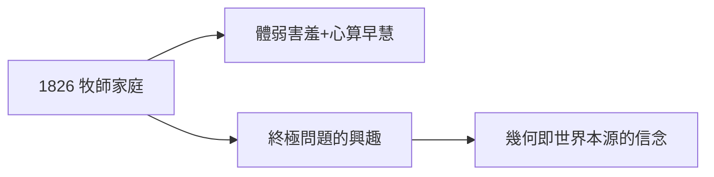

# 1.1 貧寒的牧師家庭

1826 年 9 月 17 日，格奧爾格·弗里德里希·伯恩哈德·黎曼（Bernhard Riemann）出生於漢諾威王國布雷瑟倫茨村。父親是路德宗牧師，家有六個孩子，收入微薄。黎曼自幼體弱、害羞，終身與貧病相伴——只活了 39 歲。

## 早慧與害羞

- 小學時心算能力驚人，老師給的難題他總能口算；
- 性格極度內向，公開講話會緊張到失態（這個弱點差點毀了他的就職演講，見 3.2）；
- 最親近的人是姐姐們——終身未婚，與家人感情極深。

## 牧師之家的烙印

父親希望他繼承神職。路德宗的氛圍給了他兩件東西：

1. **對「終極問題」的興趣**：神學追問世界本源，數學追問結構本源——在他心裡，這是同一件事；
2. **清貧的習慣**：一生對物質毫無要求，稿費、薪水只夠餬口也安之若素。

**因果**：牧師之子追問「空間是什麼」，與神學家追問「上帝是什麼」用的是同一種虔誠。下一節，這份虔誠將在神學與數學之間做出抉擇。
