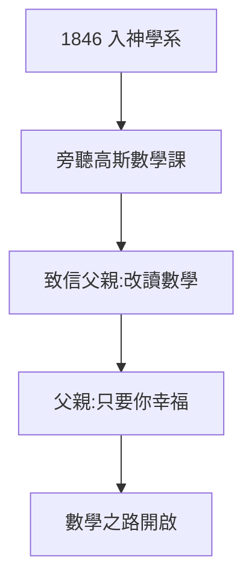

# 1.2 神學與數學的抉擇

## 1846：入哥廷根讀神學

19 歲的黎曼遵父命進入哥廷根大學神學系。但他把時間全花在聽高斯、斯特恩（Stern）的數學課上。一個學期後，他寫信給父親：「我確信，數學才是我的天職。」父親回信只有一句話：**只要你幸福，就去讀數學吧**。

## 中學校長的伯樂

早在中學時代，校長施馬爾弗斯（Schmalfuss）就發現了他的天賦，借給他勒讓德的《數論》——800 多頁的大部頭，黎曼一週讀完並完全掌握。校長驚嘆：「這孩子的理解力超出我的想像。」

## 抉擇的意義

- 對父親：放棄了家族期望的神職；
- 對自己：選擇了更窮、更難的路（19 世紀德國數學教職稀少）；
- 對歷史：如果他當了牧師，就沒有黎曼幾何、沒有黎曼猜想——廣義相對論將推遲數十年。

**因果**：父親的一句「只要你幸福」，是科學史上最偉大的家長放手之一。沒有這句話，就沒有下一章的柏林與哥廷根——也沒有現代物理的時空舞台。
