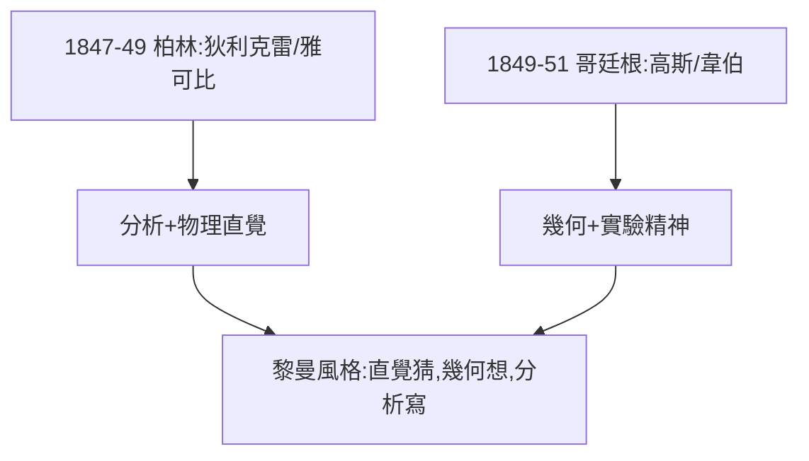

# 1.3 轉入哥廷根

## 1847–49：柏林歲月

改讀數學後，黎曼先去柏林大學（1847–49）聽課：狄利克雷、雅可比、艾森斯坦——當時德國最強的分析陣容。1848 年革命爆發，他還參加過學生自衛隊守衛王宮（害羞的青年也有熱血時刻）。

## 重返哥廷根

1849 年回哥廷根，在高斯、韋伯門下學習，並在韋伯的物理實驗室當助手。**這段物理實驗經歷至關重要**：他親手做過電磁實驗，對「物理直覺」的信任超過同時代任何純數學家。

## 雙重血統的形成

- 柏林：狄利克雷的分析嚴格性 + 物理直覺；
- 哥廷根：高斯的幾何洞察 + 韋伯的實驗精神。

黎曼後來的風格——**用物理直覺猜，用幾何圖像想，用分析嚴格寫**——正是這兩地血統的混合。

**因果**：柏林給他分析的刀，哥廷根給他幾何的眼。下一章，狄利克雷與高斯兩位巨人將分別以不同方式塑造他——一位教他「想」，一位教他「看」。
