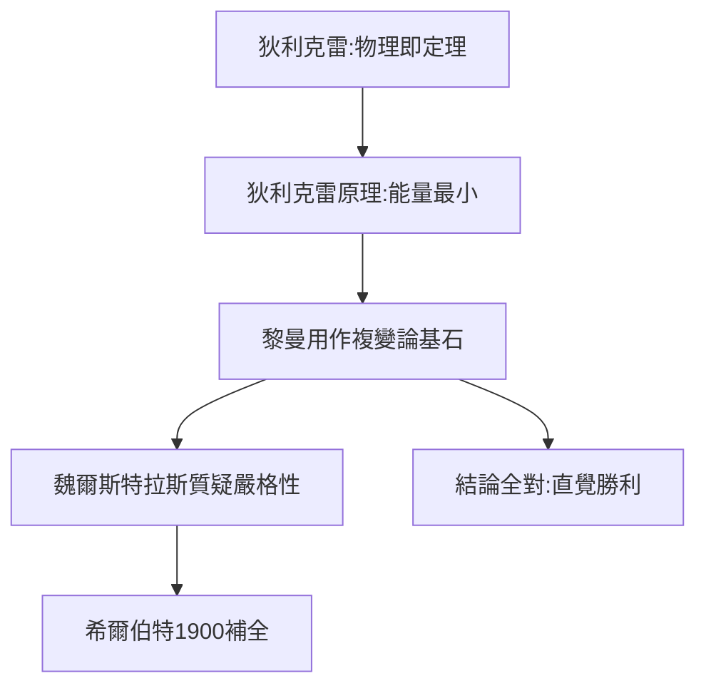

# 2.1 狄利克雷的物理直覺

## 「用物理思考數學」

狄利克雷（Dirichlet，高斯《算術研究》的第一闡釋者）是黎曼在柏林最崇拜的老師。他的口頭禪是：「不要只計算，要思考背後的原理——薄膜的振動、熱的流動，本身就是定理。」

## 狄利克雷原理

狄利克雷提出：給定邊界值，使能量積分最小的函數即為調和函數——**物理的最小能量原理直接給出數學存在性**。黎曼把這個原理命名為「狄利克雷原理」，並作為複變函數論的基石大膽使用（後來魏爾斯特拉斯指出其嚴格性漏洞，由希爾伯特 1900 年補全——但黎曼用它得到的結論全對）。

## 影響的本質

狄利克雷教會黎曼：**物理直覺不是數學的敵人，是嚮導**。先相信薄膜會繃緊成極小曲面，再去證明它——這種「先信後證」的風格，與高斯「先證後說」恰好相反，而黎曼兼有兩者。

**因果**：狄利克雷的物理直覺是黎曼方法論的一半；另一半在哥廷根——下一節，高斯將教他「看」幾何。
