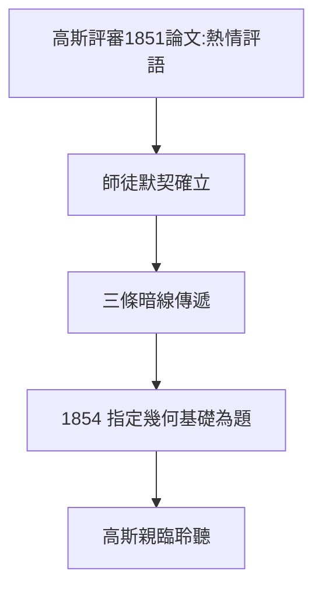

# 2.2 高斯的指導

## 吝於誇人的巨人

高斯幾乎不指導學生，但對黎曼例外：博士論文（1851）他親自評審，評語是罕見的熱情——「論文證明作者具有深刻的、獨立的思考能力」。對高斯而言，這等於加冕。

## 三條暗線的傳遞

高斯沒有「教」黎曼具體定理，但傳遞了三件無價之物（詳見《高斯傳》5.1）：

1. **非歐幾何的世界觀**：空間不一定是歐幾里得的——這給了黎曼演講的哲學底氣；
2. **曲面論的高維暗示**： $ds^2$ 度量思想的種子；
3. **物理即幾何的信念**：地磁、測量經驗讓高斯相信，幾何是物理世界的一部分。

## 1854 演講的命題人

哥廷根有傳統：就職演講題目由正教授指定。高斯特意為黎曼指定了第三個題目——**幾何基礎**。他知道這個害羞的青年心裡藏著什麼，並親自到場聆聽（年邁的高斯很少聽就職演講）。

**因果**：高斯一生不收徒，卻為黎曼破例兩次——熱情評語與指定題目。這是「數學王子」向「先知」的傳位儀式。下一節，博士論文將展示黎曼自己的第一把火。
