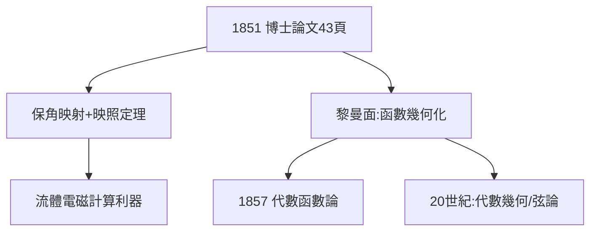

# 2.3 複變函數博士論文

## 1851：幾何化的複分析

博士論文《單複變函數的一般理論基礎》只有 43 頁，卻重建了整個複變函數論：

1. **柯西-黎曼方程的幾何意義**：解析函數 = 保角映射（conformal mapping）；
2. **黎曼映照定理**：任何單連通區域都可保角映照到單位圓盤；
3. **黎曼面**：多值函數（如 $\sqrt{z}$、$\log z$）應理解為定義在多層曲面上的單值函數——**把函數變成幾何對象**。

## 方法論的宣言

論文通篇貫徹狄利克雷原理：用物理直覺（靜電場、流體）保證存在性，再用分析落實。這種風格震驚了評審——高斯說它「深刻而獨立」，正是看到了這種前所未有的混合。

## 後續爆炸

- 黎曼面 → 代數幾何、模形式、弦論的世界面；
- 保角映射 → 流體力學、電磁學計算的利器；
- 存在性方法的信任 → 1857 年代數函數論的全面展開（見 4.1）。

**因果**：博士論文是黎曼「幾何化一切」綱領的第一次亮相。複分析只是練兵場——真正的目標（空間本身的幾何）將在 1854 年的演講中揭曉。
