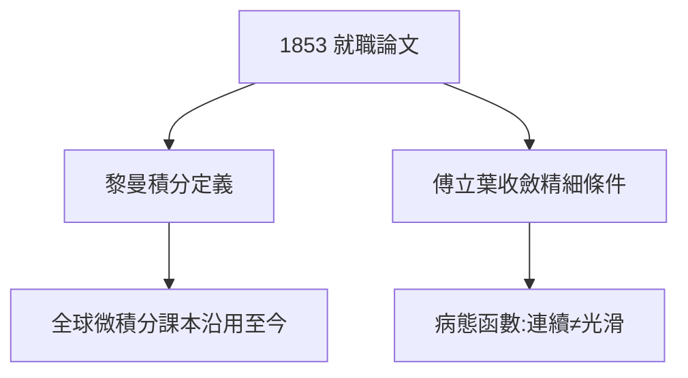

# 3.1 黎曼積分與傅立葉級數

## 1853：就職論文第一擊

為取得授課資格（Habilitation），黎曼提交論文《用三角級數表示函數的可能性》。為嚴格討論傅立葉級數，他重新定義了積分——**黎曼積分**：把區間分割、取樣、求和取極限：

$$\int_a^b f = \lim_{\|P\|\to 0}\sum f(\xi_i)\Delta x_i$$

今天全世界微積分課本裡的積分定義，就是它（勒貝格積分 1902 年才將其推廣）。

## 條件的銳利

他給出了傅立葉級數收斂的精細條件，並構造了處處連續、處處不可微函數的早期例子（後由魏爾斯特拉斯完善）——**病態函數進入了分析的殿堂**，動搖了「連續即光滑」的直覺。

## 一年三擊的第一擊

1852–54 年間，黎曼連發三彈：就職論文（分析）、博士後的物理研究（電動力學）、就職演講（幾何）。每一彈都開闢一個領域——科學史上罕見的密度。

**因果**：黎曼積分是「熱身」——它證明了黎曼重建基礎的能力。而真正的決戰（幾何基礎）將在一年後的演講中打響。
