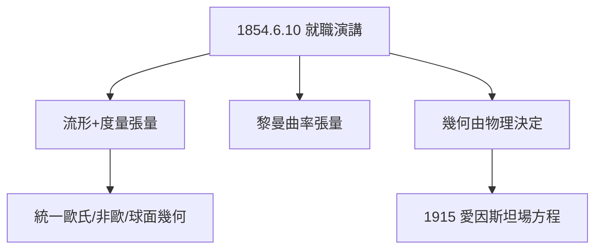

# 3.2 就職演講：黎曼幾何

## 1854 年 6 月 10 日

哥廷根哲學院，全場坐滿，高斯親臨。害羞的黎曼發表《論作為幾何基礎的假設》（Über die Hypothesen, welche der Geometrie zu Grunde liegen），全文幾乎沒有公式——卻是數學史上最富遠見的演講之一。

## 演講的三層革命

1. **流形的概念**：$n$ 維空間由局部座標描述，$ds^2 = \sum g_{ij}dx^idx^j$ 決定一切幾何——歐幾里得、羅巴切夫斯基、球面幾何都是特例；
2. **曲率張量**：彎曲由四階張量（黎曼曲率）刻畫，高斯曲率只是二維特例；
3. **物理的預言**：空間的幾何應由物理（物質、力）決定——「空間本身可能是彎曲的，彎曲的原因在於其中的物理實在。」

第三點在 1854 年無人能懂——直到 1915 年愛因斯坦寫下

$$R_{\mu\nu} - \frac{1}{2}Rg_{\mu\nu} = \frac{8\pi G}{c^4}T_{\mu\nu}$$

人們才發現，方程左邊的幾何正是黎曼的遺產。

**因果**：從博士論文的「函數幾何化」（2.3）到演講的「空間幾何化」，黎曼完成了從分析到宇宙的飛躍。六十年後，一個專利局職員將用它改寫時空。
