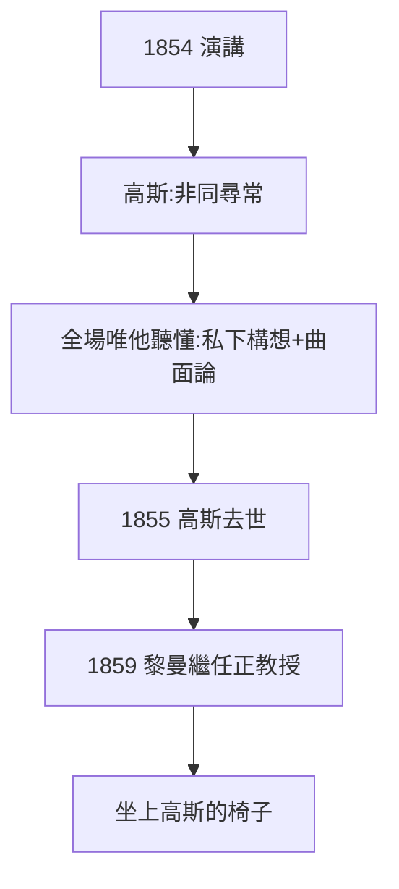

# 3.3 高斯的驚嘆

## 「非同尋常」

演講結束，高斯匆匆離開（年邁體弱）。回到家，他對前來探望的韋伯說：這個年輕人「**非同尋常**」（von ungewöhnlicher Tiefe）。這是高斯晚年對後輩唯一的公開讚譽——此前他對羅巴切夫斯基、阿貝爾都只在私信中表示過欣賞。

## 為什麼高斯聽懂了

全場只有高斯真正明白演講的分量，因為：

- 非歐幾何的私下構想（高斯傳 3.3）→ 他知道第五公設垮了；
- 曲面論的絕妙定理（高斯傳 4.1）→ 他知道內蘊幾何是對的；
- 黎曼把這兩條線推廣到 $n$ 維並連接物理——這正是高斯想做而沒做的事。

## 傳位的完成

高斯 1855 年去世，1859 年黎曼繼任哥廷根正教授——**高斯的椅子**。從 1846 年入學旁聽，到 1859 年坐上老師的椅子，十三年完成傳位。

**因果**：一句「非同尋常」是舊王對新王的加冕。從此黎曼不再是學生，而是哥廷根的主人——下一章，他將在這把椅子上寫出素數定理的鑰匙。
