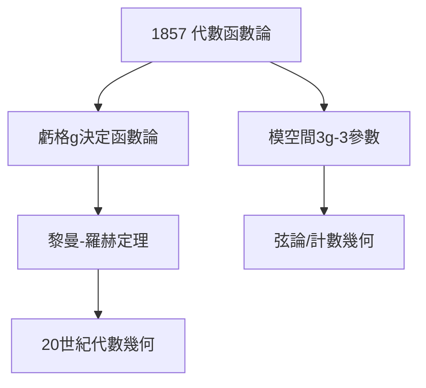

# 4.1 黎曼面與代數函數

## 1857：代數函數論

論文《代數函數及其積分理論》把博士論文的黎曼面推廣到一般代數函數 $F(w,z)=0$：每個代數函數對應一個緊黎曼面，其**虧格** $g$（洞的個數）決定函數的性質——著名的**黎曼-羅赫定理**（經羅赫補全）給出亞純函數空間的維數：

$$\ell(D) - \ell(K-D) = \deg D + 1 - g$$

## 幾何即函數

核心思想：**函數的分析性質 = 曲面的拓撲性質**。虧格 0（球面）→ 有理函數；虧格 1（環面）→ 橢圓函數；虧格 ≥2 → 自守函數。20 世紀的代數幾何（義大利學派、格羅滕迪克）都是這篇論文的注腳。

## 模空間的先聲

黎曼還提出：虧格 $g$ 的曲面依賴於 $3g-3$ 個參數（模）——**模空間**概念的誕生。今天弦論、 enumerative geometry 都在研究它。

**因果**：從 1851 年的黎曼面（2.3）到 1857 年的完整理論，複分析徹底幾何化。而同年（1859 前後），他的注意力轉向了另一個方向——素數。
