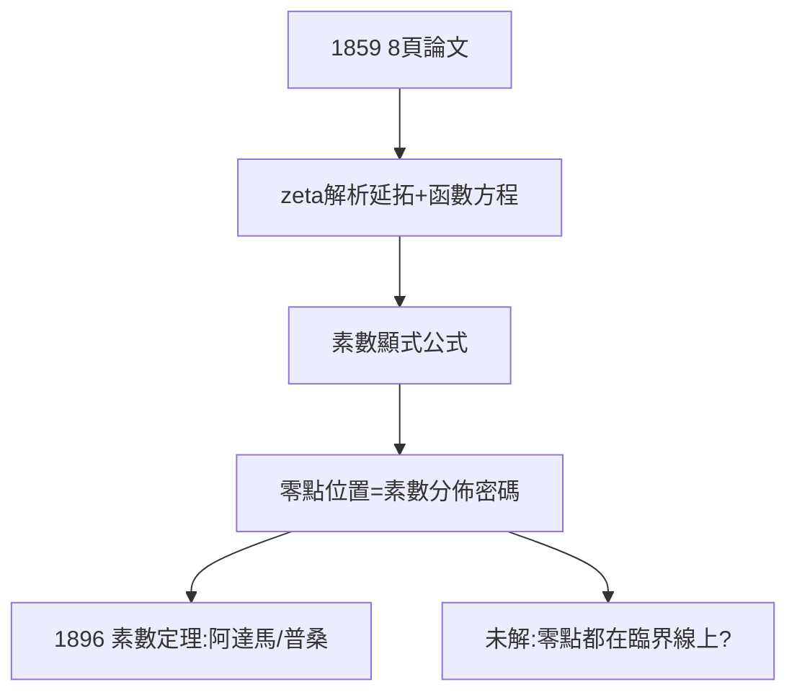

# 4.2 1859：論素數個數

## 8 頁紙的奇蹟

1859 年，為慶祝當選柏林科學院通訊院士，黎曼提交 8 頁論文《論小於給定數值的素數個數》——解析數論的開山之作，也是他一生唯一的數論論文。

## zeta 函數的解析延拓

歐拉研究過 $\zeta(s)=\sum n^{-s}$ （實 $s>1$ ），黎曼把它**解析延拓到整個複平面**（除 $s=1$ 的極點），並證明函數方程：

$$\zeta(s) = 2^s\pi^{s-1}\sin\frac{\pi s}{2}\,\Gamma(1-s)\,\zeta(1-s)$$

## 素數的顯式公式

他給出 $\pi(x)$ （小於 $x$ 的素數個數）與 zeta 零點的顯式關係：

$$\pi(x) = \mathrm{Li}(x) - \sum_{\rho}\mathrm{Li}(x^{\rho}) + \cdots$$

——素數的分佈，完全由 zeta 零點 $\rho$ 的位置編碼。這是人類第一次「看見」素數背後的譜。

**因果**：一篇 8 頁的「應景之作」，開闢了解析數論，並留下數學史上最著名的懸案——下一節，那個猜想。
