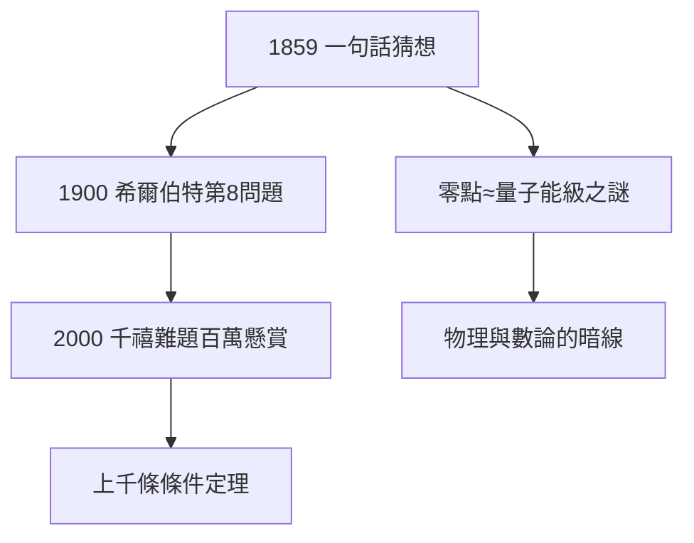

# 4.3 黎曼猜想

## 一句話的懸案

在 1859 年論文中，黎曼順帶寫道：「……很可能所有非平凡零點都位於直線 $\Re(s)=\frac12$ 上，但我未能給出證明。」——**黎曼猜想**（Riemann Hypothesis）：

$$\zeta(s)=0,\ s\notin\{-2,-4,\dots\}\ \Rightarrow\ \Re(s)=\frac12$$

## 為什麼它最重要

- 希爾伯特 1900 年 23 問題之第 8；
- 克萊研究所千禧年七大難題之一，懸賞 100 萬美元；
- 上千條定理以它為條件（「假設 RH 成立，則……」）——它是整個解析數論的地基；
- 與量子混沌、隨機矩陣的神秘聯繫（蒙哥馬利-戴森猜想）：零點間距 ≈ 重核能級間距。

## 160 年的圍攻

- 1914 哈代：無窮多零點在臨界線上；
- 1970s 萊文森：至少 1/3；
- 2004+ 計算驗證：前 $10^{13}$ 個零點全中；
- 但證明：依然為零。

**因果**：黎曼隨手寫下的一句「很可能」，成了數學的聖杯。它與黎曼幾何（3.2）並列為黎曼的兩大遺產——一個已被愛因斯坦兌現，一個仍在等待它的愛因斯坦。
