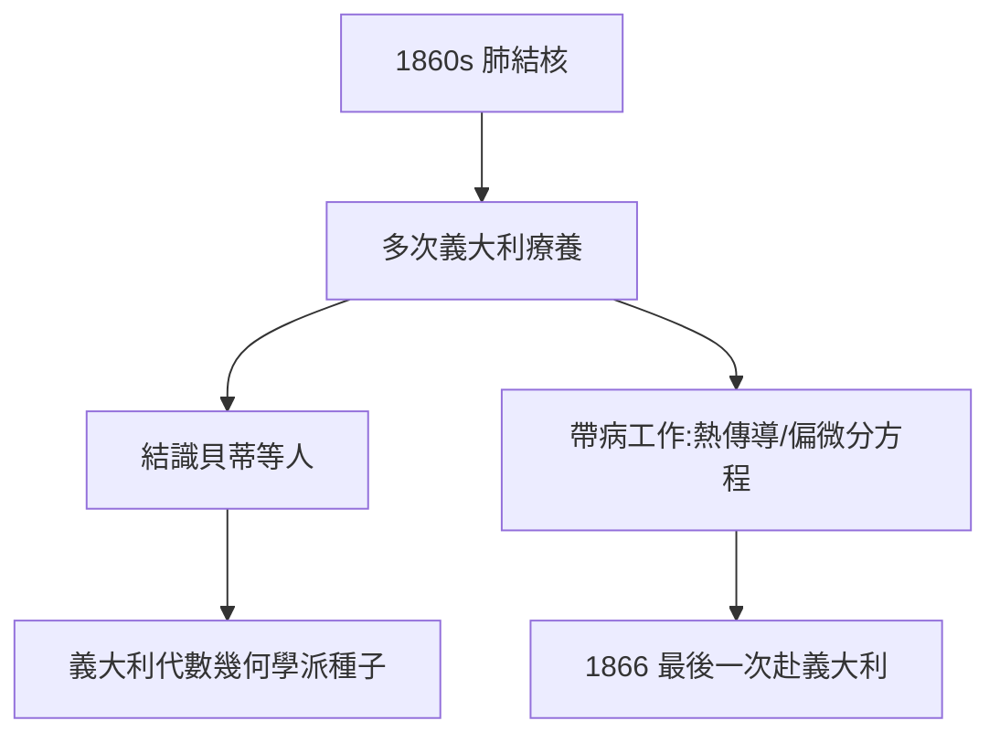

# 5.1 義大利療養

## 結核的陰影

1860 年代初，黎曼患上肺結核（當時的不治之症，與他少年體弱一脈相承）。病情時好時壞，他多次前往義大利療養——地中海的陽光暫時緩解了咳嗽，卻擋不住病魔。

## 義大利的數學友誼

療養期間，他結識了貝蒂（Betti）、卡索拉蒂等義大利數學家，傳播了黎曼面的思想。義大利代數幾何學派（克雷莫納、塞格雷）的種子，正是在這些病榻之交中播下的。

## 帶病工作

即使在療養地，他仍在思考：

- 1861 年：關於熱傳導的遺稿（死後發表，含「黎曼-勒貝格引理」雛形）；
- 1864 年：重返哥廷根講授偏微分方程；
- 1866 年夏：最後一次赴義大利，住在馬焦雷湖畔的塞拉斯卡。

**因果**：疾病把他推向義大利，義大利把他的思想傳向南歐。病榻上的播種，將在下一代義大利幾何學家手中開花——而他自己的時間，只剩幾個月了。
