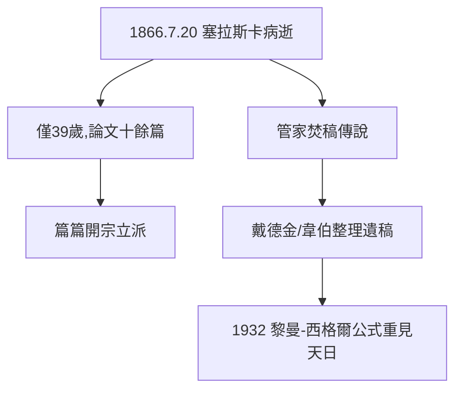

# 5.2 1866 病逝

## 馬焦雷湖畔的最後日子

1866 年 7 月 20 日，黎曼在義大利塞拉斯卡（Selasca）去世，年僅 39 歲。去世前一天，他還在無花果樹下工作，妻子愛麗絲陪伴在側。遺言平靜，一如他害羞而虔誠的一生。

## 39 年的密度

他發表的論文僅十餘篇，卻篇篇開宗立派：

| 年份 | 工作 | 開闢的領域 |
|---|---|---|
| 1851 | 複變函數論 | 黎曼面 |
| 1853 | 就職論文 | 黎曼積分 |
| 1854 | 就職演講 | 黎曼幾何 |
| 1857 | 代數函數論 | 代數幾何 |
| 1859 | 素數論文 | 解析數論 |

科學史上單位時間密度如此之高者，唯伽羅瓦（21 歲死）可比——而黎曼每一篇都完成了證明（伽羅瓦多為草稿）。

## 管家的火

傳說他去世後，管家燒掉了一些未發表的草稿——數學史永遠的遺憾。殘存的遺稿由戴德金、韋伯整理出版，仍不斷給人驚喜（如黎曼-西格爾公式，1932 年才從遺稿中發現）。

**因果**：39 年的生命，密度超過多數人 80 年的兩倍。焚稿的傳說提醒我們：我們看到的黎曼，可能還不是完整的黎曼。
