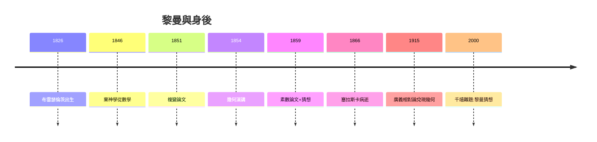

# 5.3 廣義相對論與百年懸案

## 1915：預言的兌現

愛因斯坦在格羅斯曼幫助下學會黎曼幾何，1915 年寫下場方程。廣義相對論的三個經典驗證（水星近日點、光線彎曲、紅移）全部通過——1854 年演講中的第三層革命（「幾何由物理決定」）在 61 年後成真。愛因斯坦說：「如果沒有黎曼的幾何，我走不到這一步。」

## 20 世紀的全面開花

- **代數幾何**：義大利學派 → 韋伊 → 格羅滕迪克，黎曼-羅赫定理層層推廣（阿蒂亞-辛格指標定理）；
- **拓撲**：黎曼面的虧格 → 同調論、示性類；
- **數學物理**：弦論的世界面就是黎曼面；共形場論的數學基礎是 1851 年論文；
- **數論**：素數定理（1896）證實了顯式公式的威力，黎曼猜想仍懸。

## 懸案與先知

**因果閉環**：牧師之子追問「空間是什麼」（1.1），愛因斯坦用他的答案寫下宇宙方程；他隨手寫下的猜想（4.3），至今仍是數學的聖杯。黎曼的一生證明：**最虔誠的追問，會得到最長久的回聲**——先知死後，預言一個個成真，只有最後一個，還在等待。
