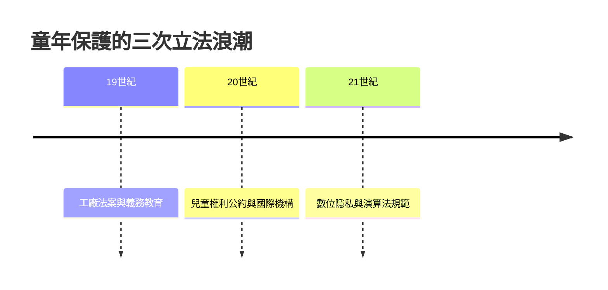

# 10.2 網紅童星、數位隱私與AI伴侶

2010年代以來，數位科技對童年的滲透進入了更深的層次：兒童不僅是媒體的消費者，也成為媒體的內容；不僅是人際關係的參與者，也開始與人工智慧建立親密關係。這些現象共同提出了一個問題：在演算法與AI高度滲透的世界裡，我們如何為下一代守護童年？

## Sharenting：父母曬娃的隱私代價

Sharenting（分享育兒）指的是父母在社交媒體上大量發布兒童的照片與生活細節。研究估計，在兒童十三歲之前，其父母平均已在網上發布了上千張兒童影像。這些內容在兒童尚無同意能力的時候，就建立了兒童的數位身分。

問題有三層。第一是隱私：兒童無法控制自己的影像被誰觀看、被如何使用，影像可能被人臉辨識、被爬取、被濫用。第二是自主權：父母發布的育兒糗事、患病紀錄與家庭衝突，將伴隨兒童一生，而兒童從未同意。第三是商業剝削：兒童網紅（YouTube上跟拍兒童日常的頻道、以兒童為主角的帳號）已成為產業，兒童成為父母的收入來源。2010年代末，多起兒童網紅家庭的爭議引發了法律行動，美國伊利諾州與明尼蘇達州先後立法，要求家庭頻道為出鏡兒童設立信託帳戶，法國2023年立法規範兒童網紅的工作時間與收益保障。

兒童權利公約的精神在此得到新的應用：兒童的最佳利益與兒童意見的尊重，意味著兒童在成長後有權要求刪除未經同意的影像，這個被稱為被遺忘權的訴求，已成為兒童數位權利的核心議題。

## AI伴侶與新的親密關係

2020年代，生成式AI的爆發把問題推向新層次。兒童與青少年開始與AI聊天機器人建立日常對話關係：AI是隨時在線、永不疲倦、無限耐心的傾聽者，它會記住你的喜好、用你喜歡的方式回應。對孤獨的兒童來說，這種關係具有真實的情感吸引力。

風險與機會並存。機會在於：AI可以作為學習伙伴、閱讀夥伴與情緒支持工具。風險在於：AI的回應以討好與留存為目標，可能強化依賴；它沒有真實的生命經驗，卻以親密語氣出現；兒童在關鍵的社會化階段，把大量關係需求投向沒有責任、沒有真實性的對象，可能影響其人際能力的發展。2024年以來，已出現青少年與AI陪伴應用的爭議案件，多國監管機構開始對AI應用的未成年人保護進行審查。

更深的問題是哲學的：當AI可以扮演朋友、老師甚至替代性的家人，童年的社會結構（依賴真實他人的成長）是否正在被改寫？皮亞傑說兒童是小小科學家，透過與真實世界的互動建構知識；如果互動對象是為了留存而優化的演算法，建構出來的世界觀會是什麼樣子？

## 守護童年的新任務

從斯巴達的嬰兒篩選到演算法的注意力競爭，本書講述的歷史有一條主線：兒童的地位取決於社會結構，而社會結構是可以改變的。童工被立法廢除，義務教育被制度建立，兒童權利被公約確認，這些改變都是先有思想（洛克、盧梭、柯札克），再有調查（工廠委員會、礦業報告），再有立法（工廠法案、兒童權利公約）。

數位時代的童年保護，也將循同樣的路徑：需要新的柯札克式思想（兒童在數位世界也是公民）、新的調查（演算法如何影響兒童發展）、新的立法（兒童資料保護、設計規範、平台責任）。2020年代已經出現了起點：多國立法禁止兒童社交媒體、規範兒童網紅、要求AI的未成年人保護。

兒童的故事沒有終點。每一代人都會用當時的技術與制度，重新回答那個古老的問題：兒童是什麼、需要什麼、擁有什麼權利。本書的歷史告訴我們，答案從來不是自然而然出現的，而是被思想、運動與立法一點一點爭取來的。下一代人的童年，將由今天的我們書寫。
