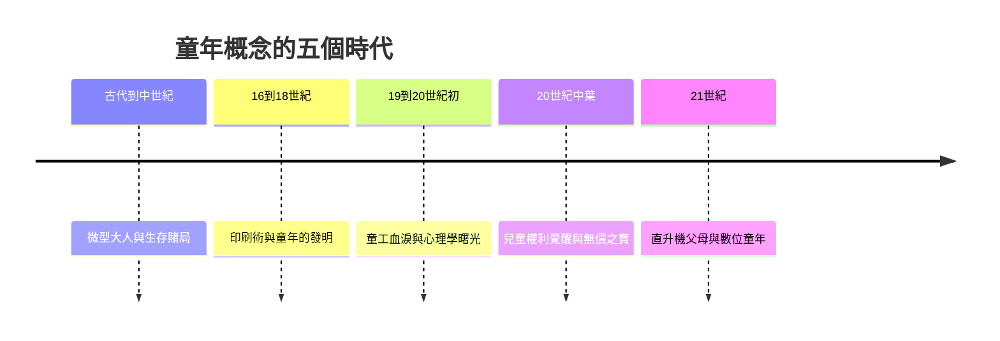

# 兒童的故事：從「微型大人」、童年被發明到兒童權利與數位世代的童年革命

本書跨越數千年，講述「兒童」與「童年」如何從古代被視為脆弱的私有財產、小號的成人，經歷工業革命的童工苦難、啟蒙運動對童年的發明、兒童心理學的建立，一路演變成現代具備獨立權利主體，並在數位時代面臨全新挑戰的文明史。

全書依循四條交織的線索：

1. 概念與定義：微型大人、需要被塑造的白板、神聖純潔的自然個體、具備獨立權利的公民主體。
2. 社會角色：家族經濟的補貼者、學校與家庭的保護對象、情感核心與消費市場的主角。
3. 成長環境：篝火與街頭、工廠與礦坑、學校公園與兒童房、螢幕網路與演算法虛擬空間。
4. 與成人的關係：絕對服從與私有支配、啟蒙教育與權威塑造、心理共情與權利保障、數位時代的邊界重塑與隱私反思。

## 目錄

* 第1章-神廟棄兒、溺嬰與嚴苛的鍛造（約西元前3000年–西元5世紀）
    * [1.1-斯巴達篩選與雅典棄養](01.1-斯巴達篩選與雅典棄養.md)
    * [1.2-羅馬家父權與早婚的童年](01.2-羅馬家父權與早婚的童年.md)
* 第2章-沒有「童年」的概念——中世紀的微型大人（西元5世紀–15世紀）
    * [2.1-阿利耶斯與微型大人的圖像](02.1-阿利耶斯與微型大人的圖像.md)
    * [2.2-七歲進入成人世界的學徒制](02.2-七歲進入成人世界的學徒制.md)
* 第3章-印刷術、學校教育與「童年」的誕生（西元16世紀–17世紀）
    * [3.1-波茲曼的理論：識字門檻與童年的邊界](03.1-波茲曼的理論：識字門檻與童年的邊界.md)
    * [3.2-宗教改革與學校制度的興起](03.2-宗教改革與學校制度的興起.md)
* 第4章-盧梭的野性與童年的神聖化（西元1693年–1762年）
    * [4.1-洛克的白板說與教育漫話](04.1-洛克的白板說與教育漫話.md)
    * [4.2-盧梭與愛彌兒](04.2-盧梭與愛彌兒.md)
* 第5章-煙囪清掃工與工廠齒輪上的童年（西元1800年代–1880年代）
    * [5.1-礦坑、紡織廠與煙囪裡的童年](05.1-礦坑、紡織廠與煙囪裡的童年.md)
    * [5.2-狄更斯與1833年工廠法案](05.2-狄更斯與1833年工廠法案.md)
* 第6章-玩具、童話與兒童心理學的曙光（西元1850年代–1920年代）
    * [6.1-安徒生、格林與愛麗絲：童書的黃金時代](06.1-安徒生、格林與愛麗絲：童書的黃金時代.md)
    * [6.2-皮亞傑與蒙特梭利：兒童心智的科學](06.2-皮亞傑與蒙特梭利：兒童心智的科學.md)
* 第7章-柯札克與戰火中的兒童宣言（西元1920年代–1948年）
    * [7.1-柯札克與孤兒之家](07.1-柯札克與孤兒之家.md)
    * [7.2-二戰兒童悲劇與UNICEF的成立](07.2-二戰兒童悲劇與UNICEF的成立.md)
* 第8章-從「經濟工具」到「情感無價」（西元1950年代–1989年）
    * [8.1-澤利澤與定價無價的兒童](08.1-澤利澤與定價無價的兒童.md)
    * [8.2-1989年兒童權利公約](08.2-1989年兒童權利公約.md)
* 第9章-過度保護與消失的遊戲場（西元1990年代–2010年代）
    * [9.1-直升機父母與密集育兒](09.1-直升機父母與密集育兒.md)
    * [9.2-自由遊戲空間的縮減](09.2-自由遊戲空間的縮減.md)
* 第10章-螢幕兒童、AI夥伴與童年的再次消逝？（21世紀至今）
    * [10.1-iPad世代與短影音演算法](10.1-iPad世代與短影音演算法.md)
    * [10.2-網紅童星、數位隱私與AI伴侶](10.2-網紅童星、數位隱私與AI伴侶.md)
