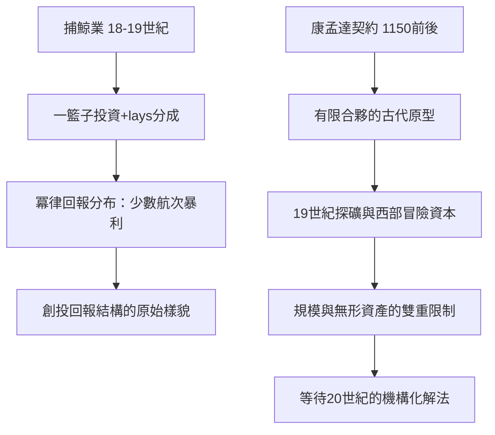

# 1.1 捕鯨船的股權分紅機制

## 高風險資助的原始形態

18–19世紀的新英格蘭捕鯨業，是現代創投最清晰的史前形態。一艘捕鯨船遠航太平洋或北極，航程可達三至四年，成功帶回鯨油與鯨鬚可獲巨利，失敗則船毀人亡、投資歸零。歷史學者 Eric Jay Dolin 在《捕鯨：美國歷史中的財富與榮耀》（Leviathan，2007）中整理的數據顯示：美國捕鯨船隊在1846年達到頂峰（735艘，占全球捕鯨船隊約八成），而單次航程的成功率波動極大——部分航季超過兩成的船隻一無所獲。

支撐這個產業的是一套精巧的風險分攤結構：

1. 一籃子投資：富裕商人（quaker 商人社群，如楠塔基特與新貝德福德的家族）不押單船，而是同時資助多艘——這正是現代基金「組合分散」的雛形。
2. 股權+分成（lays）：船的股份（ship's share，通常約占全部收益的四至六成）與船員按「份」（lays）分成——船長可得1/16至1/12，叉手與水手按比例遞減。收益依結果分配，沒有固定工資保障——全員承擔風險、共享上行空間。
3. 沉沒成本的心理承受：投資人接受多數航次平平、少數航次暴利的分布。史家估計，捕鯨業整體的年化回報約在中等水準，但個別航次的回報可達數倍至十倍——這種「冪律分布」（少數極端回報撐起整體）正是創投回報結構的原始樣貌。

## 遠洋貿易的合夥傳統

比捕鯨更早的遠洋貿易合夥，提供了另一個制度母版：中世紀義大利的康孟達（commenda，見於熱那亞1150年前後的文獻）契約——出資人（stans）承擔全部資本風險，航海人（tractor）以勞務入夥，利潤按約定比例分配（常見三七或二八），出資人不負連帶無限責任。這是「有限合夥」的古代直系祖先：金錢與冒險分屬兩方，風險由資本承擔、報酬共享。

英國東印度公司（1600）與荷蘭東印度公司（1602）把這個傳統推進到法人與永續資本（見老闆篇第二章），但單次冒險的分紅合夥並未消失——它一直在遠洋貿易、礦山勘探、乃至19世紀的美國西部礦業中延續。探礦投資（prospecting ventures）的模式與創投的精神最接近：九成探礦失敗，一成暴富，投資人靠組合生存。

## 制度的關鍵缺口

但捕鯨與探礦模式有兩個無法跨越的結構限制：

1. 規模鎖死於個人財富：投資人是家族或小圈子的自有資金，無法機構化地動員他人的錢。
2. 無法投資「無形資產」：捕鯨與礦脈的價值是實物；但新技術（發明、專利、公司）的價值無法以同樣方式評估與抵押。

第一個限制要等到20世紀的有限合夥法與 LP/GP 結構才被解除（第三章、第五章）；第二個限制要等到1946年 ARD 的實驗才被證明可以突破。在此之前，美國的高風險資本以另一種形態存在——富裕個人的私人賭注，即今天所謂的天使投資。

## 小結

捕鯨業留下的是創投的精神基因——接受極高的失敗率、以組合而非單筆下注、讓金錢與冒險各自承擔風險並分享報酬。它同時暴露了缺口：資本規模受限於個人財富，且無法為「技術」定價。填補第一個缺口的過程，將透過19世紀的天使投資人與20世紀的機構化實驗完成。
