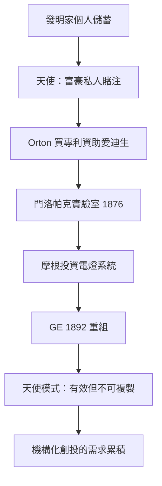

# 1.2 天使投資人與愛迪生

## 發明家與富豪的私下交易

19世紀的美國，技術創新的資金幾乎完全依賴兩條路：個人的積蓄與債務，以及富裕個人（企業家、銀行家、鐵路大亨）的私人投資。這種個人對個人的高風險資助，就是今天天使投資（angel investing）的前身——雖然當時沒有這個名字。

最著名的案例鏈條圍繞托馬斯·愛迪生展開：

1. 愛迪生早年（1870年代初）在波士頓與紐約從事電報設備改良，靠個人儲蓄與小額借款起步。
2. 1876年，鐵路與電報業巨頭、西部聯合電報公司的律師與幕後大股東之一、金融家 Gerald Loeb 等人未能直接支持，但真正關鍵的資助者是西部聯合的總裁 William Orton：他買下愛迪生1874年的四路電報發明專利（買價據記載約一萬美元），使愛迪生獲得資金與信譽，得以在新澤西門洛帕克建立實驗室（1876年）。
3. 門洛帕克實驗室（人類史上第一個有組織的工業研發實驗室）的運營經費，來自愛迪生出售專利與多位金融家的資助——包括 J·P·摩根與金融家們對電燈系統的投資（1878–79年，愛迪生電燈公司成立，摩根是主要投資人之一，投入金額據當時紀錄達數十萬美元）。
4. 摩根的參與不止金錢：他讓愛迪生在自己麥迪遜大道的宅邸安裝最早的私人電燈系統（1882年前後），既是展示也是背書。愛迪生通用電氣（Edison General Electric，1889）最終與湯姆森-休斯頓合併為通用電氣（GE，1892），由摩根主導重組。

這條鏈條展示了19世紀天使資本的三個特徵：投資與採購（Orton 買專利）混為一體；投資人深度介入商業化（摩根主導 GE 重組）；以及投資人與發明家的衝突（愛迪生與摩根在交流電、公司控制權上的多次摩擦）。

## 鐵路與工業：大資本的誕生

19世紀後半的另一條資金線是鐵路。鐵路是人類史上第一個需要超過個人財富規模的私人產業：1860年代的美國鐵路資本需求以億美元計，遠超任何家族。於是誕生了投資銀行的原初功能——摩根家族（J·P·摩根承其父朱尼厄斯在倫敦的歐洲資本網絡）以債券承銷與重組的方式，把英國與歐洲的儲蓄引入美國鐵路。1880年代的「摩根化」（把破產鐵路重組、派遣受託人治理）是現代資本與創業之間最早的制度化中介。

## 天使模式的兩難

19世紀的天使資本雖有效，卻有三個根本缺陷，這些缺陷直接催生了20世紀的機構化創投：

1. 不可複製：每一筆投資依賴特定富豪的判斷與胃口，無法規模化、無法制度化地支持全國的創新者。
2. 認知偏差：富人傾向於投資自己熟悉的產業（鐵路、電報、石油），對跨領域的新技術（如19世紀末的化學、電子）缺乏評估能力。
3. 控制權衝突：摩根與愛迪生、洛克斐勒與其技術夥伴的關係常演變為控制權之爭——資本過度介入經營，抑制了發明家的自主性。

## 小結

愛迪生與摩根展示了前機構時代資本與創新的最佳合作形態，也展示了它的極限：依賴特定個人、認知偏狹、控制權衝突。當20世紀的技術創新從單一發明（電燈、電話）轉向系統性產業（化學、航空、電子），這種私人的、零散的資助已不敷使用。填補這個缺口的，是兩個新發明：家族辦公室的組織化冒險資本（第二章），以及把「創投」變成機構的 ARD 實驗（第三章）。
