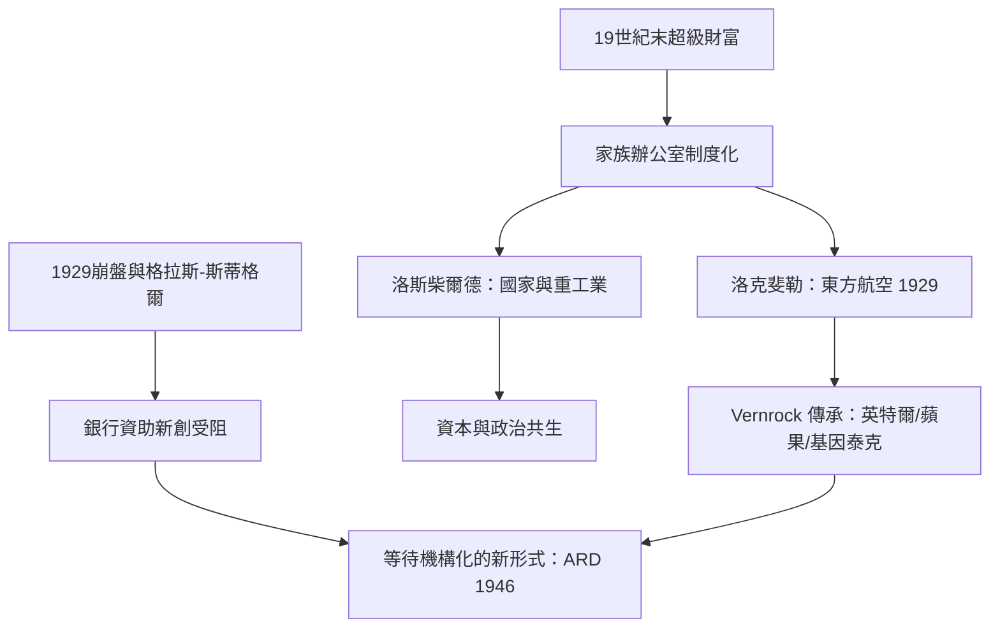

# 2.1 洛克斐勒與洛斯柴爾德的冒險資本

## 家族辦公室：財富的制度化

19世紀末的超級富豪面對一個新問題：個人財富已大到超出個人管理能力，需要專門的機構來打理。1882年，洛克斐勒家族設立了美國史上最著名的家族辦公室之一（最初為管理標準石油股權與分散資產的辦事處，後演變為 Rockefeller Family Office，1979年正式註冊為 Rockefeller & Co.）。歐洲的洛斯柴爾德家族則自18世紀末起以五兄弟分駐法蘭克福、維也納、倫敦、巴黎、那不勒斯的網絡，經營跨國金融與家族投資。

家族辦公室成為高風險資本的第二形態：它把19世紀零散的富豪個人賭注，組織成長期、專業、跨代的投資機構。

## 洛克斐勒家族與航空業

洛克斐勒家族對新興產業的冒險投資，最著名的案例是航空業：

- 1929年，小約翰·D·洛克斐勒與其子們（特別是 John D. Rockefeller Jr. 與其子 Nelson、David）透過家族投資參與東方航空運輸公司（Eastern Air Transport）的早期資本重組——該公司是美國商業航空的先驅之一（前身可追溯至1920年代末的 Pitcairn Aviation；1930年代更名 Eastern Air Lines，成為美國主要航空公司的前身之一）。這筆投資當時極具爭議：飛機還是危險的新事物，商業航空的商業模式尚未被證明。
- 洛克斐勒家族的標誌性投資機構是 Venrock Associates（1969年正式成立，名字取自 Venture + Rockefeller），但其實務傳承自1930年代的家族投資活動。Venrock 在20世紀後半成為矽谷與波士頓科技創投的重要玩家，投資對象包括英特爾（1968年，Venrock 前身參與早期融資）、Apple（1978年，Venrock 參與蘋果的早期輪融資）與 Genentech（1976年，Venrock 是最早的外部機構投資者）——從家族辦公室蛻變為現代創投的完整樣本。

## 洛斯柴爾德：跨國資本的傳統

洛斯柴爾德家族在19世紀的資助對象主要是國家（戰爭貸款、鐵路、蘇伊士運河1875年英國購股的資金即由家族提供）與重工業（法國北方的煤鐵、奧地利的鐵路、俄國石油——巴庫的 Branut 與 Caspian-Black Sea 石油公司，19世紀末與諾貝爾家族、洛克斐勒標準石油競爭）。進入20世紀，家族的倫敦與巴黎分支開始涉足新興產業（汽車、礦業、鑽石——De Beers 的控制性持股是家族最著名的產業帝國）。他們展示的是另一條路：資本與外交、政治的深度綁定——冒險資本不是孤立的市場行為，而是國家與財富的共生。

## 戰間期的組織化嘗試

1920–30年代，美國出現了幾次將高風險資本制度化的嘗試：

1. 1911年前後，摩根等銀行開始設立專門的產業證券部門，但主要服務於成熟企業的股票發行，不碰早期公司。
2. 1920年代，Investors Syndicate（明尼蘇達，1924年，後來的 Investors Diversified Services）等機構嘗試把大眾資金引入分散化投資——這是共同基金的思想先聲，但投資對象仍是公開市場證券，不是早期公司。
3. 1929年大崩盤之後，《格拉斯-斯蒂格爾法》（1933）把商業銀行與投資銀行分離，進一步壓縮了銀行資助新創的法律空間。

真正的轉折來自兩個外生力量：二戰期間美國政府對軍事科技的巨額投資（雷達、原子彈、航空）培養了一代工程人才與一種「技術可以商業化」的國家信念；以及戰後哈佛商學院教授喬治·多里奧特（Georges Doriot）對「應該有一種機構專門為新公司提供股權資本」的堅持。那將是第三章的故事。

## 小結

家族辦公室解決了19世紀天使投資的「不可複製」問題的一部分——它把個人的賭注變成機構的紀律（洛克斐勒家族對航空與後來科技的一貫支持）。但它仍未解決「如何動員公眾資本」與「如何為無形技術定價」的問題。這兩個問題的答案，要等到1946年 ARD 的誕生。
