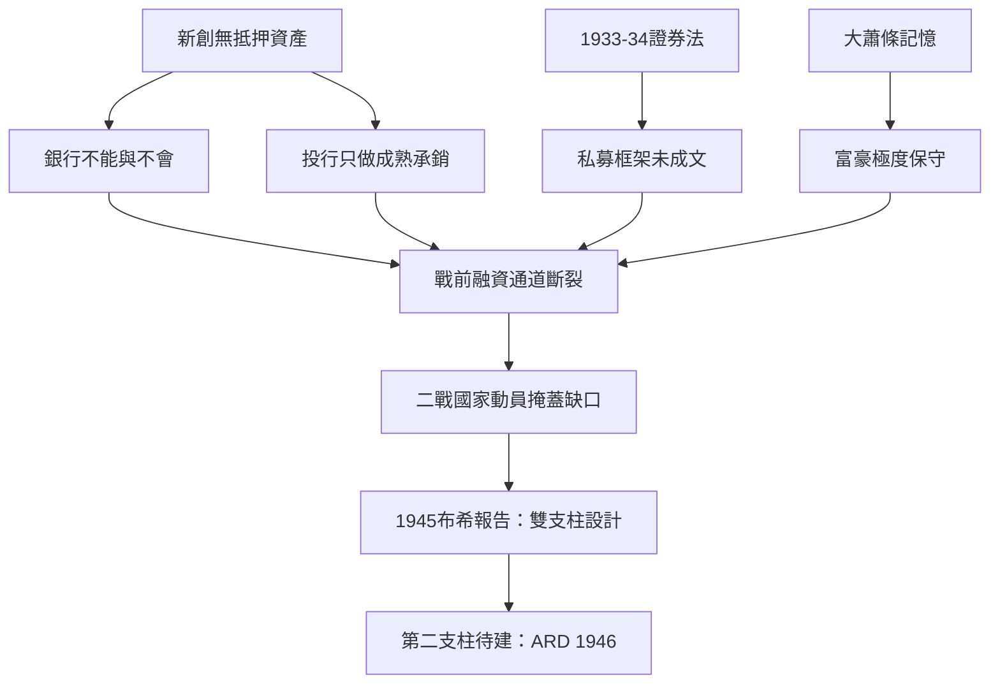

# 2.2 戰前融資困境

## 新創公司找不到錢

1930年代與1940年代初的美國，一個擁有新技術的創業者幾乎沒有融資管道。這個困境有精確的制度原因：

1. 銀行不能也不會：商業銀行以抵押貸款為主——新公司沒有可抵押的資產（沒有廠房、沒有存貨、只有尚未驗證的想法）。1933年《格拉斯-斯蒂格爾法》後，銀行更不得持有企業股權。
2. 投資銀行不做早期：摩根、高盛等投資銀行的業務是承銷成熟企業的證券（鐵路、公用事業、工業巨頭），它們的收入模式（承銷費）依賴確定性，不碰無業績的新公司。
3. 證券法的高門檻：1933年《證券法》與1934年《證券交易法》確立的強制披露與註冊制度，使向公眾募資的成本與風險大增；私下的、面向少數富人的籌資（私募）則缺乏清晰的合法框架——1933年法的私募豁免（後來的 Regulation D 及其安全港規則要到1982年才成文）在當時是灰色地帶。
4. 富豪的個人偏好：1930年代大蕭條的記憶使有錢人極度保守，傾向於公債與藍籌股。

結果是：戰前美國的高風險技術公司只能依靠自有資金、政府合約（軍工）、或特定富豪的個人偏好。航空業（波音、道格拉斯靠軍方訂單）、無線電（RCA 由 GE 與西屋控股）、化學（杜邦自研）都是大公司或國家資助的模式——純粹的「新創公司+外部股權資本」的市場幾乎不存在。

## 具體困境的案例

戰前的技術創業者留下大量融資失敗的記錄：

- 查爾斯·林白1927年跨大西洋飛行後，美國商業航空起飛，但航空公司普遍依靠郵政補貼與少數銀行家的個人支持，難以獲得系統性的股權資本。
- 1930年代的電視與電子顯像管研究（RCA 的佐里金等）由大公司內部資助——RCA 是 GE 與西屋的子控股，不是獨立新創。
- 費米、勞倫斯等戰前的核物理與迴旋加速器研究，依靠大學與私人基金會（洛克斐勒基金會對勞倫斯1930年代迴旋加速器的資助是著名案例）——基礎科學由基金會與大學資助，但成果商業化的通道完全缺失。

這條「從實驗室到公司」的斷裂，在二戰期間被戰時動員暫時掩蓋：國家直接出錢把實驗室變成工廠（曼哈頓計畫、雷達的 MIT 輻射實驗室）。但戰後數千名科學家與工程師回到民間，帶著技術與創業衝動，卻再次面對那條斷裂的融資通道。

## 范內瓦·布希的報告與國家的角色

戰爭剛結束，科學政策之父范內瓦·布希（Vannevar Bush，麻省理工學院副校長、戰時科學研究發展局局長）於1945年7月向杜魯門總統提交了《科學：無盡的前沿》（Science: The Endless Frontier）報告。報告的核心論點是：基礎研究是技術進步的源頭，國家應持續資助基礎研究（催生了1950年成立的國家科學基金會，NSF），但報告同時指出：研究成果要轉化為產業，需要民間資本的參與——國家不應直接經營企業。

布希報告確立了戰後美國創新體系的雙支柱：國家資助基礎研究（NSF、後來的 NIH、DARPA 1958），民間資本負責商業化。第二根支柱在1946年之前幾乎是空的——這正是 ARD 誕生的歷史缺口。

## 小結

戰前的美國擁有世界頂尖的科學與工程人才、龐大的富豪財富、成熟的資本市場——卻沒有一條把三者接通的制度管道。1946年，一個戰時陸軍的物流規劃者與一位哈佛商學院教授決定親手建造這條管道。那是喬治·多里奧特與美洲研發公司（ARD）的故事。
