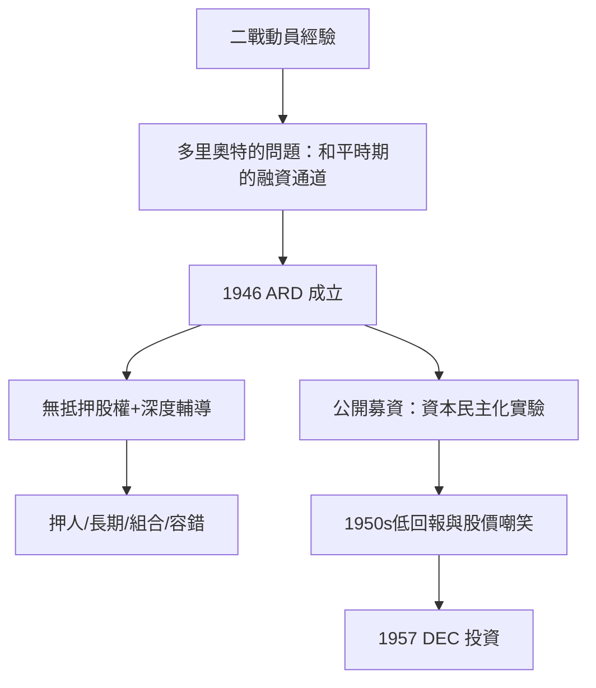

# 3.1 多里奧特與 ARD 的誕生

## 從陸軍規劃者到創投之父

喬治·多里奧特（Georges Doriot，1899–1987）生於巴黎，1920年移民美國，1926年起在哈佛商學院任教（其製造業課程在哈佛執教四十餘年，影響了整整一代美國企業管理者）。二戰期間，他以陸軍上校（後升准將）身份擔任陸軍軍需計畫與研究發展局的規劃主任，統籌戰時物資與技術動員——這段經歷讓他親眼看到：美國的技術創新能力驚人，但從實驗室到產品的通道完全依靠戰時動員，和平時期根本沒有。

戰後，多里奧特決定建造這條通道。1946年6月6日，美洲研發公司（American Research and Development Corporation，ARD）在波士頓成立。多里奧特與其合作者（包括麻省理工學院校長 Karl Compton、麻省理工學院校友與投資人 Merrill Griswold、Ralph Flanders 等人）設計的機構有兩個史無前例的特徵：

1. 面向機構與個人公開募集資本：ARD 透過公開發行股票（1947年以來的私募與1955年的公開上市，成為美國最早上市封閉式創投基金之一）籌集資金，把大眾與機構的錢引向高風險的早期公司——這是創投史上第一次資本的「民主化」實驗。
2. 專注於無抵押的股權投資：ARD 購買新公司的少數股權，並深度介入經營（多里奧特本人常出任董事，以「教父」式的建議輔導創業者——他把創投的定位定義為「幫助有潛力的人建立公司，而不是賺快錢」）。

## 多里奧特的投資哲學

多里奧特在哈佛的課堂上與 ARD 的董事會上反覆闡述幾個原則，成為創投行業的早期信條：

- 押人而非押物：投資的是創業者的品格與學習能力，不是資產負債表。
- 長期陪伴：早期公司需要五到十年才能成功，資本必須有耐心。
- 組合思維：多數投資會失敗或平平，回報由少數大贏家承擔（他把這個結構稱為創投的本質）。
- 失敗是學費：他不羞辱失敗的創業者，認為失敗經驗是下一次的資本。

他的學生（包括後來創辦 Fidelity 的愛德華·詹森、KPCB 的合夥人輩、以及無數波士頓與矽谷的創投人）把這些原則散播出去。哈佛商學院至今仍以他的名字命名創投相關的教席（Georges F. Doriot Professor）。

## ARD 的艱難起步

ARD 的前十餘年是苦難的。1947年的第一支基金募資困難（投資人對「沒有抵押品的股權投資」疑慮極深），1950年代初的幾筆投資（如用於生產 X 光的電子裝置公司）回報平平；1950年代的十年，ARD 的年化回報僅約個位數，遠低於公開市場，股價長期低於淨資產——市場用股價嘲笑這個實驗。多里奧特本人一度懷疑自己的方向，但堅持不賣出。

轉折在1957年。那一年，ARD 以7萬美元投資了一家由 MIT 林肯實驗室工程師創辦的電腦公司——數位設備公司（Digital Equipment Corporation，DEC）。這筆投資將改寫創投史。那是下一節的主題。

## 小結

ARD 是創投史上第一次系統性的嘗試：把公眾資本制度化地引向無抵押、長週期、高失敗率的早期技術公司。它前十年飽受質疑，但它建立的方法論——押人、組合、長期、輔導——成為此後整個行業的底層設計。它的證明，將由一筆7萬美元的投資完成。
