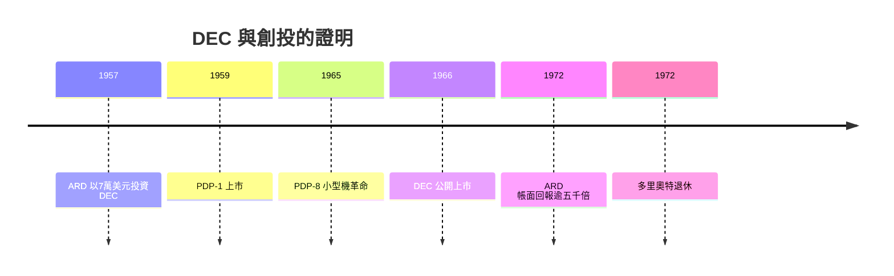

# 3.2 DEC 神話：七萬美元的證明

## 林肯實驗室的工程師

1957年，麻省理工學院林肯實驗室（二戰後為防空系統 SAGE 計畫而設的研究機構）的工程師肯·奧爾森（Ken Olsen）與哈蘭·安德森（Harlan Anderson）想創業。他們的想法來自 SAGE 計畫的經驗：軍用電腦（如 AN/FSQ-7，占滿整層樓、使用數千支真空管）極其昂貴且難用，而實驗室內部使用的 TX-0 電晶體電腦證明了小型、互動式電腦的可行性。他們相信：未來屬於小型、便宜、讓工程師直接操作的電腦。

他們帶著商業計畫拜訪了波士頓的多家金融機構，全部被拒——當時的主流判斷是：IBM 已經壟斷電腦市場，小公司沒有機會；且這些機構從未評估過「無形技術」的價值。

奧爾森隨後找到了 ARD 的多里奧特。多里奧特與 ARD 的合夥人 William Congleton 在幾次會談後拍板：ARD 出資7萬美元，換取 DEC 約70%的股權（實際結構為 ARD 認購十七萬股優先股與相當數量的普通股，另有股票認股權，最終持股比例約70%），公司設在馬薩諸塞州梅納德（Maynard）一座廢棄的羊毛工廠裡。多里奧特擔任 DEC 的董事會主席，是公司治理與經營的深度參與者。

## PDP 系列：小型機的革命

DEC 的第一個產品是1959年的 PDP-1（Programmed Data Processor-1，刻意不用 computer 一詞以避開 IBM 的陰影），售價約12萬美元，是當時最便宜的互動式電腦之一。此後的 PDP-8（1965年，售價約1.8萬美元，史上第一台真正量產的小型機 minicomputer）與 PDP-11（1970年，成為學術與工業界最普及的小型機架構，影響了 C 語言與 Unix 的開發環境）使 DEC 成為1960–70年代小型機市場的霸主，鼎盛時員工逾十萬人、營收逾百億美元、僅次於 IBM 的電腦公司。

## 回報的規模

DEC 於1966年公開上市，ARD 持有的股份在隨後數十年持續增值。到1970年代初，ARD 對 DEC 的7萬美元初始投資的市值超過3.55億美元（約5,000倍的帳面回報）；由於 ARD 是上市公司，這筆投資占其總資產的比例一度過半——這個集中風險也推動了行業對「單一持倉上限」的治理思考。

這筆回報的歷史意義在於它證明了三件事：

1. 無形技術可以被評估與投資：一家沒有廠房、沒有客戶、只有想法與工程師的公司，可以獲得機構資本並回報五千倍。
2. 創投的冪律結構成立：ARD 的整體組合回報因這一筆而改寫——多數失敗可以由一個大贏家覆蓋。
3. 機構資本（非富豪個人）可以承擔這個角色：ARD 的錢來自公開發行與機構投資者，不是洛克斐勒式的私人賭注。

## 神話的另一面

DEC 的故事也有陰影。奧爾森本人以強硬的管理與對個人電腦的堅決否定聞名（他1977年的名言「沒有任何理由讓每個人家裡都有一台電腦」成為錯失個人電腦革命的象徵）；DEC 在1980年代末錯失 PC 與工作站轉型，1998年被康柏（Compaq）收購，2002年康柏併入惠普。多里奧特本人於1972年從 ARD 退休，ARD 的封閉式結構（公開上市基金無法靈活跟投與退出）在1970年代也暴露了缺陷——行業轉向了有限合夥結構（見第五章第二節）。但作為「創投可以制度化」的證明，DEC 神話已完成使命。

## 小結

DEC 把創投從一場有爭議的實驗變成了被證明的商業模式。但 ARD 模式（公開上市基金）有結構缺陷，真正讓創投成為全球產業的，是另一項制度發明——有限合夥——以及一群從肖克利實驗室叛逃出來的年輕人。他們把創投的中心從波士頓搬到了加州的果園，那是下一章的沙丘路故事。
